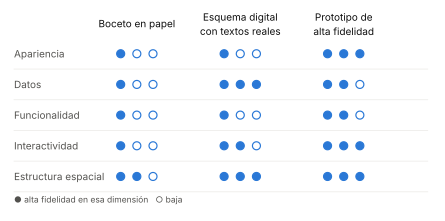
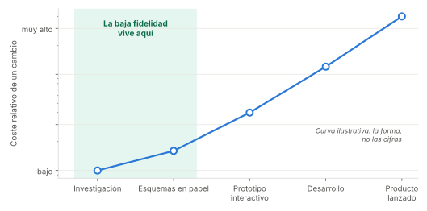

# Tema 1. Fundamentos del prototipado de baja fidelidad {#sec-tema1}

::: {.callout-note appearance="default"}
## Objetivos
- Entender qué es un prototipo y qué significa su «fidelidad».
- Distinguir para qué sirve la baja fidelidad y cuándo deja de ser suficiente.
- Situar los esquemas y prototipos de baja fidelidad en el ciclo de diseño centrado en las personas.
:::

::: {.callout-note appearance="simple" icon="false"}
## Glosario del tema
[Prototipo](92-glosario.qmd#gl-prototipo) · [Fidelidad](92-glosario.qmd#gl-fidelidad) · [Boceto](92-glosario.qmd#gl-boceto) · [Esquema de página](92-glosario.qmd#gl-wireframe) · [Diseño centrado en las personas](92-glosario.qmd#gl-dcp) · [Iteración](92-glosario.qmd#gl-iteracion)
:::

::: {.callout-tip appearance="simple" icon="false"}
## Descargas
[Plantilla de entrega del reto (.qmd)](plantillas/entrega_reto.qmd){.btn .btn-outline-primary .btn-sm download="entrega_reto.qmd"}
[Tema de estilo (.scss)](plantillas/informe.scss){.btn .btn-outline-primary .btn-sm download="informe.scss"}
[Plantillas para esquemas en papel (PDF)](plantillas/plantillas_esquemas.pdf){.btn .btn-outline-primary .btn-sm download="plantillas_esquemas.pdf"}

La plantilla `.qmd` y su tema `.scss` sirven para redactar la entrega de los retos: guárdalos en la misma carpeta. Las plantillas en PDF son marcos de móvil y escritorio con rejilla para imprimir y dibujar encima.
:::

## Lectura obligatoria

::: {.lectura}
Rudd, J.; Stern, K.; Isensee, S. (1996). [Low vs. high-fidelity prototyping debate](https://doi.org/10.1145/223500.223514). *Interactions*, 3(1), 76-85.
:::

### Lecturas complementarias {.unnumbered}

- Houde, S.; Hill, C. (1997). [What do prototypes prototype?](https://doi.org/10.1016/B978-044481862-1.50082-0) En *Handbook of Human-Computer Interaction* (pp. 367-381). Elsevier. El modelo de los tres aspectos que puede explorar un prototipo.
- Lim, Y.-K.; Stolterman, E.; Tenenberg, J. (2008). [The anatomy of prototypes](https://doi.org/10.1145/1375761.1375762). *ACM Transactions on Computer-Human Interaction*, 15(2), 1-27. Los prototipos como filtros que dejan ver unas cualidades del diseño y ocultan otras.
- Walker, M.; Takayama, L.; Landay, J. A. (2002). [High-fidelity or low-fidelity, paper or computer?](https://doi.org/10.1177/154193120204600513) *Proceedings of the Human Factors and Ergonomics Society Annual Meeting*, 46(5), 661-665. Un experimento que compara qué problemas detecta cada tipo de prototipo.

## 1. Qué es un prototipo

Un **prototipo** es una representación de un diseño que se construye para aprender algo sobre él antes de construirlo de verdad. No es una versión pequeña del producto final: es una pregunta hecha objeto. Un prototipo bien planteado sabe qué quiere averiguar.

Houde y Hill (1997) proponen pensar en **tres aspectos** que un prototipo puede explorar:

| Aspecto | Pregunta que responde | Ejemplo |
|---|---|---|
| **Papel** (*role*) | ¿Qué hace el producto en la vida de la persona? | Un *storyboard* que muestra cuándo y por qué alguien reserva una sala de estudio |
| **Apariencia y sensación** (*look and feel*) | ¿Cómo se ve, se oye y se siente al usarlo? | Un esquema en papel que se manipula como si fuera la pantalla |
| **Implementación** | ¿Es técnicamente posible y cómo funcionaría? | Una prueba de concepto que consulta el catálogo real |

La baja fidelidad trabaja sobre todo el **papel** del producto y la **estructura** de la interacción. Deja deliberadamente fuera el aspecto visual definitivo.

## 2. Qué significa «fidelidad»

La **fidelidad** es el grado en que un prototipo se parece al producto final. No es una sola escala: Lim, Stolterman y Tenenberg (2008) describen los prototipos como **filtros** que muestran unas cualidades del diseño y ocultan otras, y distinguen varias dimensiones que se pueden refinar por separado:

- **Apariencia**: tamaño, color, tipografía, imágenes.
- **Datos**: si el contenido es real o de relleno.
- **Funcionalidad**: qué partes del sistema funcionan.
- **Interactividad**: cómo responde a las acciones de la persona.
- **Estructura espacial**: cómo se organizan los elementos en la pantalla y entre pantallas.

Un esquema de página en escala de grises con textos reales tiene baja fidelidad visual pero alta fidelidad de datos. Esa mezcla es a menudo la mejor elección: con textos de relleno («lorem ipsum») no se puede comprobar si una persona entiende una etiqueta.

{#fig-fidelidad fig-alt="Matriz con tres columnas (boceto en papel, esquema digital, prototipo de alta fidelidad) y cinco filas (apariencia, datos, funcionalidad, interactividad, estructura espacial). Cada celda indica el nivel de fidelidad con uno, dos o tres puntos. El boceto tiene un punto en casi todo; el esquema digital tiene tres puntos en estructura espacial y datos; el prototipo de alta fidelidad tiene tres en apariencia."}

## 3. Para qué sirve la baja fidelidad

Buxton (2007) distingue entre **bocetar** y **prototipar**. El boceto sirve para explorar y generar alternativas: es rápido, barato, desechable, abundante y ambiguo, y por eso invita a la discusión. El prototipo sirve para comprobar y refinar una idea concreta. Los esquemas y prototipos de baja fidelidad están a medio camino: conservan la rapidez del boceto y ya permiten probar.

Sus ventajas principales son:

- **Coste y velocidad.** Se hacen en minutos y se cambian en segundos. Se pueden explorar varias alternativas en lugar de defender la primera.
- **Atención en lo importante.** Sin colores ni tipografías, la conversación con el equipo y con los usuarios se centra en la estructura, el contenido y el flujo, y no en si el azul es el adecuado.
- **Críticas más sinceras.** Un diseño que parece terminado intimida: la gente opina menos sobre algo que parece costoso de cambiar.
- **Detección temprana de problemas.** Varios estudios han comparado prototipos de baja y alta fidelidad y encontraron que detectan un número similar de problemas de usabilidad (Virzi et al., 1996; Walker et al., 2002).

Y sus límites, que Rudd et al. (1996) resumen en su debate:

- No sirven para evaluar el aspecto visual, la legibilidad final ni los tiempos de respuesta.
- Requieren un **facilitador** que «haga de ordenador», lo que puede introducir sesgos.
- Comunican peor el diseño a quien no participó en él, por ejemplo a la dirección o a un cliente.
- No sirven como especificación para desarrollar: para eso hace falta la alta fidelidad (siguiente asignatura del máster).

## 4. El lugar de la baja fidelidad en el ciclo de diseño

La norma ISO 9241-210 describe el **diseño centrado en las personas** como un ciclo de cuatro actividades que se repiten: entender el contexto de uso, especificar los requisitos de las personas usuarias, producir soluciones de diseño y evaluarlas. La baja fidelidad es la manera más barata de dar las primeras vueltas a ese ciclo.

| Momento | Artefacto típico | Qué se aprende |
|---|---|---|
| Exploración | Bocetos, *storyboards* | Qué ideas merece la pena desarrollar |
| Estructura | Flujos de usuario, esquemas de página | Qué pantallas hacen falta y qué hay en cada una |
| Validación temprana | Prototipo en papel o digital navegable | Si las personas entienden el flujo y encuentran lo que buscan |
| Refinamiento | Prototipo de alta fidelidad | Si la solución visual e interactiva funciona |

Cada vuelta del ciclo es una **iteración**. La regla práctica es subir la fidelidad solo cuando la pregunta lo exige: no se prueba la tipografía de un flujo que todavía no funciona.

## Práctica

Elige una aplicación que uses a diario. Dibuja en papel, en cinco minutos, su pantalla principal **sin mirarla**. Después compárala con la real y anota qué recordabas (la estructura, los elementos esenciales) y qué no (los detalles visuales). Lo que recuerdas es lo que la baja fidelidad debe capturar.

{#fig-t1-coste fig-alt="Línea que sube de izquierda a derecha en escala logarítmica, por cinco fases: investigación, esquemas en papel, prototipo interactivo, desarrollo y producto lanzado. Una franja verde sobre las dos primeras fases dice: la baja fidelidad vive aquí. Nota: curva ilustrativa, la forma y no las cifras."}

## Caso práctico resuelto

::: {.callout-note appearance="simple" icon="false"}
## De la idea al primer esquema en 30 minutos
La biblioteca quiere una app, **ReservaSala**, para reservar salas de estudio. Antes de abrir ninguna herramienta:

1. **Bocetar alternativas (10 min):** seis miniaturas de la pantalla principal (lista de salas, mapa, calendario, buscador por hora…). La cantidad importa más que la calidad.
2. **Elegir y combinar (5 min):** la lista por franja horaria es la más rápida para quien ya sabe cuándo quiere estudiar; el mapa ayuda a quien no conoce el edificio. Se combina: lista con un botón «ver en el mapa».
3. **Esquema de baja fidelidad (15 min):** cajas grises, texto real (no *lorem ipsum*) y ningún color. Lo importante es la jerarquía: franja horaria arriba, salas disponibles después, acción principal «Reservar» visible.

**Por qué funciona:** se exploran varias ideas antes de comprometerse con una, y el esquema se discute por su estructura, no por su estética.
:::

## Ejercicios graduados

**Básico.** Dibuja tres miniaturas distintas de la pantalla de confirmación de una reserva.

::: {.webex-solution boton="Ver solución"}
Deben diferenciarse en la estructura (por ejemplo: resumen con botón; tarjeta con código QR; pantalla con opción de añadir al calendario), no solo en detalles. Cada miniatura debe mostrar la información esencial: sala, fecha, hora y cómo cancelar.
:::

**Avanzado.** Explica, con el enfoque de Buxton, si en este punto del proyecto necesitas un boceto o un prototipo y por qué.

::: {.webex-solution boton="Ver solución"}
Al principio, para explorar alternativas, conviene el boceto: rápido, barato y ambiguo. Cuando ya hay una dirección clara y se quiere comprobar si funciona con usuarios, se pasa a un prototipo.
:::

## Actividades

::: {.clasificar #ia-t1-fidelidad titulo="¿Baja o alta fidelidad?" categorias="Baja fidelidad|Alta fidelidad"}
Decide si cada prototipo es de baja o de alta fidelidad según sus dimensiones visual, de contenido y de interacción.

- Bocetos a lápiz de cinco pantallas, con cajas grises en lugar de imágenes → Baja fidelidad
- Maqueta con la tipografía, los colores y las fotografías definitivos → Alta fidelidad
- Pantallas en papel que una persona cambia a mano cuando el participante «pulsa» → Baja fidelidad // Interacción simulada por una persona.
- Prototipo navegable con animaciones y textos reales → Alta fidelidad
- Esquema digital en escala de grises con texto de relleno → Baja fidelidad
- Prototipo que se conecta a datos reales de la biblioteca → Alta fidelidad
:::

::: {.ordenar #ia-t1-ciclo titulo="El ciclo de diseño centrado en las personas (ISO 9241-210)"}
1. Entender y especificar el contexto de uso
2. Especificar los requisitos de las personas usuarias
3. Producir soluciones de diseño
4. Evaluar las soluciones con las personas usuarias
:::

::: {.clasificar #ia-t1-para titulo="¿Es buena idea prototipar en baja fidelidad?" categorias="Sí|No"}
- Explorar tres estructuras de navegación distintas en una tarde → Sí
- Comprobar si el color corporativo transmite confianza → No // Para eso hace falta fidelidad visual.
- Detectar si las personas entienden los pasos de un trámite → Sí
- Medir el tiempo de carga real de una página → No
- Alinear al equipo sobre qué pantallas hacen falta → Sí
- Validar la legibilidad de una tipografía concreta → No
:::

::: {.callout-warning appearance="simple" icon="false"}
## Errores frecuentes
- **Pulir demasiado pronto.** Un esquema bonito invita a opinar sobre colores en lugar de sobre estructura.
- **Enamorarse de la primera idea.** La baja fidelidad sirve para explorar varias, no para decorar una.
- **Confundir fidelidad con calidad.** Un boceto puede ser un prototipo excelente si responde a la pregunta que se quería probar.
- **No decidir qué se quiere aprender** antes de prototipar.
:::

## Reto evaluable {#reto-t1}

::: {.callout-important appearance="simple" icon="false"}
## Reto del Tema 1 · Tres prototipos, tres preguntas
Elige **una pantalla** de un servicio digital real (por ejemplo, la reserva de un espacio en la biblioteca de tu universidad):

1. Formula **tres preguntas de diseño** distintas sobre esa pantalla, una por cada aspecto de Houde y Hill (papel, apariencia y sensación, implementación).
2. Para cada pregunta, describe o dibuja el prototipo **más barato** que permitiría responderla y su fidelidad en las cinco dimensiones de Lim et al.
3. Justifica cuál harías primero y por qué.

**Entrega:** un informe hecho con la [plantilla de entrega](plantillas/entrega_reto.qmd), con las imágenes de tus bocetos. Se evalúa con la rúbrica que incluye la plantilla. Este reto **no tiene solución en el libro**: cada estudiante trabaja con un servicio distinto y la corrección la hace el profesorado.
:::

## Autoevaluación

Responde a todas las preguntas y pulsa **Mostrar respuestas**: verás en verde las acertadas, en rojo las falladas y tu recuento. Puedes corregir y volver a comprobar. No cuenta para la nota.

::: {.webex-check .webex-box}
1. Un prototipo de baja fidelidad sirve para evaluar si la tipografía elegida es legible. 
2. Según Houde y Hill, un *storyboard* que muestra cuándo y por qué alguien usa un servicio explora sobre todo su 
3. Un esquema en escala de grises con los textos definitivos tiene baja fidelidad visual y alta fidelidad de 
4. Varios estudios encontraron que los prototipos de baja y alta fidelidad detectan un número similar de problemas de usabilidad. 
5. ¿Cuál de estas características corresponde a un boceto según Buxton?



6. Las cuatro actividades del diseño centrado en las personas de la ISO 9241-210 se hacen una sola vez, en orden. 
:::

::: {.webex-solution boton="Ver explicaciones"}
- La legibilidad final depende de decisiones visuales que la baja fidelidad deja fuera a propósito.
- El papel es qué hace el producto en la vida de la persona: justo lo que cuenta un *storyboard*.
- Los textos reales dan fidelidad de datos aunque el aspecto sea tosco.
- Es la conclusión de Virzi et al. (1996) y Walker et al. (2002).
- La ambigüedad del boceto invita a discutir y a generar alternativas.
- Es un ciclo: se repite en cada iteración.
:::

## Recursos complementarios

| Recurso | Para qué sirve |
|---|---|
| [Nielsen Norman Group – UX prototypes: low fidelity vs. high fidelity](https://www.nngroup.com/articles/ux-prototype-hi-lo-fidelity/) | Resumen práctico de cuándo usar cada fidelidad |
| [Interaction Design Foundation – Prototyping](https://ixdf.org/literature/topics/prototyping) | Introducción y ejemplos |
| [Ko, A. J. – Design Methods: Prototyping](https://faculty.washington.edu/ajko/books/design-methods/prototyping.html) | Capítulo abierto sobre prototipado |
| [ISO 9241-210:2019](https://www.iso.org/standard/77520.html) | Norma de diseño centrado en las personas |
