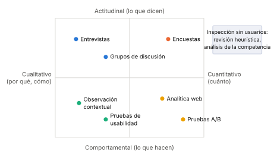

# Tema 2. La investigación como base del concepto creativo {#sec-tema2}

::: {.callout-note appearance="default"}
## Objetivos
- Elegir métodos de investigación cualitativos y cuantitativos según la pregunta.
- Planificar entrevistas, encuestas, observación, análisis de la competencia y revisión heurística.
- Convertir los hallazgos en conceptos creativos viables y comprobables.
:::

::: {.callout-note appearance="simple" icon="false"}
## Glosario del tema
[Investigación con usuarios](92-glosario.qmd#gl-investigacion) · [Método actitudinal](92-glosario.qmd#gl-actitudinal) · [Método comportamental](92-glosario.qmd#gl-comportamental) · [Evaluación heurística](92-glosario.qmd#gl-heuristica) · [Severidad](92-glosario.qmd#gl-severidad) · [Diagrama de afinidad](92-glosario.qmd#gl-afinidad) · [Hallazgo](92-glosario.qmd#gl-hallazgo) · [«¿Cómo podríamos…?»](92-glosario.qmd#gl-hmw)
:::

::: {.callout-tip appearance="simple" icon="false"}
## Descargas
[Script R del capítulo](plantillas/02_investigacion.R){.btn .btn-outline-primary .btn-sm download="02_investigacion.R"}
[Plantilla de entrega del reto (.qmd)](plantillas/entrega_reto.qmd){.btn .btn-outline-primary .btn-sm download="entrega_reto.qmd"}
[Tema de estilo (.scss)](plantillas/informe.scss){.btn .btn-outline-primary .btn-sm download="informe.scss"}
:::

## Lectura obligatoria

::: {.lectura}
Nielsen, J.; Molich, R. (1990). [Heuristic evaluation of user interfaces](https://doi.org/10.1145/97243.97281). En *Proceedings of the SIGCHI Conference on Human Factors in Computing Systems (CHI '90)* (pp. 249-256). ACM.
:::

### Lecturas complementarias {.unnumbered}

- Nielsen, J. (1994). [Enhancing the explanatory power of usability heuristics](https://doi.org/10.1145/191666.191729). En *CHI '94* (pp. 152-158). ACM. El origen de las diez heurísticas que se usan hoy.
- Rohrer, C. (2022). [When to use which user-experience research methods](https://www.nngroup.com/articles/which-ux-research-methods/). Nielsen Norman Group. El mapa de métodos que usa este tema.
- Sharp, H.; Rogers, Y.; Preece, J. (2023). *Interaction design: Beyond human-computer interaction*. Wiley. Capítulos sobre recogida y análisis de datos.

## 1. Por qué investigar antes de dibujar

Un esquema de página resuelve un problema; si el problema está mal entendido, el mejor esquema no sirve. La investigación con usuarios reduce la incertidumbre sobre **quién** usará el producto, **qué** intenta conseguir, **en qué contexto** y **qué le impide** conseguirlo hoy. No se trata de preguntar a la gente qué quiere, sino de entender lo que hace y por qué.

Rohrer (2022) ordena los métodos en dos ejes que ayudan a elegir:

- **Actitudinal o comportamental**: lo que las personas *dicen* (opiniones, intenciones) frente a lo que *hacen* (conducta observada). Ambas cosas difieren a menudo.
- **Cualitativo o cuantitativo**: entender el *porqué* y el *cómo* con pocas personas, frente a medir el *cuánto* con muchas.

{#fig-metodos fig-alt="Plano con un eje horizontal que va de cualitativo a cuantitativo y un eje vertical que va de comportamental (abajo) a actitudinal (arriba). Arriba a la izquierda, entrevistas y grupos de discusión; arriba a la derecha, encuestas; abajo a la izquierda, observación contextual y pruebas de usabilidad; abajo a la derecha, analítica web y pruebas A/B. La revisión heurística y el análisis de la competencia aparecen aparte, como métodos de inspección sin usuarios."}

## 2. Métodos cualitativos

**Entrevistas.** Conversaciones individuales semiestructuradas, de 30 a 60 minutos, con un guion de temas y no de preguntas cerradas. Funcionan mejor si se pide a la persona que cuente **la última vez** que hizo algo concreto («cuéntame la última vez que buscaste un libro para un trabajo») que si se le pide que generalice. Se evitan las preguntas que sugieren la respuesta («¿verdad que sería útil…?»).

**Observación contextual.** Se observa a la persona en su entorno real mientras hace la tarea, y se le pregunta sobre la marcha. Revela lo que no se cuenta en una entrevista: atajos, notas en papel, trucos para sortear el sistema.

**Grupos de discusión.** Útiles para conocer actitudes y vocabulario, pero poco fiables para predecir conducta: la dinámica del grupo influye en lo que se dice.

Con cinco a ocho entrevistas por perfil suelen aparecer los patrones principales. El análisis más habitual es el **diagrama de afinidad**: cada observación se escribe en una nota, y las notas se agrupan por similitud hasta que emergen temas.

## 3. Métodos cuantitativos

**Encuestas.** Miden actitudes y características en muchas personas. Exigen preguntas neutras, opciones de respuesta exhaustivas y excluyentes, y una muestra que represente a quien interesa. Una encuesta no explica el porqué: suele combinarse con entrevistas.

**Analítica.** Los datos de uso de un producto existente (páginas vistas, búsquedas sin resultados, abandono en un formulario) muestran dónde están los problemas, aunque no por qué ocurren.

## 4. Análisis de la competencia

Consiste en revisar de forma sistemática productos que resuelven el mismo problema, directos (otra aplicación de reservas) o indirectos (cómo se reserva hoy por teléfono o en persona). Se compara con una tabla: tareas que permite, cómo las resuelve, puntos fuertes y débiles. El objetivo no es copiar, sino conocer las convenciones que los usuarios ya esperan (Tema 7) y encontrar huecos.

## 5. Revisión heurística

Nielsen y Molich (1990) propusieron que varios evaluadores revisen una interfaz con una lista breve de principios, las **heurísticas**, y anoten los problemas. Es un método de **inspección**: no participan usuarios, así que es rápido y barato, pero no sustituye a las pruebas con personas. Sus hallazgos más importantes:

- Un evaluador solo encuentra una parte de los problemas; con **tres a cinco** evaluadores independientes se detecta la mayoría.
- Cada evaluador revisa por separado y después se juntan los resultados.

Cada problema se valora con una escala de **severidad** de 0 a 4: 0, no es un problema; 1, cosmético; 2, menor; 3, importante; 4, catástrofe que hay que resolver antes de lanzar. Las diez heurísticas de Nielsen (1994) son:

| N.º | Heurística |
|---|---|
| 1 | Visibilidad del estado del sistema |
| 2 | Correspondencia entre el sistema y el mundo real |
| 3 | Control y libertad del usuario |
| 4 | Consistencia y estándares |
| 5 | Prevención de errores |
| 6 | Reconocer mejor que recordar |
| 7 | Flexibilidad y eficiencia de uso |
| 8 | Diseño estético y minimalista |
| 9 | Ayudar a reconocer, diagnosticar y recuperarse de errores |
| 10 | Ayuda y documentación |

### Laboratorio: tu revisión heurística {#lab-heuristica}

::: {.laboratorio}
::: {.laboratorio-etiqueta}
Laboratorio · se ejecuta en tu navegador
:::

Revisa una interfaz (la de tu proyecto o la de la competencia) heurística por heurística. Anota la severidad de lo que encuentres y una nota breve. El informe se ordena por severidad y puedes descargarlo en Markdown para pegarlo en tu entrega.

```{ojs}
//| echo: false
{
  const H = ["Visibilidad del estado del sistema", "Correspondencia entre el sistema y el mundo real", "Control y libertad del usuario", "Consistencia y estándares", "Prevención de errores", "Reconocer mejor que recordar", "Flexibilidad y eficiencia de uso", "Diseño estético y minimalista", "Ayudar a reconocer, diagnosticar y recuperarse de errores", "Ayuda y documentación"];
  const SEV = ["0 · no es un problema", "1 · cosmético", "2 · menor", "3 · importante", "4 · catástrofe"];
  const raiz = html`<div class="heur-lab"></div>`;
  const nombre = html`<div class="mb-2"><label class="form-label" for="heur-int">Interfaz evaluada</label><input id="heur-int" class="form-control form-control-sm" value="ReservaSala, versión 1"></div>`;
  const tabla = html`<table class="table table-sm align-middle"><thead><tr><th scope="col">Heurística</th><th scope="col">Severidad</th><th scope="col">Hallazgo</th></tr></thead><tbody></tbody></table>`;
  const filas = H.map((h, i) => { const tr = html`<tr><td class="small">${i + 1}. ${h}</td><td><select class="form-select form-select-sm" aria-label="Severidad: ${h}">${SEV.map((s, k) => `<option value="${k}">${s}</option>`).join("")}</select></td><td><input class="form-control form-control-sm" aria-label="Hallazgo: ${h}" placeholder="Qué pasa y dónde"></td></tr>`; tabla.tBodies[0].append(tr); return tr.querySelectorAll("select, input"); });
  const salida = html`<div role="status" aria-live="polite"></div>`;
  const esc = (s) => s.replace(/[&<>|]/g, (c) => ({"&": "&amp;", "<": "&lt;", ">": "&gt;", "|": "/"}[c]));
  function informe() {
    const items = filas.map(([s, n], i) => ({h: H[i], i: i + 1, s: +s.value, n: n.value.trim()})).filter((x) => x.s > 0).sort((a, b) => b.s - a.s);
    const graves = items.filter((x) => x.s >= 3).length;
    const md = `# Revisión heurística: ${nombre.querySelector("input").value}\n\n| Severidad | Heurística | Hallazgo |\n|---|---|---|\n` + items.map((x) => `| ${x.s} | ${x.i}. ${x.h} | ${x.n.replace(/\|/g, "/") || "(sin nota)"} |`).join("\n") + `\n\nProblemas importantes o catastróficos: ${graves}.\n`;
    const url = URL.createObjectURL(new Blob([md], {type: "text/markdown"}));
    salida.innerHTML = items.length ? `<p><strong>${items.length} problemas</strong> · ${graves} de severidad 3 o 4${graves ? " — resuélvelos antes de seguir." : "."}</p><ol>${items.map((x) => `<li><strong>Severidad ${x.s}</strong> · ${x.h}${x.n ? ": " + esc(x.n) : ""}</li>`).join("")}</ol><a class="btn btn-outline-primary btn-sm" download="revision-heuristica.md" href="${url}">Descargar el informe (.md)</a>` : "<p>Todavía no has anotado problemas. Asigna una severidad mayor que 0 a una heurística.</p>";
  }
  raiz.addEventListener("input", informe);
  raiz.append(nombre, tabla, salida); informe();
  return raiz;
}
```

Para que la revisión sea fiable, haz que **3 a 5 personas** la hagan por separado y después juntad los hallazgos: una sola persona encuentra alrededor de un tercio de los problemas.
:::


## 6. Del hallazgo al concepto creativo

Los datos no diseñan solos. El paso de la investigación al concepto tiene tres momentos:

1. **Hallazgos**: lo que se ha observado, con su evidencia («4 de 6 personas buscaban el horario en la página de contacto»).
2. **Conclusiones** (*insights*): la interpretación que explica el hallazgo («para quien no conoce la biblioteca, el horario es información de contacto»).
3. **Oportunidades**, formuladas como preguntas **«¿Cómo podríamos…?»** («¿cómo podríamos hacer que el horario esté donde la gente lo busca?»). Son lo bastante abiertas para admitir varias soluciones y lo bastante concretas para orientar los bocetos.

Un **concepto creativo** viable responde a una oportunidad con una idea que se puede explicar en una frase y probar con un prototipo de baja fidelidad.

## Práctica en R: priorizar los hallazgos de una revisión heurística

Tres evaluadores han revisado una aplicación de biblioteca. La tabla `hallazgos_heuristicos` (datos simulados) recoge cada problema, la heurística afectada y la severidad que le da cada evaluador.

```{webr}
#| autorun: true
source("datos/funciones_ux.R")
hallazgos_heuristicos
```

La función `priorizar_hallazgos()` agrupa por problema, calcula la severidad media y cuántos evaluadores lo detectaron, y ordena:

```{webr}
#| autorun: true
priorizar_hallazgos(hallazgos_heuristicos)
```

### Ejercicio 2.1 {.unnumbered}

¿Cuántos problemas tienen prioridad **alta**? Completa el código.

```{webr}
#| exercise: t2_alta
#| setup: true
source("datos/funciones_ux.R")
```

```{webr}
#| exercise: t2_alta
p <- priorizar_hallazgos(hallazgos_heuristicos)
sum(p$prioridad == "______")
```

::: {.hint exercise="t2_alta"}
Las categorías son «alta», «media» y «baja», en minúsculas.
:::

::: {.solution exercise="t2_alta"}
```r
p <- priorizar_hallazgos(hallazgos_heuristicos)
sum(p$prioridad == "alta")
```
Dos: el botón «Atrás» que borra el formulario y los mensajes de error genéricos. Son los primeros que hay que resolver en el siguiente esquema.
:::

```{webr}
#| exercise: t2_alta
#| check: true
if (identical(as.integer(.result), 2L)) {
  list(correct = TRUE, message = "Correcto: dos problemas de prioridad alta.")
} else {
  list(correct = FALSE, message = "Compara la columna prioridad con \"alta\".")
}
```

### Ejercicio 2.2 {.unnumbered}

Un problema detectado por un solo evaluador puede ser una opinión personal; uno detectado por todos, casi seguro un problema real. ¿Qué problema detectaron **menos** evaluadores y a la vez tiene la **menor** severidad media? Escribe el código que lo muestra.

```{webr}
#| exercise: t2_menor
#| setup: true
source("datos/funciones_ux.R")
p <- priorizar_hallazgos(hallazgos_heuristicos)
```

```{webr}
#| exercise: t2_menor
p$problema[nrow(______)]
```

::: {.hint exercise="t2_menor"}
La tabla está ordenada de mayor a menor severidad: el último es el de la fila número `nrow(p)`.
:::

::: {.solution exercise="t2_menor"}
```r
p$problema[nrow(p)]
```
La tipografía de 12 px en los avisos legales: dos evaluadores, severidad media 1,5. No se ignora (el Tema 12 explica por qué el tamaño de letra importa), pero va al final de la lista.
:::

```{webr}
#| exercise: t2_menor
#| check: true
if (identical(as.character(.result), "Tipografía de 12 px en los avisos legales")) {
  list(correct = TRUE, message = "Correcto: es el último de la lista priorizada.")
} else {
  list(correct = FALSE, message = "Usa nrow(p) para llegar a la última fila.")
}
```

## Laboratorio: ordenación de tarjetas (*card sorting*) {#lab-t2-tarjetas}

::: {.laboratorio}
::: {.laboratorio-etiqueta}
Laboratorio · datos simulados
:::

La **ordenación de tarjetas** revela cómo agrupan las personas los contenidos, y sirve para diseñar la arquitectura de información. Agrupa estas diez funciones de la aplicación de una biblioteca en los grupos que te parezcan naturales (puedes renombrar los grupos). Después compara tu propuesta con la de **20 participantes simulados**: la matriz muestra qué porcentaje de ellos puso cada par de tarjetas en el mismo grupo.

```{ojs}
//| echo: false
texto = window.Lab.texto
seleccion = window.Lab.seleccion
area = window.Lab.area
rango = window.Lab.rango
boton = window.Lab.boton
color = window.Lab.color
tarjetas = ["Buscar en el catálogo", "Reservar un libro", "Renovar un préstamo", "Ver mis préstamos", "Pagar una multa",
  "Cambiar la contraseña", "Elegir el idioma", "Horarios y sedes", "Contactar con la biblioteca", "Mis listas de lectura"]
viewof grupos = texto("Nombres de tus grupos (separados por comas)", {value: "Buscar, Mis préstamos, Mi cuenta, Información", submit: "Usar estos grupos"})
```

```{ojs}
//| echo: false
viewof asignacion = {
  const nombres = grupos.split(",").map(x => x.trim()).filter(Boolean);
  const caja = html`<div class="lab-tarjetas"></div>`;
  const sels = tarjetas.map((t, i) => {
    const s = seleccion(t, [["", "Elige un grupo…"], ...nombres.map(n => [n, n])]);
    s.addEventListener("input", e => { e.stopPropagation(); caja.value = sels.map(x => x.value); caja.dispatchEvent(new Event("input", {bubbles: true})); });
    caja.appendChild(s); return s;
  });
  caja.value = sels.map(x => x.value);
  return caja;
}
```

```{ojs}
//| echo: false
simulados = {
  // 20 participantes simulados: tres agrupaciones de base con algo de variación
  const base = [0, 0, 1, 1, 1, 2, 2, 3, 3, 0];
  let s = 11; const rnd = () => (s = (s * 9301 + 49297) % 233280) / 233280;
  return Array.from({length: 20}, () => base.map((g, i) => {
    const r = rnd();
    if (i === 9 && r < 0.45) return 1;       // «Mis listas» a veces con los préstamos
    if (i === 4 && r < 0.35) return 2;       // «Pagar una multa» a veces en la cuenta
    if (i === 1 && r < 0.3) return 1;        // «Reservar» a veces con los préstamos
    return r < 0.06 ? Math.floor(rnd() * 4) : g;
  }));
}
juntos = tarjetas.map((_, i) => tarjetas.map((_, j) => simulados.filter(p => p[i] === p[j]).length / simulados.length))
{
  const tuyo = asignacion;
  const completo = tuyo.every(Boolean);
  let acuerdo = 0, pares = 0;
  for (let i = 0; i < 10; i++) for (let j = i + 1; j < 10; j++) {
    pares++; const t = tuyo[i] && tuyo[i] === tuyo[j]; const m = juntos[i][j] >= 0.5;
    if (t === m) acuerdo++;
  }
  const celda = 30, izq = 190, arriba = 190, w = izq + celda * 10 + 70, h = arriba + celda * 10 + 10;
  const svg = [`<svg viewBox="0 0 ${w} ${h}" width="100%" style="max-width:${w}px" role="img" aria-label="Matriz de similitud de las diez tarjetas según los participantes simulados">`];
  tarjetas.forEach((t, i) => {
    svg.push(`<text x="${izq - 6}" y="${arriba + i * celda + 19}" text-anchor="end" font-size="11" fill="currentColor">${t}</text>`);
    svg.push(`<text transform="translate(${izq + i * celda + 19},${arriba - 6}) rotate(-60)" font-size="11" fill="currentColor">${t}</text>`);
    tarjetas.forEach((_, j) => {
      const v = juntos[i][j], mismo = tuyo[i] && tuyo[i] === tuyo[j];
      svg.push(`<rect x="${izq + j * celda}" y="${arriba + i * celda}" width="${celda - 2}" height="${celda - 2}" rx="3" fill="#2a78d6" fill-opacity="${0.08 + 0.85 * v}" stroke="${mismo && i !== j ? "#eb6834" : "none"}" stroke-width="2.5"/>`);
      svg.push(`<text x="${izq + j * celda + 14}" y="${arriba + i * celda + 19}" text-anchor="middle" font-size="9" fill="${v > 0.55 ? "#fff" : "currentColor"}">${Math.round(v * 100)}</text>`);
    });
  });
  svg.push("</svg>");
  const d = html`<div role="status"></div>`;
  d.innerHTML = `<p>${completo ? `<strong>Coincides con la mayoría en el ${Math.round(100 * acuerdo / pares)} % de los pares</strong> (dos tarjetas juntas o separadas).` : "Asigna un grupo a todas las tarjetas para comparar tu propuesta."}</p>
  <p class="small">Cada celda es el % de participantes que juntaron esas dos tarjetas; los bordes naranjas marcan los pares que tú has juntado.</p>${svg.join("")}`;
  return d;
}
```

**Fíjate** en las tarjetas que dividen a los participantes («Mis listas de lectura», «Pagar una multa»): son las que piden una etiqueta más clara o estar en dos sitios.
:::

## Caso práctico resuelto

::: {.callout-note appearance="simple" icon="false"}
## De las entrevistas al concepto
Se entrevista a ocho estudiantes sobre cómo buscan sitio para estudiar. Proceso de síntesis:

1. **Transcribir citas** relevantes en notas (una idea por nota): «Voy a la biblioteca y doy vueltas buscando una sala libre», «En época de exámenes no hay nada a partir de las 10».
2. **Mapa de afinidad:** agrupar las notas por temas emergentes: *incertidumbre sobre la disponibilidad*, *picos de demanda*, *trabajo en grupo*.
3. **Insights:** «Los estudiantes pierden tiempo porque no saben qué salas están libres antes de llegar».
4. **Concepto creativo:** «Saber antes de salir de casa dónde vas a estudiar».

El concepto orienta todo el diseño posterior: la información de disponibilidad debe ser lo primero que se ve.
:::

## Ejercicios graduados

**Básico.** Convierte esta observación en un *insight*: «Muchos estudiantes reservan salas y no aparecen».

::: {.webex-solution boton="Ver solución"}
Un *insight* explica el porqué: «Los estudiantes reservan por precaución en varias franjas porque temen quedarse sin sala, y no cancelan porque hacerlo es incómodo». Sugiere soluciones (cancelación fácil, recordatorios, liberación automática).
:::

**Avanzado.** Diseña un guion de entrevista de seis preguntas abiertas para entender cómo estudian en grupo.

::: {.webex-solution boton="Ver solución"}
Preguntas abiertas y sobre comportamientos concretos pasados («Cuéntame la última vez que…»), sin sugerir soluciones ni respuestas («¿Te gustaría una app que…?» es una pregunta sesgada).
:::


## Actividades

::: {.zonas #ia-t2-heuristica titulo="Revisión heurística de un formulario" imagen="figuras/t2_formulario.svg" alt="Esquema de la pantalla «Renovar préstamos» de una biblioteca: cabecera con menú, lista de tres préstamos con casillas, un recuadro de novedades, dos campos de texto, dos botones azules iguales y un mensaje de error rojo; abajo a la derecha, un enlace de ayuda."}
Pulsa sobre las **cinco** zonas que incumplen alguna heurística de Nielsen y comprueba.

- [0.6, 0.8, 98.8, 11] Cabecera con el menú principal | no | Es consistente y deja ver dónde estás.
- [5, 25, 55, 24] Lista de préstamos con casillas | no | Muestra el estado y la fecha de cada préstamo.
- [66, 25, 29, 24] Recuadro de novedades | no | Puede distraer, pero no impide la tarea.
- [5, 54, 34, 7] Campo con el texto «Introduce el código» | si | Sin etiqueta visible: el texto desaparece al escribir y no dice qué código es (heurísticas 6 y 10).
- [45, 54, 34, 7] Campo con el texto «AAAAMMDD» | si | Exige un formato rígido sin ejemplo ni calendario (5, prevención de errores).
- [5, 66, 30, 9] Botón «Ejecutar transacción OPAC» | si | Jerga del sistema en lugar del lenguaje de la persona: «Renovar» (2).
- [38, 66, 20, 9] Botón «Borrar todo» | si | Acción destructiva con el mismo peso que la principal y sin confirmación (3 y 5).
- [5, 80, 50, 7] Mensaje «Error 0x8F2» | si | No explica qué ha pasado ni cómo solucionarlo (9).
- [84, 90, 10, 7] Enlace de ayuda | no | Existe ayuda accesible (10).
:::

::: {.clasificar #ia-t2-metodos titulo="¿Cualitativo o cuantitativo?" categorias="Cualitativo|Cuantitativo"}
- Entrevistas en profundidad con ocho estudiantes → Cualitativo
- Encuesta a 400 personas usuarias → Cuantitativo
- Observación contextual en la sala de lectura → Cualitativo
- Análisis de los registros de búsqueda del catálogo → Cuantitativo
- Prueba A/B de dos versiones de un botón → Cuantitativo
- Estudio de diario durante dos semanas → Cualitativo
:::

::: {.clasificar #ia-t2-heuristicas titulo="¿Qué heurística se incumple?" categorias="1 Visibilidad del estado|2 Mundo real|3 Control y libertad|5 Prevención de errores|6 Reconocer mejor que recordar|9 Recuperarse de errores"}
- Al subir un archivo grande no aparece ninguna barra de progreso → 1 Visibilidad del estado
- Un icono de disquete significa «Exportar a PDF» → 2 Mundo real
- No hay forma de deshacer el envío de un formulario → 3 Control y libertad
- El formulario acepta una fecha de devolución anterior a la de préstamo → 5 Prevención de errores
- Hay que recordar el código de la sede escrito en la pantalla anterior → 6 Reconocer mejor que recordar
- El mensaje dice «Fallo de validación» sin indicar qué campo está mal → 9 Recuperarse de errores
:::

## Reto evaluable {#reto-t2}

::: {.callout-important appearance="simple" icon="false"}
## Reto del Tema 2 · Plan de investigación y revisión heurística
Elige un servicio digital de una biblioteca, un archivo o un museo:

1. Redacta **tres preguntas de investigación** y, para cada una, el método más adecuado según el mapa de Rohrer, justificando el cuadrante.
2. Escribe el **guion de una entrevista** de 30 minutos (máximo diez temas) que evite preguntas sugestivas.
3. Haz una **revisión heurística** del servicio con las diez heurísticas de Nielsen: al menos seis problemas, con captura, heurística y severidad de 0 a 4.
4. Formula **dos preguntas «¿Cómo podríamos…?»** a partir de los problemas más graves.

**Entrega:** un informe hecho con la [plantilla de entrega](plantillas/entrega_reto.qmd). Se evalúa con la rúbrica que incluye la plantilla. Este reto **no tiene solución en el libro**: cada estudiante trabaja con un servicio distinto y la corrección la hace el profesorado.
:::

## Autoevaluación

Responde a todas las preguntas y pulsa **Mostrar respuestas**: verás en verde las acertadas, en rojo las falladas y tu recuento. Puedes corregir y volver a comprobar. No cuenta para la nota.

::: {.webex-check .webex-box}
1. Una encuesta es el mejor método para entender **por qué** las personas abandonan un formulario. 
2. Observar a alguien mientras busca un libro en el catálogo es un método 
3. En una revisión heurística participan usuarios reales. 
4. Según Nielsen y Molich, ¿cuántos evaluadores independientes conviene emplear para detectar la mayoría de los problemas? 
5. En la escala de severidad de Nielsen, un problema que hay que resolver antes del lanzamiento recibe un 
6. ¿Cuál de estas preguntas de entrevista es más adecuada?



7. «Para quien no conoce la biblioteca, el horario es información de contacto» es un 
:::

::: {.webex-solution boton="Ver explicaciones"}
- La encuesta mide cuánto, pero no explica por qué: para eso hacen falta métodos cualitativos o la observación.
- Observar la conducta es comportamental; preguntar opiniones es actitudinal.
- Es un método de inspección: lo hacen evaluadores con experiencia, sin usuarios.
- Un solo evaluador detecta solo una parte; tres a cinco cubren la mayoría.
- 4 es «catástrofe de usabilidad»: imprescindible resolverla.
- Pedir un episodio concreto y reciente da información fiable y evita sugerir la respuesta.
- Es la interpretación que explica lo observado; el hallazgo es el dato con su evidencia.
:::

## Recursos complementarios

| Recurso | Para qué sirve |
|---|---|
| [Nielsen Norman Group – 10 usability heuristics](https://www.nngroup.com/articles/ten-usability-heuristics/) | Las heurísticas con ejemplos actuales |
| [Nielsen Norman Group – Which UX research methods](https://www.nngroup.com/articles/which-ux-research-methods/) | El mapa de métodos |
| [Interaction Design Foundation – User research](https://ixdf.org/literature/topics/user-research) | Introducción a los métodos |
| Hanington, B.; Martin, B. (2022). *The pocket universal methods of design*. Quarto | Fichas breves de métodos (bibliografía complementaria) |
