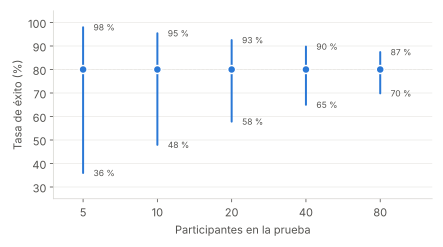
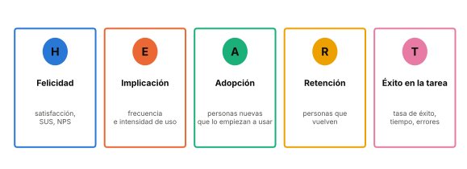

# Tema 4. Hitos, objetivos y métricas {#sec-tema4}

::: {.callout-note appearance="default"}
## Objetivos
- Formular objetivos SMART para un proyecto de diseño.
- Definir hitos verificables.
- Elegir métricas de éxito y calcularlas con muestras pequeñas sin sacar conclusiones exageradas.
:::

::: {.callout-note appearance="simple" icon="false"}
## Glosario del tema
[Objetivo SMART](92-glosario.qmd#gl-smart) · [Hito](92-glosario.qmd#gl-hito) · [Marco HEART](92-glosario.qmd#gl-heart) · [Tasa de éxito](92-glosario.qmd#gl-tasa-exito) · [Intervalo de confianza](92-glosario.qmd#gl-intervalo) · [Media geométrica](92-glosario.qmd#gl-media-geometrica) · [SUS](92-glosario.qmd#gl-sus)
:::

::: {.callout-tip appearance="simple" icon="false"}
## Descargas
[Script R del capítulo](plantillas/04_metricas.R){.btn .btn-outline-primary .btn-sm download="04_metricas.R"}
[Plantilla de entrega del reto (.qmd)](plantillas/entrega_reto.qmd){.btn .btn-outline-primary .btn-sm download="entrega_reto.qmd"}
[Tema de estilo (.scss)](plantillas/informe.scss){.btn .btn-outline-primary .btn-sm download="informe.scss"}
:::

## Lectura obligatoria

::: {.lectura}
Rodden, K.; Hutchinson, H.; Fu, X. (2010). [Measuring the user experience on a large scale: User-centered metrics for web applications](https://doi.org/10.1145/1753326.1753687). En *Proceedings of the SIGCHI Conference on Human Factors in Computing Systems (CHI '10)* (pp. 2395-2398). ACM.
:::

### Lecturas complementarias {.unnumbered}

- Bangor, A.; Kortum, P. T.; Miller, J. T. (2008). [An empirical evaluation of the System Usability Scale](https://doi.org/10.1080/10447310802205776). *International Journal of Human-Computer Interaction*, 24(6), 574-594. Cómo interpretar las puntuaciones SUS.
- Doran, G. T. (1981). There's a S.M.A.R.T. way to write management's goals and objectives. *Management Review*, 70(11), 35-36. El origen del acrónimo SMART.
- Sauro, J.; Lewis, J. R. (2016). *Quantifying the user experience: Practical statistics for user research* (2.ª ed.). Morgan Kaufmann. La referencia para calcular métricas con muestras pequeñas.

## 1. Objetivos SMART

Un objetivo vago («que la web sea más fácil de usar») no permite saber si se ha cumplido. El acrónimo **SMART**, propuesto por Doran (1981) para la gestión y adoptado en el diseño, pide que un objetivo sea:

| Letra | Criterio | Pregunta de control |
|---|---|---|
| **S** | Específico | ¿Qué cambia exactamente y para quién? |
| **M** | Medible | ¿Con qué dato sabremos que se ha conseguido? |
| **A** | Alcanzable | ¿Es realista con el tiempo y los recursos del proyecto? |
| **R** | Relevante | ¿Responde al problema definido en el *brief*? |
| **T** | Temporal | ¿Para cuándo? |

Ejemplo: «Antes del 15 de diciembre, al menos el 80 % de los participantes de la prueba con el prototipo navegable encontrarán el horario de la biblioteca sin ayuda en menos de 20 segundos».

## 2. Hitos verificables

Un **hito** es un punto del proyecto en el que se puede comprobar que algo está terminado. Se define por su **resultado**, no por la actividad: «flujo principal validado con cinco usuarios» es un hito; «trabajar en el flujo» no lo es. Un calendario de proyecto de baja fidelidad podría ser:

1. *Brief* de diseño aprobado por el equipo (Tema 3).
2. Flujos principal, alternativos y de error documentados (Tema 5).
3. Esquemas de todas las pantallas del flujo principal (Tema 7).
4. Prototipo navegable con estados y transiciones (Tema 8).
5. Prueba con cinco participantes y lista priorizada de cambios (Tema 9).

## 3. Métricas de éxito: el marco HEART

Rodden, Hutchinson y Fu (2010) propusieron en Google el marco **HEART**, que agrupa las métricas de la experiencia en cinco categorías:

| Categoría | Qué mide | Ejemplo |
|---|---|---|
| **H**appiness (satisfacción) | Actitudes | Puntuación SUS, satisfacción declarada |
| **E**ngagement (implicación) | Intensidad de uso | Reservas por estudiante y mes |
| **A**doption (adopción) | Nuevos usuarios | Estudiantes que hacen su primera reserva |
| **R**etention (retención) | Usuarios que vuelven | Porcentaje que repite al mes siguiente |
| **T**ask success (éxito en la tarea) | Eficacia y eficiencia | Tasa de éxito, tiempo en la tarea, errores |

Para elegir, el marco propone un proceso de **objetivos, señales y métricas**: primero el objetivo, después la señal de conducta que indicaría que se cumple y, al final, la métrica que cuantifica esa señal. En baja fidelidad, las categorías útiles son sobre todo el **éxito en la tarea** y la **satisfacción**; las demás exigen un producto en uso.

## 4. Medir con pocas personas

Las pruebas de prototipos se hacen con pocas personas, a menudo cinco. Con muestras así, una cifra sola engaña: «4 de 5 completaron la tarea» es un 80 %, pero el porcentaje real en la población podría estar bastante más abajo. Sauro y Lewis (2016) recomiendan:

- **Tasa de éxito con intervalo de confianza** de Wald ajustado: indica entre qué valores está probablemente la tasa real.
- **Media geométrica** para los tiempos: con pocas personas y alguna muy lenta, representa mejor el tiempo típico que la media aritmética.
- **SUS** (*System Usability Scale*) para la satisfacción: diez afirmaciones con respuesta de 1 a 5 que dan una puntuación de 0 a 100. No es un porcentaje. Bangor et al. (2008) consideran «aceptable» una puntuación desde 70, «marginal» entre 50 y 70, y «no aceptable» por debajo de 50.

{#fig-intervalos fig-alt="Gráfico de puntos con barras de error. En el eje horizontal, el número de participantes: 5, 10, 20, 40 y 80. Para todos el punto está en el 80 %, pero la barra de error se estrecha: con 5 va del 36 % al 98 %; con 80, del 70 % al 87 %."}

## Práctica en R: medir una prueba pequeña

`tasa_exito()` calcula la tasa con su intervalo; `tiempo_tipico()`, la media geométrica; `puntuacion_sus()`, el SUS de cada participante.

```{webr}
#| autorun: true
source("datos/funciones_ux.R")
tasa_exito(exitos = 4, n = 5)
tiempos <- c(32, 41, 38, 45, 120)
c(media = mean(tiempos), media_geometrica = tiempo_tipico(tiempos))
```

### Ejercicio 4.1 {.unnumbered}

En la prueba con el prototipo en papel, 3 de 8 participantes reservaron la sala sin ayuda. Calcula el **límite superior** del intervalo de confianza: ¿es probable que la tasa real llegue al 70 %?

```{webr}
#| exercise: t4_intervalo
#| setup: true
source("datos/funciones_ux.R")
```

```{webr}
#| exercise: t4_intervalo
t <- tasa_exito(exitos = 3, n = ______)
t["superior"]
```

::: {.hint exercise="t4_intervalo"}
`n` es el número total de participantes.
:::

::: {.solution exercise="t4_intervalo"}
```r
t <- tasa_exito(exitos = 3, n = 8)
t["superior"]
```
El límite superior es 0,70 (0,696): aun en el mejor caso razonable, la tasa real apenas llegaría al 70 %. Con solo ocho personas ya sabemos lo importante: la tarea necesita cambios antes de seguir.
:::

```{webr}
#| exercise: t4_intervalo
#| check: true
if (isTRUE(all.equal(unname(as.numeric(.result)), unname(tasa_exito(3, 8)["superior"])))) {
  list(correct = TRUE, message = paste0("Correcto: límite superior ", round(as.numeric(.result), 2), "."))
} else {
  list(correct = FALSE, message = "Hubo 8 participantes.")
}
```

### Ejercicio 4.2 {.unnumbered}

`respuestas_sus` contiene las respuestas de 12 participantes a un prototipo navegable. Calcula la **mediana** de sus puntuaciones SUS.

```{webr}
#| exercise: t4_sus
#| setup: true
source("datos/funciones_ux.R")
```

```{webr}
#| exercise: t4_sus
sus <- puntuacion_sus(respuestas_sus[, -1])   # [, -1] quita la columna del participante
______(sus)
```

::: {.hint exercise="t4_sus"}
La función de la mediana es `median()`.
:::

::: {.solution exercise="t4_sus"}
```r
sus <- puntuacion_sus(respuestas_sus[, -1])
median(sus)
```
75: por encima del umbral de 70 que Bangor et al. consideran aceptable. Con `aceptabilidad_sus(sus)` puedes ver la categoría de cada participante.
:::

```{webr}
#| exercise: t4_sus
#| check: true
if (isTRUE(all.equal(as.numeric(.result), 75))) {
  list(correct = TRUE, message = "Correcto: mediana SUS = 75.")
} else {
  list(correct = FALSE, message = "Aplica median() al vector sus.")
}
```

{#fig-t4-heart fig-alt="Cinco tarjetas: H, felicidad (satisfacción, SUS, NPS); E, implicación (frecuencia e intensidad de uso); A, adopción (personas nuevas que lo empiezan a usar); R, retención (personas que vuelven); T, éxito en la tarea (tasa de éxito, tiempo, errores)."}

## Laboratorio: la escala SUS {#lab-t4-sus}

::: {.laboratorio}
::: {.laboratorio-etiqueta}
Laboratorio · cálculo en tu navegador
:::

Responde a los diez ítems de la *System Usability Scale* (Brooke, 1996) como si acabaras de usar el catálogo de tu biblioteca (1 = totalmente en desacuerdo, 5 = totalmente de acuerdo). Fíjate en que los ítems impares son positivos y los pares negativos: por eso se puntúan al revés.

```{ojs}
//| echo: false
rango = window.Lab.rango
items_sus = ["Creo que me gustaría usar este sistema con frecuencia.", "El sistema me pareció innecesariamente complejo.",
  "Pensé que era fácil de usar.", "Creo que necesitaría ayuda de una persona técnica para poder usarlo.",
  "Las funciones del sistema estaban bien integradas.", "Había demasiadas incoherencias en el sistema.",
  "Imagino que la mayoría de la gente aprendería a usarlo muy rápido.", "El sistema me resultó muy engorroso de usar.",
  "Me sentí muy seguro al usarlo.", "Tuve que aprender muchas cosas antes de poder manejarlo."]
viewof respuestas = {
  const caja = html`<div class="lab-sus"></div>`;
  const r = items_sus.map((t, i) => { const c = rango(`${i + 1}. ${t}`, [1, 5], {step: 1, value: 3}); c.addEventListener("input", e => { e.stopPropagation(); caja.value = r.map(x => x.value); caja.dispatchEvent(new Event("input", {bubbles: true})); }); caja.appendChild(c); return c; });
  caja.value = r.map(x => x.value); return caja;
}
```

```{ojs}
//| echo: false
{
  const puntos = respuestas.map((v, i) => i % 2 === 0 ? v - 1 : 5 - v);
  const sus = 2.5 * puntos.reduce((a, b) => a + b, 0);
  const banda = sus < 50 ? ["No aceptable", "lab-mal"] : sus < 70 ? ["Marginal", "lab-medio"] : ["Aceptable", "lab-bien"];
  return html`<div role="status"><p style="font-size:1.25rem"><strong>SUS = ${sus.toFixed(1)}</strong> · <span class="${banda[1]}" style="font-weight:600">${banda[0]}</span></p>
  <div style="position:relative;height:1.1rem;border-radius:4px;background:linear-gradient(90deg,#f6d3cd 0 50%,#fbe7b8 50% 70%,#d3efdc 70% 100%)">
    <div style="position:absolute;left:calc(${sus}% - 2px);top:-4px;width:4px;height:1.6rem;background:currentColor"></div></div>
  <p class="small">Cortes de aceptabilidad orientativos: menos de 50, no aceptable; 50-70, marginal; más de 70, aceptable (Bangor, Kortum y Miller). La media de referencia ronda 68. Con las funciones del libro: <code>puntuacion_sus()</code> y <code>aceptabilidad_sus()</code>.</p></div>`;
}
```
:::

## Laboratorio: cuánto dice una tasa de éxito con pocas personas {#lab-t4-intervalo}

::: {.laboratorio}
::: {.laboratorio-etiqueta}
Laboratorio · cálculo en tu navegador
:::

En una prueba con pocas personas, la tasa de éxito observada es solo una estimación. Mueve los controles y mira cómo cambia el **intervalo de confianza del 95 %** (Wald ajustado, el recomendado para muestras pequeñas).

```{ojs}
//| echo: false
viewof n_int = rango("Participantes", [3, 40], {step: 1, value: 8})
viewof x_int = rango("Completaron la tarea", [0, 40], {step: 1, value: 6})
```

```{ojs}
//| echo: false
{
  const n = n_int, x = Math.min(x_int, n_int), z = 1.959964;
  const nt = n + z * z, pt = (x + z * z / 2) / nt, m = z * Math.sqrt(pt * (1 - pt) / nt);
  const li = Math.max(0, pt - m), ls = Math.min(1, pt + m), p = x / n;
  return html`<div role="status"><p><strong>${x} de ${n}</strong> (${Math.round(100 * p)} %) → el valor real está, con un 95 % de confianza, entre el <strong>${Math.round(100 * li)} %</strong> y el <strong>${Math.round(100 * ls)} %</strong>.</p>
  <svg viewBox="0 0 400 46" width="100%" style="max-width:600px" role="img" aria-label="Intervalo de ${Math.round(100 * li)} a ${Math.round(100 * ls)} por ciento">
    <line x1="10" x2="390" y1="22" y2="22" stroke="#d9d8d4" stroke-width="2"/>
    ${[0, 25, 50, 75, 100].map(v => `<text x="${10 + 3.8 * v}" y="44" font-size="10" text-anchor="middle" fill="currentColor">${v} %</text>`).join("")}
    <rect x="${10 + 380 * li}" y="14" width="${380 * (ls - li)}" height="16" rx="4" fill="#2a78d6" fill-opacity=".35"/>
    <circle cx="${10 + 380 * p}" cy="22" r="6" fill="#eb6834"/></svg>
  ${x_int > n_int ? html`<p class="small">Hay más éxitos que participantes: se usa ${n}.</p>` : ""}
  <p class="small">Prueba 4 de 5 y después 40 de 50: la misma tasa, pero el intervalo se estrecha mucho.</p></div>`;
}
```
:::

## Actividades

::: {.clasificar #ia-t4-heart titulo="¿Qué categoría de HEART mide?" categorias="Felicidad|Implicación|Adopción|Retención|Éxito en la tarea"}
- Puntuación media en el cuestionario SUS → Felicidad
- Número de búsquedas por persona y semana → Implicación
- Estudiantes de primero que activan su cuenta en el primer mes → Adopción
- Porcentaje que vuelve a usar la aplicación al mes siguiente → Retención
- Porcentaje que consigue renovar un préstamo sin ayuda → Éxito en la tarea
- Tiempo medio para reservar una sala de estudio → Éxito en la tarea
:::

::: {.clasificar #ia-t4-smart titulo="¿Es un objetivo SMART?" categorias="SMART|No SMART"}
- «Mejorar la experiencia de usuario.» → No SMART // No es específico ni medible.
- «Que el 80 % de las personas participantes renueve un préstamo en menos de un minuto en la prueba de diciembre.» → SMART
- «Tener la mejor aplicación de bibliotecas del mundo.» → No SMART
- «Reducir del 35 % al 20 % el abandono del formulario de registro antes de marzo.» → SMART
:::

## Reto evaluable {#reto-t4}

::: {.callout-important appearance="simple" icon="false"}
## Reto del Tema 4 · Plan de hitos y métricas
Para el proyecto de tu *brief* (reto del Tema 3):

1. Reescribe tus objetivos como **tres objetivos SMART** y comprueba cada criterio con la tabla del apartado 1.
2. Define **cinco hitos** verificables con su fecha y su resultado.
3. Aplica el proceso **objetivos-señales-métricas** del marco HEART a dos de tus objetivos.
4. Para una métrica de éxito en la tarea, calcula con `tasa_exito()` el intervalo que obtendrías con 5 y con 15 participantes si el 80 % tuviera éxito, y explica qué implica para tu plan de pruebas.

**Entrega:** un informe hecho con la [plantilla de entrega](plantillas/entrega_reto.qmd). Se evalúa con la rúbrica que incluye la plantilla. Este reto **no tiene solución en el libro**: cada estudiante trabaja con un proyecto distinto y la corrección la hace el profesorado.
:::

## Autoevaluación

Responde a todas las preguntas y pulsa **Mostrar respuestas**: verás en verde las acertadas, en rojo las falladas y tu recuento. Puedes corregir y volver a comprobar. No cuenta para la nota.

::: {.webex-check .webex-box}
1. «Mejorar la usabilidad de la web» es un objetivo SMART. 
2. En el marco HEART, la letra T corresponde a 
3. «Trabajar en los esquemas» es un hito verificable. 
4. Una puntuación SUS de 75 significa que el 75 % de los participantes está satisfecho. 
5. Según Bangor et al. (2008), una puntuación SUS de 62,5 es 
6. Con tiempos de 32, 41, 38, 45 y 120 segundos, ¿qué resumen representa mejor el tiempo típico?



7. En el proceso del marco HEART, ¿qué se define primero? 
:::

::: {.webex-solution boton="Ver explicaciones"}
- No dice qué, para quién, cómo se mide ni para cuándo.
- *Task success*: eficacia y eficiencia en las tareas.
- Un hito se define por un resultado comprobable, no por una actividad.
- El SUS es una puntuación de 0 a 100, no un porcentaje.
- Entre 50 y 70 es «marginal».
- La media geométrica reduce el peso del participante muy lento.
- Objetivos, después señales y, al final, métricas.
:::

## Recursos complementarios

| Recurso | Para qué sirve |
|---|---|
| [MeasuringU – Calculadoras de Jeff Sauro](https://measuringu.com/calculators/) | Intervalos y comparaciones para muestras pequeñas |
| [Nielsen Norman Group – Success rate: the simplest usability metric](https://www.nngroup.com/articles/success-rate-the-simplest-usability-metric/) | Cómo medir el éxito en la tarea |
| [Usability.gov – System Usability Scale](https://www.usability.gov/how-to-and-tools/methods/system-usability-scale.html) | El cuestionario SUS y su cálculo |
