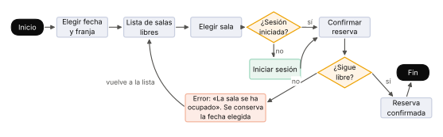

# Tema 5. Flujos de usuario: modelado y representación {#sec-tema5}

::: {.callout-note appearance="default"}
## Objetivos
- Modelar las tareas de las personas usuarias antes de diseñar pantallas.
- Representar flujos principales, alternativos y de error con una notación clara.
- Diseñar flujos coherentes, eficientes y sin barreras, y detectar dónde se pierden los usuarios.
:::

::: {.callout-note appearance="simple" icon="false"}
## Glosario del tema
[Flujo de usuario](92-glosario.qmd#gl-flujo) · [Análisis de tareas](92-glosario.qmd#gl-analisis-tareas) · [Mapa de tareas](92-glosario.qmd#gl-mapa-tareas) · [*Wireflow*](92-glosario.qmd#gl-wireflow) · [Flujo de error](92-glosario.qmd#gl-flujo-error) · [Callejón sin salida](92-glosario.qmd#gl-callejon) · [Embudo](92-glosario.qmd#gl-embudo)
:::

::: {.callout-tip appearance="simple" icon="false"}
## Descargas
[Script R del capítulo](plantillas/05_flujos.R){.btn .btn-outline-primary .btn-sm download="05_flujos.R"}
[Plantilla de entrega del reto (.qmd)](plantillas/entrega_reto.qmd){.btn .btn-outline-primary .btn-sm download="entrega_reto.qmd"}
[Tema de estilo (.scss)](plantillas/informe.scss){.btn .btn-outline-primary .btn-sm download="informe.scss"}
:::

## Lectura obligatoria

::: {.lectura}
Kalbach, J. (2021). *Mapping experiences: A complete guide to customer alignment through journeys, blueprints, and diagrams* (2.ª ed.). O'Reilly. Capítulos sobre los diagramas de alineamiento y los mapas de tareas.
:::

### Lecturas complementarias {.unnumbered}

- @nielsennormangroupsf — Diferencia entre el viaje completo y el flujo de una tarea.
- @nielsennormangroupsfa — Flujos dibujados con esquemas de página.
- @nielsennormangroupsfb

## 1. De la tarea al flujo

Antes de dibujar pantallas hay que entender la **tarea**: qué quiere conseguir la persona y qué pasos sigue. El **análisis de tareas** descompone un objetivo en subtareas y pasos. Por ejemplo, «reservar una sala de trabajo en grupo» se descompone en: elegir fecha y franja, ver salas libres, elegir una, identificarse, confirmar y recibir la confirmación.

Un **flujo de usuario** representa el recorrido por el sistema para completar una tarea: qué ve la persona, qué decide y adónde la lleva cada decisión. No es lo mismo que un **viaje de usuario** (*user journey*), que cubre toda la experiencia, dentro y fuera del producto (enterarse de que existe la sala, desplazarse, usarla), ni que un **mapa de tareas**, que ordena todas las tareas del servicio sin entrar en pantallas.

## 2. Flujos principal, alternativo y de error

Cada tarea tiene varios caminos:

- **Flujo principal** (o «camino feliz»): el recorrido más directo cuando todo va bien.
- **Flujos alternativos**: caminos válidos distintos (reservar desde el calendario o desde la ficha de la sala; reservar sin haber iniciado sesión).
- **Flujos de error**: qué pasa cuando algo falla (la sala se ocupa mientras se reserva, la sesión caduca, falta un dato).

Los flujos de error son los que más se olvidan y los que más frustran. Un buen flujo de error explica qué ha pasado, conserva lo que la persona ya había hecho y le ofrece un camino para continuar (heurísticas 3, 5 y 9 de Nielsen, Tema 2).

## 3. Notación

No hay una notación única, pero la más extendida, heredada de los diagramas de flujo, usa:

| Forma | Significa |
|---|---|
| Óvalo | Inicio o fin del flujo |
| Rectángulo | Pantalla o estado que ve la persona |
| Rombo | Decisión (de la persona o del sistema) |
| Flecha | Paso de un punto a otro, con la acción que lo provoca |

{#fig-flujo fig-alt="Diagrama de flujo. Inicio, elegir fecha y franja, lista de salas libres, elegir sala. Rombo: ¿ha iniciado sesión? Si no, pantalla de inicio de sesión que vuelve al flujo. Si sí, confirmar reserva. Rombo: ¿sigue libre? Si no, mensaje de error que vuelve a la lista de salas manteniendo la fecha. Si sí, confirmación y fin."}

Los ***wireflows*** combinan el flujo con miniaturas de los esquemas de cada pantalla, y son útiles cuando el contenido de la pantalla cambia según la decisión. Se trabajan en los temas 7 y 8.

## 4. Flujos coherentes, eficientes y sin barreras

Al revisar un flujo conviene comprobar:

- **Sin callejones sin salida**: desde cualquier punto se puede continuar, volver o salir.
- **Pocos pasos**: cada paso debe aportar algo a la persona, no solo a la organización. Pedir datos que no se necesitan para la tarea añade abandono.
- **Coherencia**: la misma acción produce el mismo resultado en todo el flujo.
- **Sin barreras**: el flujo se puede completar con teclado, con lector de pantalla y sin depender de la memoria (por ejemplo, sin códigos que haya que copiar de otra pantalla); el Tema 12 lo desarrolla.
- **Retroceso seguro**: volver atrás no destruye lo que la persona ya había escrito.

## 5. ¿Dónde se pierden los usuarios?

Cuando un flujo ya existe, la analítica muestra cuántas personas llegan a cada paso. Ese recorrido se representa como un **embudo**: para cada paso, cuántos continúan respecto al paso anterior y respecto al inicio. El paso con menos continuidad señala dónde hay que mirar primero, aunque no explica por qué: para eso se necesita investigación cualitativa (Tema 2).

## 6. Del flujo a la arquitectura: el mapa del sitio

El flujo describe **una tarea**; el **mapa del sitio** describe **todo el espacio** por el que se mueven las tareas: qué secciones hay y cómo se agrupan. Se construyen juntos: cada pantalla del flujo tiene que tener un lugar en el mapa, y cada sección del mapa debe servir al menos a una tarea importante.

```{dot}
//| fig-cap: "Mapa del sitio de ReservaSala. Las tareas principales (buscar y reservar) están a un toque de la pantalla de inicio."
digraph reservasala {
  graph [rankdir=TB, nodesep=0.3, ranksep=0.5, fontname="Helvetica", bgcolor="white", pad=0.2];
  node [shape=box, style="rounded", fontname="Helvetica", fontsize=11];
  edge [arrowhead=none];
  Inicio [style="rounded,filled", fillcolor="#e8f0fb"];
  Inicio -> {"Buscar salas"; "Mis reservas"; Mapa; Perfil};
  "Buscar salas" -> Lista -> "Ficha de sala" -> "Confirmar" -> "Reserva confirmada";
  "Mis reservas" -> {"Próximas"; "Historial"};
  "Próximas" -> {"Cancelar"; "Cómo llegar"};
  Perfil -> {"Avisos"; "Normas"; "Ayuda"};
}
```

Para decidir cómo agrupar las secciones según el modelo mental de las personas, usa la **ordenación de tarjetas** (puedes practicarla en el [laboratorio de la galería](93-galeria.qmd#lab-galeria-tarjetas)) y, para comprobar que encuentran las cosas, la **prueba de árbol** del Tema 7.

::: {.column-margin}
**Regla práctica.** Las tareas más frecuentes deberían estar a uno o dos toques del inicio. Si una tarea frecuente queda en el tercer nivel del mapa, revisa la agrupación.
:::

## Práctica en R: el embudo de un flujo de registro

`flujo_registro` contiene los usuarios que llegan a cada paso del registro en una aplicación de biblioteca (datos simulados). La función `embudo()` calcula la continuidad:

```{webr}
#| autorun: true
source("datos/funciones_ux.R")
e <- embudo(flujo_registro$paso, flujo_registro$usuarios)
e
```

### Ejercicio 5.1 {.unnumbered}

¿En qué paso continúan **menos** personas respecto al paso anterior? Completa el código con la columna adecuada.

```{webr}
#| exercise: t5_peor
#| setup: true
source("datos/funciones_ux.R")
e <- embudo(flujo_registro$paso, flujo_registro$usuarios)
```

```{webr}
#| exercise: t5_peor
e$paso[which.min(e$______)]
```

::: {.hint exercise="t5_peor"}
La columna que compara con el paso anterior se llama `continua`.
:::

::: {.solution exercise="t5_peor"}
```r
e$paso[which.min(e$continua)]
```
«Crear cuenta»: solo continúa el 70 % de quienes llegan a la pantalla de inicio. Es un punto clásico de abandono. Antes de rediseñarlo, conviene averiguar por qué: ¿hace falta una cuenta para lo que la persona quería hacer?
:::

```{webr}
#| exercise: t5_peor
#| check: true
if (identical(as.character(.result), "Crear cuenta")) {
  list(correct = TRUE, message = "Correcto: «Crear cuenta», con un 70 % de continuidad.")
} else {
  list(correct = FALSE, message = "Busca el mínimo de la columna continua.")
}
```

### Ejercicio 5.2 {.unnumbered}

¿Qué porcentaje de quienes llegan a la pantalla de inicio termina con la cuenta activa?

```{webr}
#| exercise: t5_final
#| setup: true
source("datos/funciones_ux.R")
e <- embudo(flujo_registro$paso, flujo_registro$usuarios)
```

```{webr}
#| exercise: t5_final
e$acumulado[nrow(______)]
```

::: {.hint exercise="t5_final"}
El último paso está en la fila número `nrow(e)`.
:::

::: {.solution exercise="t5_final"}
```r
e$acumulado[nrow(e)]
```
El 31,7 %: de cada diez personas que empiezan, solo tres terminan el registro. Quitar pasos que no aporten valor a la persona es la primera hipótesis que habría que probar.
:::

```{webr}
#| exercise: t5_final
#| check: true
if (isTRUE(all.equal(as.numeric(.result), 31.7))) {
  list(correct = TRUE, message = "Correcto: el 31,7 % completa el registro.")
} else {
  list(correct = FALSE, message = "Usa la columna acumulado en la última fila.")
}
```

## Laboratorio: el embudo de un flujo {#lab-t5-embudo}

::: {.laboratorio}
::: {.laboratorio-etiqueta}
Laboratorio · cálculo en tu navegador
:::

Un **embudo** muestra cuántas personas llegan a cada paso de un flujo. Ajusta las cifras del flujo de reserva de una sala de estudio y localiza el paso donde se pierde más gente: es el primero que conviene rediseñar.

```{ojs}
//| echo: false
rango = window.Lab.rango
pasos_embudo = ["Entran en «Reservar sala»", "Eligen fecha", "Eligen franja horaria", "Se identifican", "Confirman la reserva"]
viewof cifras = {
  const caja = html`<div></div>`, ini = [1000, 820, 700, 360, 330];
  const r = pasos_embudo.map((t, i) => { const c = rango(t, [0, 1000], {step: 10, value: ini[i]}); c.addEventListener("input", e => { e.stopPropagation(); caja.value = r.map(x => x.value); caja.dispatchEvent(new Event("input", {bubbles: true})); }); caja.appendChild(c); return c; });
  caja.value = r.map(x => x.value); return caja;
}
```

```{ojs}
//| echo: false
{
  const v = cifras.map((x, i) => Math.min(x, i ? cifras.slice(0, i).reduce((a, b) => Math.min(a, b)) : x));
  const perdidas = v.map((x, i) => i ? (v[i - 1] ? 1 - x / v[i - 1] : 0) : 0);
  const peor = perdidas.indexOf(Math.max(...perdidas));
  const fmt = new Intl.NumberFormat("es-ES");
  return html`<div role="status"><table class="table table-sm"><thead><tr><th scope="col">Paso</th><th scope="col">Personas</th><th scope="col">Se pierden</th><th scope="col"><span class="visually-hidden">Barra</span></th></tr></thead><tbody>
  ${pasos_embudo.map((p, i) => html`<tr style="${i === peor && i ? "font-weight:600" : ""}"><td>${p}</td><td style="text-align:right">${fmt.format(v[i])}</td>
   <td style="text-align:right">${i ? Math.round(100 * perdidas[i]) + " %" : "—"}</td>
   <td style="width:40%"><div style="height:.8rem;border-radius:2px;background:${i === peor && i ? "#eb6834" : "#2a78d6"};width:${v[0] ? 100 * v[i] / v[0] : 0}%"></div></td></tr>`)}</tbody></table>
  <p>Conversión total: <strong>${v[0] ? Math.round(100 * v[4] / v[0]) : 0} %</strong>. ${peor ? html`La mayor pérdida está en <strong>«${pasos_embudo[peor]}»</strong> (${Math.round(100 * perdidas[peor])} %).` : ""}</p>
  <p class="small">Un paso no puede tener más personas que el anterior: el laboratorio lo corrige. Con las funciones del libro: <code>embudo()</code>.</p></div>`;
}
```
:::

## Caso práctico resuelto

::: {.callout-note appearance="simple" icon="false"}
## Un flujo de reserva con caminos alternativos
Flujo principal (*happy path*): abrir la app → elegir franja → ver salas libres → elegir sala → confirmar → recibir confirmación.

Caminos alternativos que el esquema debe contemplar:

- **No hay salas libres** en la franja: proponer franjas cercanas o lista de espera.
- **Grupo grande**: filtrar por capacidad antes de mostrar salas.
- **Sesión caducada** al confirmar: volver al paso de confirmación sin perder la selección.
- **Cancelar** desde la confirmación o desde una notificación.

Representarlo con un diagrama de flujo (rectángulos para pantallas, rombos para decisiones) revela pantallas que faltan antes de dibujarlas.
:::

## Ejercicios graduados

**Básico.** Añade al flujo el caso «la sala reservada está ocupada al llegar».

::: {.webex-solution boton="Ver solución"}
Nueva rama tras «llegar a la sala»: decisión «¿Está libre?» → no → pantalla «Notificar incidencia» con opción de buscar otra sala disponible ahora y aviso al personal.
:::

**Avanzado.** Cuenta cuántas pantallas distintas necesita el flujo completo con sus alternativas.

::: {.webex-solution boton="Ver solución"}
Aproximadamente: inicio, selección de franja, lista de salas, detalle de sala, confirmación, error de disponibilidad, lista de espera, cancelación e incidencia. Lo importante es que cada decisión del diagrama tenga su pantalla de destino.
:::


## Actividades

::: {.clasificar #ia-t5-ramas titulo="¿Flujo principal, alternativo o de error?" categorias="Principal|Alternativo|Error"}
- Busco un libro, lo encuentro y lo reservo → Principal
- Busco un libro, no está disponible y me apunto a la lista de espera → Alternativo
- Al reservar, el sistema avisa de que la sesión ha caducado → Error
- Reservo desde la ficha del libro que me envió un compañero → Alternativo // Otro punto de entrada al mismo objetivo.
- Introduzco un número de carné que no existe → Error
:::

::: {.ordenar #ia-t5-pasos titulo="Ordena el flujo principal de «Renovar un préstamo»"}
1. Iniciar sesión
2. Abrir «Mis préstamos»
3. Seleccionar el préstamo que vence
4. Pulsar «Renovar»
5. Ver la nueva fecha de devolución
:::

::: {.clasificar #ia-t5-notacion titulo="¿Qué representa cada forma en un diagrama de flujo?" categorias="Inicio o fin|Pantalla o acción|Decisión|Conector"}
- Óvalo → Inicio o fin
- Rectángulo → Pantalla o acción
- Rombo → Decisión
- Flecha → Conector
:::

::: {.callout-warning appearance="simple" icon="false"}
## Errores frecuentes
- **Dibujar solo el camino feliz.** Los flujos de error y alternativos son donde más se pierde la gente.
- **Confundir flujo con mapa del sitio.** El flujo sigue una tarea; el mapa, la estructura.
- **Decisiones sin salida**: cada rombo necesita al menos dos ramas etiquetadas.
- **Pasos que piden lo que el sistema ya sabe** (volver a escribir el correo, el carné…).
:::

## Reto evaluable {#reto-t5}

::: {.callout-important appearance="simple" icon="false"}
## Reto del Tema 5 · Flujos de la tarea principal
Para la tarea principal de tu proyecto:

1. Haz el **análisis de la tarea**: objetivo, subtareas y pasos.
2. Dibuja el **flujo principal**, al menos **dos alternativos** y al menos **dos de error**, con la notación del apartado 3.
3. Revisa el flujo con la lista del apartado 4 y documenta los cambios que haces y por qué.
4. Indica qué datos de analítica o de prueba usarías para saber dónde se pierden los usuarios.

**Entrega:** un informe hecho con la [plantilla de entrega](plantillas/entrega_reto.qmd) con los diagramas (en papel fotografiado o en una herramienta digital). Se evalúa con la rúbrica que incluye la plantilla. Este reto **no tiene solución en el libro**: cada estudiante trabaja con un proyecto distinto y la corrección la hace el profesorado.
:::

## Autoevaluación

Responde a todas las preguntas y pulsa **Mostrar respuestas**: verás en verde las acertadas, en rojo las falladas y tu recuento. Puedes corregir y volver a comprobar. No cuenta para la nota.

::: {.webex-check .webex-box}
1. Un viaje de usuario y un flujo de usuario son lo mismo. 
2. En un diagrama de flujo, una decisión se representa con un 
3. Qué ocurre cuando la sala se ocupa mientras alguien la reserva se documenta en un flujo 
4. Volver atrás en un formulario no debería borrar lo que la persona ya había escrito. 
5. En el embudo de la práctica, ¿qué porcentaje de quienes llegan a «Crear cuenta» pasa a «Datos personales»?  %
6. El embudo indica en qué paso abandonan los usuarios y también por qué lo hacen. 
:::

::: {.webex-solution boton="Ver explicaciones"}
- El viaje cubre toda la experiencia, también fuera del producto; el flujo, el recorrido por el sistema en una tarea.
- El rombo es la decisión; el rectángulo, una pantalla; el óvalo, el inicio o el fin.
- Es un fallo que el diseño debe prever.
- Es control y libertad del usuario (heurística 3) y prevención de errores.
- 610 / 840 = 72,6 %.
- El embudo dice dónde, no por qué: para eso hace falta investigación cualitativa.
:::

## Recursos complementarios

| Recurso | Para qué sirve |
|---|---|
| [Nielsen Norman Group – User journeys vs. user flows](https://www.nngroup.com/articles/user-journeys-vs-user-flows/) | Diferencias entre artefactos |
| [Nielsen Norman Group – Wireflows](https://www.nngroup.com/articles/wireflows/) | Flujos con esquemas de página |
| [Nielsen Norman Group – Task analysis](https://www.nngroup.com/articles/task-analysis/) | Descomponer tareas |
| [Figma Community](https://www.figma.com/community) | Plantillas de diagramas de flujo |
