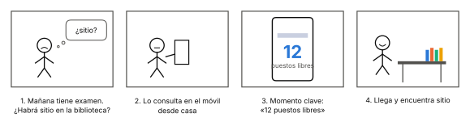
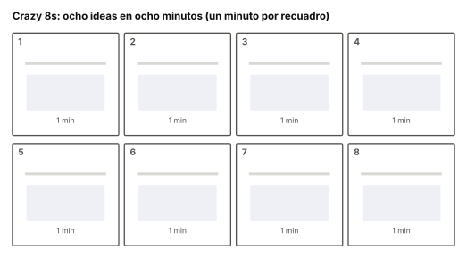

# Tema 6. *Storyboards* en el diseño de interacción {#sec-tema6}

::: {.callout-note appearance="default"}
## Objetivos
- Distinguir los *storyboards* narrativos, de interacción y de proceso.
- Usar *storyboards* para representar escenarios, contexto de uso y momentos clave.
- Dibujar *storyboards* eficaces aunque no se sepa dibujar.
:::

::: {.callout-note appearance="simple" icon="false"}
## Glosario del tema
[*Storyboard*](92-glosario.qmd#gl-storyboard) · [Escenario](92-glosario.qmd#gl-escenario) · [Contexto de uso](92-glosario.qmd#gl-contexto) · [Momento clave](92-glosario.qmd#gl-momento) · [Viñeta](92-glosario.qmd#gl-vineta)
:::

::: {.callout-tip appearance="simple" icon="false"}
## Descargas
[Plantilla de entrega del reto (.qmd)](plantillas/entrega_reto.qmd){.btn .btn-outline-primary .btn-sm download="entrega_reto.qmd"}
[Tema de estilo (.scss)](plantillas/informe.scss){.btn .btn-outline-primary .btn-sm download="informe.scss"}
[Plantillas para esquemas y *storyboards* (PDF)](plantillas/plantillas_esquemas.pdf){.btn .btn-outline-primary .btn-sm download="plantillas_esquemas.pdf"}
:::

## Lectura obligatoria

::: {.lectura}
Truong, K. N.; Hayes, G. R.; Abowd, G. D. (2006). [Storyboarding: An empirical determination of best practices and effective guidelines](https://doi.org/10.1145/1142405.1142410). En *Proceedings of the 6th Conference on Designing Interactive Systems (DIS '06)* (pp. 12-21). ACM.
:::

### Lecturas complementarias {.unnumbered}

- Buxton, W. (2007). *Sketching user experiences*. Elsevier. Capítulos sobre los bocetos en secuencia y los guiones visuales.
- Nielsen Norman Group. [Storyboards help visualize UX ideas](https://www.nngroup.com/articles/storyboards-visualize-ideas/). Guía práctica con ejemplos.

## 1. Qué es un *storyboard*

Un ***storyboard*** es una secuencia de viñetas que cuenta cómo una persona usa un producto en una situación concreta. Viene del cine y la animación, donde se usa para planificar las escenas antes de rodar. En el diseño de interacción cumple la misma función: imaginar el uso antes de construir nada.

Su fuerza está en mostrar lo que los esquemas de página no muestran: **quién**, **dónde**, **cuándo**, **con qué ánimo** y **por qué** usa alguien el producto. Un esquema enseña una pantalla; un *storyboard* enseña una vida en la que esa pantalla tiene sentido.

## 2. Tres tipos de *storyboard*

| Tipo | Qué cuenta | Cuándo es útil |
|---|---|---|
| **Narrativo** (de escenario) | La situación de la persona, su problema y cómo el producto encaja en su día | Al principio, para comunicar y validar el concepto (papel del producto, Tema 1) |
| **De interacción** | La secuencia de pantallas y acciones dentro del producto en una tarea | Al pasar del flujo (Tema 5) a los esquemas (Tema 7) |
| **De proceso** | Cómo participan varias personas, canales o sistemas a lo largo del tiempo | En servicios con partes digitales y presenciales, como un préstamo interbibliotecario |

Un **escenario** es la historia escrita que sirve de guion: una persona concreta, con un objetivo, en un contexto, que da una serie de pasos. El *storyboard* la convierte en imágenes.

## 3. Elementos de un buen *storyboard*

Truong, Hayes y Abowd (2006) analizaron *storyboards* de diseñadores profesionales y estudiaron cómo se perciben. Identificaron cinco elementos que hay que decidir:

1. **Nivel de detalle**: basta con lo que la historia necesita; el exceso de detalle distrae de la idea.
2. **Texto**: frases breves que expliquen lo que la imagen no puede, sin repetirla.
3. **Personas y emociones**: mostrar a la persona y cómo se siente (frustración al principio, alivio al final) ayuda a empatizar.
4. **Número de viñetas**: pocas, centradas en los momentos que importan; una historia larga se divide.
5. **Paso del tiempo**: indicarlo cuando es relevante (un reloj, «dos días después»).

## 4. Contexto y momentos clave

Los *storyboards* son especialmente útiles para representar:

- **El contexto de uso**: el entorno físico y social. No es lo mismo buscar un libro sentado en casa que en el autobús, con una mano y con mala cobertura.
- **El detonante**: qué hace que la persona necesite el producto en ese momento.
- **El momento clave**: el instante en que el producto marca la diferencia. Si el *storyboard* no tiene un momento clave claro, quizá el concepto tampoco lo tenga.
- **El desenlace**: qué ha conseguido la persona y cómo se siente.

{#fig-storyboard fig-alt="Cuatro viñetas con figuras de palitos. En la primera, una estudiante en casa piensa en un examen. En la segunda, mira el móvil. En la tercera, el móvil muestra que quedan 12 puestos libres en la biblioteca. En la cuarta, la estudiante está sentada en la biblioteca, sonriente."}

## 5. No hace falta saber dibujar

Un *storyboard* comunica ideas, no talento artístico. Bastan figuras de palitos, cajas y flechas. Algunos recursos:

- **Personas**: un círculo y unas líneas; la emoción se dibuja con la boca y las cejas.
- **Pantallas**: un rectángulo con los elementos clave, sin detalle.
- **Entornos**: un par de objetos que lo sitúen (una mesa y una estantería son una biblioteca).
- **Encuadres**: alternar planos generales (contexto) y primeros planos (la pantalla o la cara).

## Práctica

Escribe en cinco líneas un escenario para el proyecto de tu equipo: persona, situación, detonante, uso del producto y desenlace. Después dibújalo en cuatro viñetas en menos de diez minutos con la plantilla en PDF. Enséñaselo a alguien que no conozca el proyecto y pídele que te cuente la historia: si no la entiende sin tu ayuda, revisa el momento clave.

{#fig-t6-crazy8 fig-alt="Una hoja dividida en ocho recuadros numerados del 1 al 8, cada uno con un título esbozado, un rectángulo de contenido y la indicación «1 min»."}

## Actividades

::: {.ordenar #ia-t6-historia titulo="Ordena las viñetas de este storyboard"}
Marta tiene que entregar un trabajo y necesita un libro que está prestado.

1. Marta descubre en el catálogo que el libro está prestado
2. Se apunta a la lista de espera desde el móvil
3. Recibe un aviso cuando el libro vuelve a la biblioteca
4. Lo recoge en el mostrador de autopréstamo
5. Entrega el trabajo a tiempo
:::

::: {.clasificar #ia-t6-tipos titulo="¿Qué tipo de storyboard es?" categorias="Contexto y situación|Interacción con la pantalla|Recorrido completo"}
- Viñetas que muestran dónde está la persona y qué le pasa antes de usar el servicio → Contexto y situación
- Viñetas que dibujan, pantalla a pantalla, cómo se completa una reserva → Interacción con la pantalla
- Viñetas que siguen a la persona antes, durante y después de usar el servicio → Recorrido completo
:::

::: {.clasificar #ia-t6-elementos titulo="¿Sobra o hace falta?" categorias="Hace falta|Sobra"}
- Una persona protagonista con un objetivo → Hace falta
- El contexto: dónde está y con qué limitaciones → Hace falta
- Un momento de tensión o dificultad → Hace falta
- Dibujos detallados y sombreados de los personajes → Sobra // Basta con figuras simples.
- El desenlace: qué consigue la persona → Hace falta
- La paleta de colores definitiva de la interfaz → Sobra
:::

## Reto evaluable {#reto-t6}

::: {.callout-important appearance="simple" icon="false"}
## Reto del Tema 6 · Dos *storyboards* del proyecto
Para tu proyecto:

1. Escribe el **escenario** de la tarea principal (máximo 150 palabras).
2. Dibuja un ***storyboard* narrativo** de cuatro a seis viñetas que muestre el contexto, el detonante, el momento clave y el desenlace.
3. Dibuja un ***storyboard* de interacción** del flujo principal (Tema 5).
4. Explica cómo has resuelto los cinco elementos de Truong et al. en cada uno.

**Entrega:** un informe hecho con la [plantilla de entrega](plantillas/entrega_reto.qmd) con las imágenes de tus *storyboards*. Se evalúa con la rúbrica que incluye la plantilla. Este reto **no tiene solución en el libro**: cada estudiante trabaja con un proyecto distinto y la corrección la hace el profesorado.
:::

## Autoevaluación

Responde a todas las preguntas y pulsa **Mostrar respuestas**: verás en verde las acertadas, en rojo las falladas y tu recuento. Puedes corregir y volver a comprobar. No cuenta para la nota.

::: {.webex-check .webex-box}
1. Para hacer un buen *storyboard* hace falta saber dibujar bien. 
2. Un *storyboard* que muestra cómo participan la biblioteca de origen, el transporte y la biblioteca de destino en un préstamo interbibliotecario es 
3. La historia escrita que sirve de guion a un *storyboard* se llama 
4. Según Truong et al., mostrar a la persona y sus emociones ayuda a empatizar con la historia. 
5. ¿Qué muestra un *storyboard* que un esquema de página no muestra?



6. El instante de la historia en el que el producto marca la diferencia es el 
:::

::: {.webex-solution boton="Ver explicaciones"}
- Bastan figuras de palitos: comunica la historia, no el dibujo.
- Varias personas y sistemas a lo largo del tiempo: *storyboard* de proceso.
- El escenario es el guion escrito.
- Es uno de los cinco elementos que identifican.
- El contexto y la motivación; la pantalla la detalla el esquema.
- El detonante crea la necesidad; el momento clave la resuelve.
:::

## Recursos complementarios

| Recurso | Para qué sirve |
|---|---|
| [Nielsen Norman Group – Storyboards help visualize UX ideas](https://www.nngroup.com/articles/storyboards-visualize-ideas/) | Pasos y ejemplos |
| [Interaction Design Foundation – Storyboards](https://ixdf.org/literature/topics/storyboards) | Introducción y técnicas |
