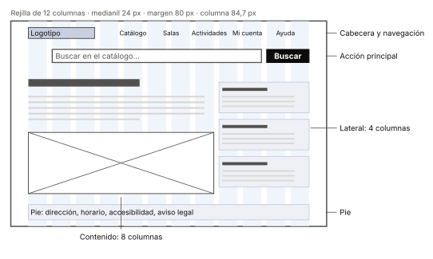
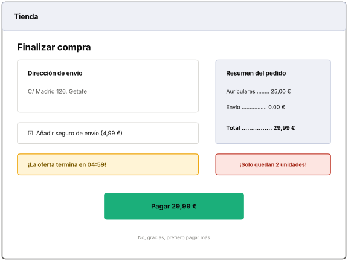

# Tema 7. Esquemas de página en papel y en pantalla {#sec-tema7}

::: {.callout-note appearance="default"}
## Objetivos
- Dibujar esquemas de página a mano y con herramientas digitales.
- Organizar la pantalla con jerarquía visual, rejillas y áreas de contenido.
- Representar la navegación, los formularios y los elementos funcionales.
:::

::: {.callout-note appearance="simple" icon="false"}
## Glosario del tema
[Esquema de página](92-glosario.qmd#gl-wireframe) · [Jerarquía visual](92-glosario.qmd#gl-jerarquia) · [Rejilla](92-glosario.qmd#gl-rejilla) · [Medianil](92-glosario.qmd#gl-medianil) · [Área de contenido](92-glosario.qmd#gl-area) · [Convención](92-glosario.qmd#gl-convencion) · [Anotación](92-glosario.qmd#gl-anotacion)
:::

::: {.callout-tip appearance="simple" icon="false"}
## Descargas
[Script R del capítulo](plantillas/07_wireframes.R){.btn .btn-outline-primary .btn-sm download="07_wireframes.R"}
[Plantillas para esquemas en papel (PDF)](plantillas/plantillas_esquemas.pdf){.btn .btn-outline-primary .btn-sm download="plantillas_esquemas.pdf"}
[Plantilla de entrega del reto (.qmd)](plantillas/entrega_reto.qmd){.btn .btn-outline-primary .btn-sm download="entrega_reto.qmd"}
[Tema de estilo (.scss)](plantillas/informe.scss){.btn .btn-outline-primary .btn-sm download="informe.scss"}
:::

## Lectura obligatoria

::: {.lectura}
Garrett, J. J. (2011). *The elements of user experience: User-centered design for the web and beyond* (2.ª ed.). New Riders. Capítulo dedicado al plano del esqueleto (*skeleton plane*): diseño de la interfaz, de la navegación y de la información.
:::

### Lecturas complementarias {.unnumbered}

- Krug, S. (2006). *Don't make me think!*. New Riders. Por qué las convenciones y la jerarquía visual hacen que una página se entienda de un vistazo.
- Nielsen Norman Group. [F-shaped pattern for reading web content](https://www.nngroup.com/articles/f-shaped-pattern-reading-web-content/). Cómo recorren la vista las páginas con mucho texto.
- Nielsen Norman Group. [Using grids in interface designs](https://www.nngroup.com/articles/using-grids-in-interface-designs/). Rejillas de columnas en interfaces.

## 1. Qué es un esquema de página

Un **esquema de página** (*wireframe*) representa la estructura de una pantalla: qué elementos contiene, dónde están y qué importancia tienen. Deja fuera el estilo visual (color, tipografía definitiva, imágenes) para que la discusión se centre en el contenido y la organización. En el modelo de Garrett (2011), el esquema corresponde al **plano del esqueleto**: el que concreta la estructura antes de llegar a la superficie visual.

Un buen esquema responde a tres preguntas: **qué** hay en la pantalla, **qué es lo más importante** y **qué puede hacer** la persona desde ella.

## 2. En papel y en pantalla

| | En papel | En pantalla (Figma u otra herramienta) |
|---|---|---|
| Velocidad | Máxima: segundos por pantalla | Media: requiere colocar elementos |
| Alternativas | Muchas, fáciles de comparar sobre la mesa | Menos, aunque se duplican fácilmente |
| Precisión | Baja: proporciones aproximadas | Alta: medidas exactas y rejilla |
| Colaboración | Presencial, alrededor de la mesa | Remota y en tiempo real |
| Reutilización | Nula | Componentes reutilizables y prototipo navegable |

La práctica habitual es **empezar en papel** para explorar varias alternativas (de tres a cinco por pantalla clave) y pasar a digital la que se elige. Las plantillas en PDF de este tema traen marcos de móvil y escritorio con una rejilla de puntos.

## 3. Jerarquía visual

La **jerarquía visual** indica qué es más importante. En un esquema se construye sin color, con:

- **Tamaño**: lo más grande se ve primero.
- **Posición**: en las culturas que leen de izquierda a derecha, la parte superior izquierda recibe más atención. En páginas con mucho texto, la mirada suele recorrer un patrón en forma de F.
- **Agrupación y espacio**: los elementos próximos se perciben como relacionados (ley de proximidad de la Gestalt).
- **Contraste de peso**: un bloque relleno destaca frente a uno con solo contorno.

Cada pantalla debería tener **una acción principal** evidente. Si todo destaca, nada destaca.

## 4. Rejillas y áreas de contenido

Una **rejilla** divide el ancho de la pantalla en columnas separadas por **medianiles** (*gutters*) y con márgenes laterales. Los elementos se alinean con las columnas, lo que da orden y coherencia entre pantallas. Las configuraciones habituales son 12 columnas en escritorio, 8 en tableta y 4 en móvil.

El ancho de cada columna es: (ancho total − 2 × margen − (columnas − 1) × medianil) / columnas.

Las **áreas de contenido** son las zonas que se repiten en todas las pantallas: cabecera, navegación principal, contenido, zona lateral y pie. Se dibujan como cajas con su nombre; el contenido de relleno se indica con líneas (texto) o con una caja cruzada por una X (imagen).

{#fig-anatomia fig-alt="Esquema de una página de escritorio en escala de grises sobre doce columnas verticales tenues. Arriba, la cabecera con el logotipo a la izquierda y cinco enlaces de navegación. Debajo, un buscador ancho con un botón destacado. El contenido ocupa ocho columnas con un título, líneas de texto y una imagen cruzada por una X; el lateral ocupa cuatro columnas con tres bloques. Abajo, el pie."}

## 5. Navegación, formularios y elementos funcionales

- **Navegación**: menú principal, migas de pan, pestañas, paginación, barra inferior en móvil. Se representan con su etiqueta real: la etiqueta forma parte de la estructura.
- **Formularios**: una etiqueta visible encima de cada campo (no solo como texto de ayuda dentro del campo), campos agrupados por tema, una sola columna y un botón principal claro. Los campos obligatorios se marcan.
- **Elementos funcionales**: botones, enlaces, buscadores, filtros, avisos. Se distinguen entre sí por la forma, no por el color.

Respetar las **convenciones** (el logotipo lleva al inicio, la lupa es buscar, el carrito está arriba a la derecha) reduce el esfuerzo de las personas: usan lo que ya saben de otros sitios.

## 6. Anotar los esquemas

Un esquema no se explica solo. Las **anotaciones** numeradas al margen explican el comportamiento que no se ve: qué pasa al pulsar, de dónde sale el contenido, qué reglas se aplican, qué ocurre si no hay resultados. Son la base de la documentación que se entregará al equipo de desarrollo en alta fidelidad.

## Práctica en R: calcular una rejilla

`rejilla()` calcula la posición de cada columna; `ancho_bloque()`, el ancho de un bloque que ocupa varias columnas; y `caracteres_por_linea()`, cuántos caracteres caben en una línea (la longitud cómoda de lectura está entre 45 y 75).

```{webr}
#| autorun: true
source("datos/funciones_ux.R")
r <- rejilla(ancho = 1440, columnas = 12, medianil = 24, margen = 80)
attr(r, "ancho_columna")
ancho_bloque(8)                               # el contenido de la figura
caracteres_por_linea(ancho_bloque(8), tamano = 18)
```

### Ejercicio 7.1 {.unnumbered}

En móvil se usan 4 columnas sobre 375 px, con 16 px de medianil y 16 px de margen. ¿Cuánto mide cada columna?

```{webr}
#| exercise: t7_movil
#| setup: true
source("datos/funciones_ux.R")
```

```{webr}
#| exercise: t7_movil
r <- rejilla(ancho = 375, columnas = ______, medianil = 16, margen = 16)
attr(r, "ancho_columna")
```

::: {.hint exercise="t7_movil"}
La rejilla de móvil del enunciado tiene 4 columnas.
:::

::: {.solution exercise="t7_movil"}
```r
r <- rejilla(ancho = 375, columnas = 4, medianil = 16, margen = 16)
attr(r, "ancho_columna")
```
(375 − 32 − 48) / 4 = 73,75 px.
:::

```{webr}
#| exercise: t7_movil
#| check: true
if (isTRUE(all.equal(as.numeric(.result), 73.75))) {
  list(correct = TRUE, message = "Correcto: 73,75 px por columna.")
} else {
  list(correct = FALSE, message = "La rejilla tiene 4 columnas.")
}
```

## Laboratorio: calcula tu rejilla {#lab-t7-rejilla}

::: {.laboratorio}
::: {.laboratorio-etiqueta}
Laboratorio · cálculo en tu navegador
:::

Ajusta la rejilla y mira cuánto mide cada columna y cuántos caracteres caben por línea si el texto ocupa un número de columnas. Una línea cómoda de lectura tiene entre **45 y 75 caracteres**.

```{ojs}
//| echo: false
rango = window.Lab.rango
seleccion = window.Lab.seleccion
viewof r_ancho = rango("Ancho de la pantalla (px)", [320, 1920], {step: 8, value: 1440})
viewof r_cols = rango("Columnas", [2, 16], {step: 1, value: 12})
viewof r_med = rango("Medianil (px)", [8, 48], {step: 4, value: 24})
viewof r_mar = rango("Margen lateral (px)", [16, 200], {step: 8, value: 80})
viewof r_span = rango("Columnas que ocupa el texto", [1, 16], {step: 1, value: 5})
viewof r_tam = rango("Tamaño del texto (px)", [12, 24], {step: 1, value: 16})
```

```{ojs}
//| echo: false
{
  const util = r_ancho - 2 * r_mar, col = (util - (r_cols - 1) * r_med) / r_cols;
  const span = Math.min(r_span, r_cols), bloque = span * col + (span - 1) * r_med;
  const cpl = Math.round(bloque / (r_tam * 0.5));
  const ok = cpl >= 45 && cpl <= 75;
  const esc = 600 / r_ancho;
  const rects = Array.from({length: r_cols}, (_, i) => `<rect x="${(r_mar + i * (col + r_med)) * esc}" y="20" width="${Math.max(col, 0) * esc}" height="110" fill="${i < span ? "#2a78d6" : "#e87ba4"}" fill-opacity="${i < span ? .45 : .2}"/>`).join("");
  const d = html`<div role="status"></div>`;
  d.innerHTML = col <= 0 ? "<p>Con estos valores las columnas no caben: reduce el medianil, el margen o el número de columnas.</p>" :
   `<p>Columna: <strong>${col.toFixed(1)} px</strong> · bloque de texto (${span} columnas): <strong>${bloque.toFixed(0)} px</strong> ·
   unos <strong>${cpl} caracteres por línea</strong> <span class="${ok ? "lab-bien" : "lab-medio"}" style="font-weight:600">${ok ? "· cómodo" : cpl < 45 ? "· demasiado corto" : "· demasiado largo"}</span></p>
   <svg viewBox="0 0 600 140" width="100%" style="max-width:700px" role="img" aria-label="Rejilla de ${r_cols} columnas; el texto ocupa ${span}">
   <rect x="0.5" y="10.5" width="599" height="129" rx="6" fill="none" stroke="currentColor" stroke-opacity=".4"/>${rects}</svg>
   <p class="small">Estimación con 0,5 em por carácter. Con las funciones del libro: <code>rejilla()</code>, <code>ancho_bloque()</code> y <code>caracteres_por_linea()</code>.</p>`;
  return d;
}
```
:::

## Laboratorio: prueba de los cinco segundos {#lab-t7-cinco}

::: {.laboratorio}
::: {.laboratorio-etiqueta}
Laboratorio · se ejecuta en tu navegador
:::

En una **prueba de los cinco segundos** se enseña una pantalla durante cinco segundos y después se pregunta qué se recuerda. Mide si la jerarquía visual comunica lo esencial. Pulsa **Empezar**, mira la pantalla y responde.

```{ojs}
//| echo: false
viewof cinco = {
  const caja = html`<div class="lab-cinco">
    <button type="button" class="btn btn-primary btn-sm">Empezar</button>
    <p class="lab-cuenta" role="status" aria-live="polite"></p>
    
  </div>`;
  const [b, cuenta, img] = [caja.querySelector("button"), caja.querySelector(".lab-cuenta"), caja.querySelector("img")];
  caja.value = 0;
  b.onclick = () => {
    b.disabled = true; img.style.display = "block"; img.alt = "Pantalla de pago de una tienda en línea"; let t = 5;
    cuenta.textContent = `Quedan ${t} segundos`;
    const id = setInterval(() => { t--; cuenta.textContent = t ? `Quedan ${t} segundos` : "Tiempo";
      if (!t) { clearInterval(id); img.style.display = "none"; caja.value++; caja.dispatchEvent(new Event("input", {bubbles: true})); b.disabled = false; b.textContent = "Volver a ver"; } }, 1000);
  };
  return caja;
}
```

```{ojs}
//| echo: false
cinco === 0 ? html`<p class="small">Las preguntas aparecerán cuando termine el tiempo.</p>` : (() => {
  const preguntas = [["¿Qué tipo de pantalla era?", ["Un formulario de registro", "*La pantalla de pago de una tienda", "Un buscador"]],
    ["¿Cuánto había que pagar?", ["25,00 €", "*29,99 €", "4,99 €"]],
    ["¿Recuerdas si había algo añadido además del producto?", ["No había nada más", "*Un seguro de envío marcado", "Un cupón de descuento"]]];
  const d = html`<form class="lab-preguntas"></form>`;
  preguntas.forEach(([q, ops], k) => {
    const fs = html`<fieldset class="mb-2"><legend class="fs-6 fw-semibold">${q}</legend></fieldset>`;
    ops.forEach((o, j) => { const id = `cinco-${k}-${j}`; fs.append(html`<div class="form-check"><input class="form-check-input" type="radio" name="q${k}" id="${id}" value="${o.startsWith("*") ? 1 : 0}"><label class="form-check-label" for="${id}">${o.replace("*", "")}</label></div>`); });
    d.append(fs);
  });
  const res = html`<p role="status"></p>`, b = html`<button type="button" class="btn btn-primary btn-sm">Comprobar</button>`;
  b.onclick = () => { const ok = [0, 1, 2].filter(k => d.querySelector(`input[name=q${k}]:checked`)?.value === "1").length;
    res.textContent = `${ok} de 3. La tercera es la clave: un seguro premarcado que pocas personas recuerdan haber visto es justo lo que busca un patrón engañoso (tema 10).`; };
  d.append(b, res); return d;
})()
```
:::

## Laboratorio: prueba de árbol (*tree testing*) {#lab-t7-arbol}

::: {.laboratorio}
::: {.laboratorio-etiqueta}
Laboratorio · se ejecuta en tu navegador
:::

La **prueba de árbol** evalúa la arquitectura de información sin diseño visual: solo el menú. Tu tarea: **«Quieres saber hasta cuándo puedes quedarte un libro que tienes en préstamo»**. Navega por el menú y pulsa **Lo encontré aquí** cuando creas que has llegado.

```{ojs}
//| echo: false
arbol = ({n: "Inicio", h: [
  {n: "Catálogo", h: [{n: "Búsqueda simple"}, {n: "Búsqueda avanzada"}, {n: "Novedades"}]},
  {n: "Servicios", h: [{n: "Préstamo", h: [{n: "Condiciones del préstamo"}, {n: "Préstamo interbibliotecario"}]}, {n: "Reserva de salas"}, {n: "Formación"}]},
  {n: "Mi cuenta", h: [{n: "Mis préstamos", meta: true}, {n: "Mis reservas"}, {n: "Datos personales"}]},
  {n: "La biblioteca", h: [{n: "Horarios"}, {n: "Sedes"}, {n: "Contacto"}]}]})
viewof prueba_arbol = {
  const caja = html`<div class="lab-arbol"><nav aria-label="Ruta" class="small mb-2"></nav><div class="lab-arbol-opciones d-flex flex-column gap-1 align-items-start"></div>
    <div class="mt-2 d-flex gap-2"><button type="button" class="btn btn-outline-primary btn-sm lab-atras">Atrás</button><button type="button" class="btn btn-primary btn-sm lab-aqui">Lo encontré aquí</button><button type="button" class="btn btn-outline-primary btn-sm lab-reinicio">Empezar de nuevo</button></div>
    <p role="status" class="mt-2 lab-arbol-res"></p></div>`;
  let ruta = [arbol], clics = 0, atras = 0, primero = null;
  const [nav, ops, res] = [caja.querySelector("nav"), caja.querySelector(".lab-arbol-opciones"), caja.querySelector(".lab-arbol-res")];
  const pinta = () => {
    nav.textContent = ruta.map(x => x.n).join(" › ");
    ops.innerHTML = ""; const actual = ruta[ruta.length - 1];
    (actual.h || []).forEach(h => { const b = html`<button type="button" class="btn btn-outline-secondary btn-sm">${h.n}${h.h ? " ›" : ""}</button>`;
      b.onclick = () => { clics++; if (primero === null) primero = h.n; ruta.push(h); pinta(); }; ops.append(b); });
    if (!actual.h) ops.append(html`<p class="small mb-0">(Página final del menú)</p>`);
  };
  caja.querySelector(".lab-atras").onclick = () => { if (ruta.length > 1) { ruta.pop(); atras++; pinta(); } };
  caja.querySelector(".lab-reinicio").onclick = () => { ruta = [arbol]; clics = 0; atras = 0; primero = null; res.textContent = ""; pinta(); };
  caja.querySelector(".lab-aqui").onclick = () => {
    const ok = !!ruta[ruta.length - 1].meta;
    res.textContent = ok ? `Éxito ${atras ? "indirecto" : "directo"}: ${clics} clics${atras ? `, ${atras} vueltas atrás` : ""}. Primer clic: «${primero}».`
      : `No es aquí. En una prueba real contaría como fracaso. Primer clic: «${primero ?? "ninguno"}». Pista: ¿dónde están tus cosas?`;
  };
  pinta(); caja.value = null; return caja;
}
```

En una prueba real se mide con 30 o más personas: **tasa de éxito**, **directividad** (sin volver atrás) y **primer clic**. Si muchas empiezan por «Servicios › Préstamo», quizá la etiqueta engaña o hace falta un enlace también allí.
:::

## Caso práctico resuelto

::: {.callout-note appearance="simple" icon="false"}
## Esquema de la lista de salas, revisado
Primera versión: una lista con foto grande de cada sala. Problemas detectados en revisión: solo caben dos salas en pantalla y la información clave (hora libre, capacidad) queda abajo.

Segunda versión:

- Cabecera fija con la **franja horaria** seleccionada y un filtro de capacidad.
- Cada sala como fila compacta: **nombre**, **capacidad**, **planta** y **horas libres**, con la acción «Reservar» a la derecha.
- Foto solo en el detalle de la sala.

Resultado: seis salas visibles por pantalla y la comparación es inmediata. Las anotaciones del esquema explican el comportamiento (qué pasa al pulsar, qué se ordena primero).
:::

## Ejercicios graduados

**Básico.** Anota el esquema de la lista con cinco comentarios de comportamiento.

::: {.webex-solution boton="Ver solución"}
Ejemplos: orden por disponibilidad más cercana; la fila completa es pulsable; el filtro recuerda la última capacidad; las salas sin disponibilidad se muestran atenuadas al final; tirar hacia abajo actualiza.
:::

**Avanzado.** Dibuja la versión para escritorio de la misma pantalla aprovechando el ancho.

::: {.webex-solution boton="Ver solución"}
Por ejemplo: lista a la izquierda y mapa del edificio a la derecha, sincronizados (al pasar por una sala se resalta en el mapa). La jerarquía debe mantenerse.
:::


## Actividades

::: {.clasificar #ia-t7-elementos titulo="¿Qué elemento del esquema es?" categorias="Navegación|Contenido|Llamada a la acción|Formulario|Información del sistema"}
- Menú principal en la cabecera → Navegación
- Migas de pan («Inicio › Catálogo › Ficha») → Navegación
- Botón «Reservar» destacado → Llamada a la acción
- Campos de nombre y correo → Formulario
- Aviso «Tu sesión caducará en 2 minutos» → Información del sistema
- Resumen y portada del libro → Contenido
:::

::: {.ordenar #ia-t7-jerarquia titulo="Ordena por peso visual (del que más debe destacar al que menos) en la ficha de un libro"}
1. Título del libro
2. Botón «Reservar»
3. Disponibilidad (en estantería o prestado)
4. Datos bibliográficos (autoría, editorial, año)
5. Enlaces a libros relacionados
:::

::: {.callout-warning appearance="simple" icon="false"}
## Errores frecuentes
- **Texto de relleno en todo**: el «lorem ipsum» oculta si la jerarquía funciona con contenidos reales; usa textos realistas en títulos y botones.
- **Ignorar la rejilla** y alinear a ojo.
- **No anotar**: un esquema sin notas deja al equipo adivinando qué hace cada elemento.
- **Diseñar solo para escritorio**: empieza por la pantalla más estrecha.
:::

## Reto evaluable {#reto-t7}

::: {.callout-important appearance="simple" icon="false"}
## Reto del Tema 7 · Del papel a la pantalla
Para las pantallas del flujo principal de tu proyecto (Tema 5):

1. Dibuja en papel **tres alternativas** de la pantalla más importante y explica cuál eliges y por qué.
2. Pasa a digital **todas las pantallas** del flujo principal en escala de grises, sobre una rejilla que documentes (columnas, medianil, margen).
3. Señala en cada pantalla la **acción principal** y cómo la destaca la jerarquía visual.
4. Añade **anotaciones** numeradas con el comportamiento que no se ve.

**Entrega:** un informe hecho con la [plantilla de entrega](plantillas/entrega_reto.qmd) con las fotos de los bocetos y el enlace al archivo digital. Se evalúa con la rúbrica que incluye la plantilla. Este reto **no tiene solución en el libro**: cada estudiante trabaja con un proyecto distinto y la corrección la hace el profesorado.
:::

## Autoevaluación

Responde a todas las preguntas y pulsa **Mostrar respuestas**: verás en verde las acertadas, en rojo las falladas y tu recuento. Puedes corregir y volver a comprobar. No cuenta para la nota.

::: {.webex-check .webex-box}
1. Un esquema de página debe incluir ya los colores definitivos de la marca. 
2. La separación entre columnas de una rejilla se llama 
3. Una rejilla de 1440 px con 12 columnas, 24 px de medianil y 80 px de margen tiene columnas de unos 
4. En un formulario es preferible que la etiqueta de cada campo esté visible encima del campo y no solo dentro como texto de ayuda. 
5. ¿Qué principio explica que los elementos próximos se perciban como relacionados? 
6. ¿Para qué sirven las anotaciones de un esquema?


:::

::: {.webex-solution boton="Ver explicaciones"}
- El color pertenece a la alta fidelidad; el esquema trabaja la estructura.
- Medianil (*gutter*).
- (1440 − 160 − 264) / 12 = 84,7 px.
- La etiqueta dentro del campo desaparece al escribir y obliga a recordar qué se pedía.
- Ley de proximidad de la Gestalt.
- Explican interacciones, reglas y casos especiales.
:::

## Recursos complementarios

| Recurso | Para qué sirve |
|---|---|
| [Nielsen Norman Group – Using grids in interface designs](https://www.nngroup.com/articles/using-grids-in-interface-designs/) | Rejillas en interfaces |
| [Nielsen Norman Group – F-shaped pattern](https://www.nngroup.com/articles/f-shaped-pattern-reading-web-content/) | Patrones de lectura en pantalla |
| [Figma Community](https://www.figma.com/community) | Kits de esquemas de página |
| [Interaction Design Foundation – Wireframes](https://ixdf.org/literature/topics/wireframe) | Introducción y ejemplos |
