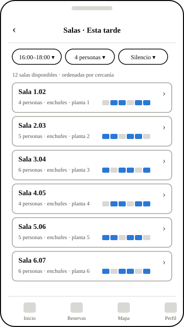
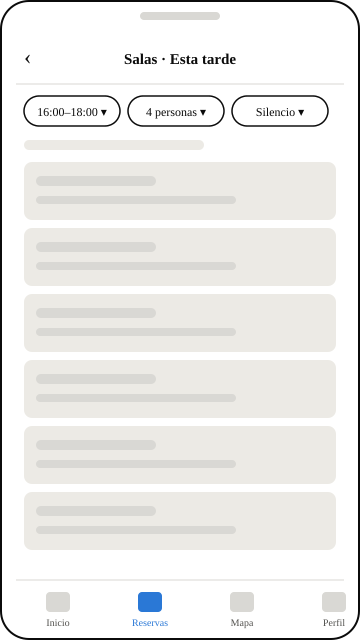
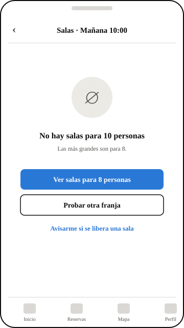
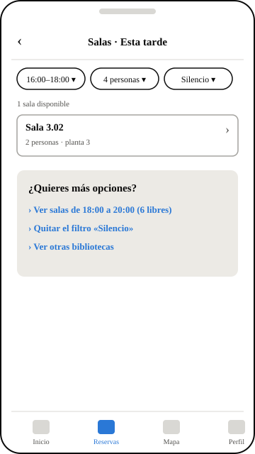
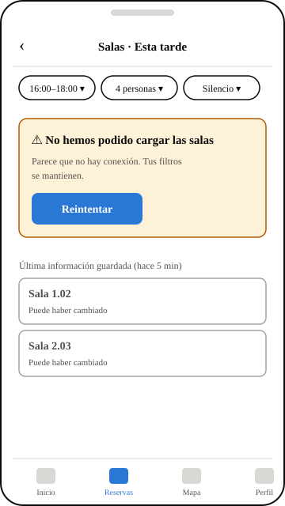

# Tema 8. Estados y transiciones en los esquemas {#sec-tema8}

::: {.callout-note appearance="default"}
## Objetivos
- Identificar los estados de los componentes y de las pantallas.
- Representar transiciones y enlaces entre pantallas.
- Construir esquemas digitales navegables con estados definidos.
:::

::: {.callout-note appearance="simple" icon="false"}
## Glosario del tema
[Estado](92-glosario.qmd#gl-estado) · [Transición](92-glosario.qmd#gl-transicion) · [Diagrama de estados](92-glosario.qmd#gl-diagrama-estados) · [Estado vacío](92-glosario.qmd#gl-vacio) · [Foco](92-glosario.qmd#gl-foco) · [Prototipo navegable](92-glosario.qmd#gl-navegable)
:::

::: {.callout-tip appearance="simple" icon="false"}
## Descargas
[Plantilla de entrega del reto (.qmd)](plantillas/entrega_reto.qmd){.btn .btn-outline-primary .btn-sm download="entrega_reto.qmd"}
[Tema de estilo (.scss)](plantillas/informe.scss){.btn .btn-outline-primary .btn-sm download="informe.scss"}
:::

## Lectura obligatoria

::: {.lectura}
Harel, D. (1987). [Statecharts: A visual formalism for complex systems](https://doi.org/10.1016/0167-6423(87)90035-9). *Science of Computer Programming*, 8(3), 231-274. Lee la introducción y los primeros ejemplos: son el origen de la notación de estados que se usa hoy en diseño de interacción.
:::

### Lecturas complementarias {.unnumbered}

- Cooper, A. (2014). *About face: The essentials of interaction design*. Wiley. Capítulos sobre el comportamiento de los controles y la retroalimentación.
- Nielsen Norman Group. [Wireflows](https://www.nngroup.com/articles/wireflows/). Representar estados y transiciones con esquemas.

## 1. Una pantalla no es una imagen fija

Un esquema dibuja una pantalla en un instante, pero la interfaz cambia: un botón se pulsa, una lista se carga, un formulario muestra un error. Cada situación distinta es un **estado**, y el paso de uno a otro es una **transición**. Diseñar solo el estado ideal (la pantalla llena de datos perfectos) deja sin resolver la mayor parte de lo que vivirá la persona.

## 2. Estados de los componentes

Los controles interactivos tienen estados que hay que diseñar y distinguir:

| Estado | Cuándo ocurre | Qué debe comunicar |
|---|---|---|
| Reposo | Por defecto | Que se puede usar |
| *Hover* | El puntero está encima (no existe en pantallas táctiles) | Que responde a la acción |
| **Foco** | Se ha llegado con el teclado (tabulador) | Dónde está el usuario: **imprescindible** para la accesibilidad |
| Pulsado o activo | Mientras se pulsa | Que la acción se ha recibido |
| Seleccionado | En casillas, pestañas, filtros | Qué opción está elegida |
| Desactivado | La acción no está disponible | Que no se puede usar, y a ser posible por qué |
| Cargando | La acción está en curso | Que hay que esperar |

En baja fidelidad no se diseña el aspecto final de cada estado, pero sí se decide **qué estados existen** y se indican con anotaciones o con variantes simples (contorno grueso para el foco, trama para el desactivado).

## 3. Estados de las pantallas

Una pantalla que muestra datos tiene, como mínimo, estos estados:

- **Vacío**: todavía no hay contenido (primera visita, búsqueda sin resultados). Es una oportunidad para orientar: qué hacer a continuación.
- **Cargando**: el contenido está llegando. Si tarda, conviene mostrar su estructura.
- **Parcial**: hay poco contenido, que puede verse descompensado.
- **Error**: algo ha fallado. Hay que explicar qué y cómo seguir.
- **Ideal**: el contenido esperado.

La misma pantalla de ReservaSala, la lista de salas, en sus cinco estados:

::: {.panel-tabset}

### Ideal

::: {layout="[40,60]"}
{fig-alt="Esquema de la lista de salas con filtros y seis salas con su capacidad y disponibilidad."}

El estado que se suele dibujar primero… y el único que muchos equipos dibujan. Muestra el contenido esperado con los filtros aplicados.
:::

### Cargando

::: {layout="[40,60]"}
{fig-alt="Esquema de la lista en estado de carga: los filtros visibles y seis bloques grises con la forma de las tarjetas, sin texto."}

Una **pantalla esqueleto** muestra la estructura mientras llegan los datos: la persona sabe qué va a ver y la espera parece más corta. Los filtros ya funcionan. Si la carga pasa de unos segundos, añade un mensaje.
:::

### Vacío

::: {layout="[40,60]"}
{fig-alt="Esquema de estado vacío con un símbolo, el texto No hay salas para 10 personas, la explicación de que las más grandes son para 8 y alternativas."}

El estado vacío **explica por qué** no hay resultados y **qué hacer**: no es un callejón sin salida.
:::

### Parcial

::: {layout="[40,60]"}
{fig-alt="Esquema con un solo resultado, Sala 3.02, y debajo el bloque ¿Quieres más opciones? con tres enlaces: otra franja con 6 salas libres, quitar el filtro Silencio y ver otras bibliotecas."}

Con poco contenido la pantalla parece rota. Aprovecha el espacio para **ampliar la búsqueda** con sugerencias concretas, que digan cuántos resultados darán.
:::

### Error

::: {layout="[40,60]"}
{fig-alt="Esquema de error con un aviso naranja No hemos podido cargar las salas, explicación de la falta de conexión, botón Reintentar y dos salas de la última información guardada marcadas como Puede haber cambiado."}

El mensaje dice **qué ha pasado** en lenguaje de la persona, **conserva** sus filtros y ofrece **cómo seguir** (reintentar). Mostrar los últimos datos guardados, avisando de que pueden haber cambiado, es mejor que una pantalla en blanco.
:::

:::

::: {.column-margin}
**Pantallas esqueleto.** Indican la estructura sin prometer contenido concreto. No las uses para cargas muy rápidas (menos de 1 s): el parpadeo molesta más que la espera.
:::

## 4. Diagramas de estados

Harel (1987) propuso los ***statecharts***, una notación para describir sistemas que cambian de estado según los eventos. En diseño de interacción se usa una versión simplificada: cada estado es una caja con nombre, cada transición es una flecha con el **evento** que la provoca y, si hace falta, la **condición**. Sirve para comprobar que no falta ningún caso: ¿qué pasa si se pulsa «Reservar» dos veces?, ¿y si se pierde la conexión mientras se carga?

{#fig-estados fig-alt="Cinco cajas redondeadas unidas por flechas rotuladas. Reposo pasa a Cargando con el evento pulsar. Cargando pasa a Confirmado con reserva correcta y a Error con sala ocupada. Error vuelve a Reposo con elegir otra sala. Una flecha que sale y vuelve a Cargando indica que una segunda pulsación se ignora. Reposo pasa a Desactivado si no hay sala elegida."}

## 5. Transiciones y enlaces entre pantallas

Las **transiciones** entre pantallas comunican la relación entre ellas: avanzar en un proceso, abrir un detalle, volver. En baja fidelidad basta con decidir y anotar:

- **Qué desencadena** la transición (pulsar, deslizar, enviar, tiempo).
- **Adónde lleva** y si se puede volver.
- **Qué se conserva** (los datos del formulario, la posición en la lista).

En un **prototipo navegable** digital, cada elemento interactivo se enlaza con la pantalla o el estado al que lleva. Para probar un flujo bastan los enlaces del camino principal y de los errores que interesa observar; no hace falta enlazar todo.

## Práctica

Elige un formulario de una web que uses (por ejemplo, la inscripción en una actividad). Dibuja su diagrama de estados: estados del botón de envío y de la pantalla, con los eventos y las condiciones. Busca al menos un caso que el formulario real no resuelva bien.

## Caso práctico resuelto

::: {.callout-note appearance="simple" icon="false"}
## Todos los estados de una pantalla
La lista de salas no tiene un solo aspecto. Estados que hay que esquematizar:

| Estado | Qué ve el usuario |
|---|---|
| **Cargando** | Esqueleto de filas grises |
| **Vacío** | «No hay salas libres en esta franja», con franjas alternativas |
| **Error** | «No se pudo cargar la disponibilidad», con «Reintentar» |
| **Parcial** | Pocas salas: se sugiere ampliar la franja |
| **Ideal** | La lista completa |

Olvidar estos estados es uno de los fallos más frecuentes: el equipo de desarrollo los resuelve improvisando.
:::

## Ejercicios graduados

**Básico.** Escribe el texto del estado vacío para un usuario que filtra salas para diez personas.

::: {.webex-solution boton="Ver solución"}
Ejemplo: «No hay salas para 10 personas libres esta tarde. Las más grandes son para 8. ¿Quieres ver salas para 8 o probar otra franja?». Explica el motivo y ofrece salidas.
:::

**Avanzado.** Dibuja la transición entre el estado «Cargando» y el «Ideal» con un diagrama de estados.

::: {.webex-solution boton="Ver solución"}
Estados: Cargando → (éxito) Ideal / Parcial / Vacío; Cargando → (fallo) Error → (Reintentar) Cargando. Cada flecha indica el evento que provoca el cambio.
:::

## Actividades

::: {.clasificar #ia-t8-estados titulo="¿En qué estado está la pantalla?" categorias="Vacío|Cargando|Error|Parcial|Completo"}
- «Todavía no tienes ningún préstamo. Busca en el catálogo para empezar.» → Vacío
- Tres tarjetas grises animadas mientras llegan los resultados → Cargando
- «No hemos podido conectar. Comprueba tu conexión y vuelve a intentarlo.» → Error
- Se muestran 2 de los 5 préstamos; el resto sigue llegando → Parcial
- La lista con los cinco préstamos y sus fechas → Completo
:::

::: {.clasificar #ia-t8-componentes titulo="¿Qué estado del botón «Reservar» es?" categorias="Reposo|Foco|Pulsado|Desactivado|Cargando"}
- Borde marcado al llegar con el tabulador → Foco
- Color más oscuro mientras se mantiene presionado → Pulsado
- Gris y sin respuesta porque el libro no se puede reservar → Desactivado // Explica por qué está desactivado.
- Un indicador giratorio en lugar del texto → Cargando
- Aspecto normal, a la espera → Reposo
:::

::: {.escenario #ia-t8-error titulo="Diseña el estado de error"}
Estás diseñando qué pasa cuando falla la renovación de un préstamo.

### Primer borrador {#t8e-inicio}
¿Qué mensaje pones?

- [«Error.»](#t8e-vago)
- [«No se ha podido renovar: el libro tiene una reserva de otra persona. Devuélvelo antes del 02/12 o habla con el mostrador.»](#t8e-bueno)
- [«Error 409: conflicto en la transacción.»](#t8e-tecnico)

### Demasiado vago {#t8e-vago .final .mal}
No explica qué ha pasado ni qué hacer: la persona queda bloqueada (heurística 9).

### Demasiado técnico {#t8e-tecnico .final .regular}
Es preciso para el equipo de desarrollo, pero no para quien usa el servicio. Traduce el código a una causa y una salida.

### Mensaje útil {#t8e-bueno}
Bien: dice qué ha pasado, por qué y qué hacer. ¿Dónde lo colocas?

- [En una ventana emergente que tapa la lista](#t8e-modal)
- [Junto al préstamo afectado, sin perder el resto de la lista](#t8e-junto)

### Interrumpe demasiado {#t8e-modal .final .regular}
Una ventana modal obliga a cerrarla y oculta el contexto. Resérvala para errores que bloquean todo.

### Error en su sitio {#t8e-junto .final .bien}
El mensaje aparece donde está el problema, con una salida clara, y la persona puede seguir con los demás préstamos.
:::

## Reto evaluable {#reto-t8}

::: {.callout-important appearance="simple" icon="false"}
## Reto del Tema 8 · Prototipo navegable con estados
A partir de los esquemas digitales del reto del Tema 7:

1. Dibuja el **diagrama de estados** de la pantalla más compleja del flujo principal.
2. Diseña sus estados **vacío, cargando, error e ideal**, y los estados de foco y desactivado de sus controles.
3. Enlaza las pantallas en un **prototipo navegable** que recorra el flujo principal y al menos uno de error.
4. Documenta las transiciones: qué las desencadena, adónde llevan y qué se conserva.

**Entrega:** un informe hecho con la [plantilla de entrega](plantillas/entrega_reto.qmd) con el diagrama y el enlace al prototipo navegable. Se evalúa con la rúbrica que incluye la plantilla. Este reto **no tiene solución en el libro**: cada estudiante trabaja con un proyecto distinto y la corrección la hace el profesorado.
:::

## Autoevaluación

Responde a todas las preguntas y pulsa **Mostrar respuestas**: verás en verde las acertadas, en rojo las falladas y tu recuento. Puedes corregir y volver a comprobar. No cuenta para la nota.

::: {.webex-check .webex-box}
1. El estado *hover* existe también en las pantallas táctiles. 
2. El estado que indica dónde está quien navega con el teclado se llama 
3. Una búsqueda sin resultados muestra el estado 
4. En un diagrama de estados, las flechas se rotulan con el evento que provoca la transición. 
5. ¿Qué notación propuso Harel en 1987 para describir sistemas que cambian de estado? 
6. ¿Qué conviene hacer con el botón «Reservar» mientras la reserva se está procesando?


:::

::: {.webex-solution boton="Ver explicaciones"}
- Sin puntero no hay *hover*: no se puede confiar en él para comunicar nada esencial.
- Sin un foco visible, el teclado no sirve.
- El estado vacío aparece cuando no hay contenido que mostrar.
- El evento (y la condición, si la hay) explica por qué cambia el estado.
- Los *statecharts* son la base de los diagramas de estados actuales.
- Así se evitan reservas duplicadas y se informa de que hay que esperar.
:::

## Recursos complementarios

| Recurso | Para qué sirve |
|---|---|
| [Nielsen Norman Group – Wireflows](https://www.nngroup.com/articles/wireflows/) | Estados y transiciones con esquemas |
| [W3C – Understanding SC 2.4.7: Focus visible](https://www.w3.org/WAI/WCAG22/Understanding/focus-visible.html) | Por qué el foco debe verse |
| [Figma – Guide to prototyping](https://help.figma.com/hc/en-us/articles/360040314193-Guide-to-prototyping-in-Figma) | Enlazar pantallas y estados |
