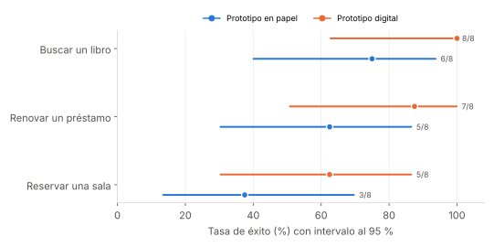

# Tema 9. Prototipos en papel: técnicas y validación temprana {#sec-tema9}

::: {.callout-note appearance="default"}
## Objetivos
- Construir prototipos en papel que se puedan manipular durante una prueba.
- Planificar y dirigir una sesión de prueba con usuarios.
- Analizar los resultados y decidir qué cambiar en la siguiente iteración.
:::

::: {.callout-note appearance="simple" icon="false"}
## Glosario del tema
[Prototipo en papel](92-glosario.qmd#gl-papel) · [Facilitador](92-glosario.qmd#gl-facilitador) · [«Ordenador humano»](92-glosario.qmd#gl-ordenador) · [Pensamiento en voz alta](92-glosario.qmd#gl-voz-alta) · [Escenario de tarea](92-glosario.qmd#gl-escenario-tarea) · [Prueba de usabilidad](92-glosario.qmd#gl-prueba)
:::

::: {.callout-tip appearance="simple" icon="false"}
## Descargas
[Script R del capítulo](plantillas/09_prototipos_papel.R){.btn .btn-outline-primary .btn-sm download="09_prototipos_papel.R"}
[Plantillas para esquemas en papel (PDF)](plantillas/plantillas_esquemas.pdf){.btn .btn-outline-primary .btn-sm download="plantillas_esquemas.pdf"}
[Plantilla de entrega del reto (.qmd)](plantillas/entrega_reto.qmd){.btn .btn-outline-primary .btn-sm download="entrega_reto.qmd"}
[Tema de estilo (.scss)](plantillas/informe.scss){.btn .btn-outline-primary .btn-sm download="informe.scss"}
:::

## Lectura obligatoria

::: {.lectura}
Rettig, M. (1994). [Prototyping for tiny fingers](https://doi.org/10.1145/175276.175288). *Communications of the ACM*, 37(4), 21-27.
:::

### Lecturas complementarias {.unnumbered}

- Virzi, R. A.; Sokolov, J. L.; Karis, D. (1996). [Usability problem identification using both low- and high-fidelity prototypes](https://doi.org/10.1145/238386.238516). En *CHI '96* (pp. 236-243). ACM. Los prototipos en papel detectan problemas similares a los de alta fidelidad.
- Nielsen, J.; Landauer, T. K. (1993). [A mathematical model of the finding of usability problems](https://doi.org/10.1145/169059.169166). En *CHI '93* (pp. 206-213). ACM. El modelo detrás de la recomendación de probar con pocas personas y repetir.
- Nielsen Norman Group. [Paper prototyping: Getting user data before you code](https://www.nngroup.com/articles/paper-prototyping/). Guía práctica.

## 1. Por qué probar en papel

Rettig (1994) defendía en «Prototyping for tiny fingers» que construir prototipos en papel permite probar un diseño **antes de escribir una línea de código**, con un coste tan bajo que se pueden hacer varias rondas en un día. Al ver que el prototipo es provisional, las personas critican con más libertad, y el equipo, al no haber invertido mucho, acepta mejor los cambios. Virzi et al. (1996) mostraron que los problemas de usabilidad detectados con prototipos de baja fidelidad son en gran parte los mismos que con alta fidelidad.

## 2. Construir el prototipo

Materiales: papel o cartulina, rotuladores de dos grosores, notas adhesivas, tijeras, celo y, si se quiere, láminas de acetato para escribir encima. Las plantillas en PDF de este libro sirven como marcos de pantalla.

- Una hoja por pantalla, a escala aproximada.
- Las partes que cambian (menús desplegables, mensajes de error, listas de resultados) se dibujan **en piezas sueltas** que se colocan encima.
- Los campos de texto se cubren con acetato o notas para que la persona escriba.
- Se preparan **todos los estados** que pueden aparecer en las tareas (Tema 8), incluidos los errores.

## 3. Roles en la sesión

| Rol | Qué hace |
|---|---|
| **Facilitador** | Presenta la sesión, lee las tareas, pide que la persona piense en voz alta y mantiene la neutralidad |
| **«Ordenador humano»** | Cambia las hojas y piezas según lo que la persona «pulsa», sin hablar ni explicar |
| **Observadores** | Anotan lo que ocurre: dónde dudan, qué dicen, qué errores cometen |

El ordenador humano solo responde a lo que la persona hace, como lo haría el sistema. Si la persona pregunta, el facilitador devuelve la pregunta: «¿Qué crees que pasaría?».

## 4. Planificar la sesión

1. **Objetivo**: qué queremos averiguar (las hipótesis del Tema 3).
2. **Participantes**: personas que se parezcan a las usuarias reales. Nielsen y Landauer (1993) mostraron que con unas **cinco** personas aparecen la mayoría de los problemas más frecuentes, y que es más rentable hacer varias rondas pequeñas que una grande.
3. **Escenarios de tarea**: situaciones realistas que dan un objetivo sin decir cómo conseguirlo. Mal: «Pulsa en Reservas y elige la sala 3». Bien: «Mañana tienes que preparar un trabajo con dos compañeros por la tarde. Busca un sitio donde podáis hablar».
4. **Guion**: bienvenida y consentimiento, explicación de que se prueba el diseño y no a la persona, tareas, preguntas finales.
5. **Registro**: para cada tarea, si se completa, cuánto tarda (aproximado), errores y comentarios.

Durante la sesión se pide a la persona que **piense en voz alta**: que diga lo que busca, lo que espera y lo que le sorprende. Es la técnica más útil de la usabilidad, porque revela el porqué de los errores.

## 5. Analizar y decidir

Después de cada ronda, el equipo junta las observaciones, agrupa los problemas y los prioriza por gravedad y frecuencia (como en la revisión heurística del Tema 2). Los cambios se hacen **en el momento**, en el propio papel, y se prueban con la siguiente persona. Las métricas del Tema 4 (tasa de éxito con intervalo, tiempo típico) sirven para comparar rondas, siempre recordando su incertidumbre.

{#fig-exito fig-alt="Gráfico de puntos con barras de error para tres tareas, con dos series: papel y digital. Buscar un libro: papel 75 %, digital 100 %. Renovar un préstamo: papel 62,5 %, digital 87,5 %. Reservar una sala: papel 37,5 %, digital 62,5 %. Las barras de error son anchas y se solapan en todas las tareas."}

## Práctica en R: comparar dos prototipos

`sesiones_prueba` (datos simulados) recoge, para 8 participantes, si completaron cada tarea con un prototipo en papel y con uno digital de baja fidelidad.

```{webr}
#| autorun: true
source("datos/funciones_ux.R")
aggregate(exito ~ prototipo + tarea, data = sesiones_prueba, FUN = sum)
```

### Ejercicio 9.1 {.unnumbered}

Calcula la tasa de éxito con intervalo de confianza de la tarea «Reservar una sala» con el prototipo **digital**.

```{webr}
#| exercise: t9_reservar
#| setup: true
source("datos/funciones_ux.R")
```

```{webr}
#| exercise: t9_reservar
d <- subset(sesiones_prueba, prototipo == "______" & tarea == "Reservar una sala")
tasa_exito(sum(d$exito), nrow(d))
```

::: {.hint exercise="t9_reservar"}
Los valores de la columna `prototipo` son «papel» y «digital».
:::

::: {.solution exercise="t9_reservar"}
```r
d <- subset(sesiones_prueba, prototipo == "digital" & tarea == "Reservar una sala")
tasa_exito(sum(d$exito), nrow(d))
```
5 de 8 (62,5 %), con un intervalo aproximado del 30 % al 87 %. El intervalo es tan ancho que no permite afirmar que el digital sea mejor que el papel (37,5 %): los dos intervalos se solapan. Lo que sí dicen los datos es que la tarea tiene problemas en los dos.
:::

```{webr}
#| exercise: t9_reservar
#| check: true
esperado <- tasa_exito(5, 8)
if (isTRUE(all.equal(unname(as.numeric(.result)), unname(as.numeric(esperado))))) {
  list(correct = TRUE, message = "Correcto: 5 de 8, con un intervalo muy ancho.")
} else {
  list(correct = FALSE, message = "Filtra el prototipo \"digital\".")
}
```

### Ejercicio 9.2 {.unnumbered}

Calcula el **tiempo típico** (media geométrica) de la tarea «Renovar un préstamo» con el prototipo en papel.

```{webr}
#| exercise: t9_tiempo
#| setup: true
source("datos/funciones_ux.R")
```

```{webr}
#| exercise: t9_tiempo
d <- subset(sesiones_prueba, prototipo == "papel" & tarea == "Renovar un préstamo")
______(d$tiempo_s)
```

::: {.hint exercise="t9_tiempo"}
La función del libro para la media geométrica es `tiempo_tipico()`.
:::

::: {.solution exercise="t9_tiempo"}
```r
d <- subset(sesiones_prueba, prototipo == "papel" & tarea == "Renovar un préstamo")
tiempo_tipico(d$tiempo_s)
```
Unos 65 segundos. En papel los tiempos son orientativos, porque dependen de la rapidez del «ordenador humano»: sirven más para comparar tareas que para fijar objetivos.
:::

```{webr}
#| exercise: t9_tiempo
#| check: true
d <- subset(sesiones_prueba, prototipo == "papel" & tarea == "Renovar un préstamo")
if (isTRUE(all.equal(as.numeric(.result), tiempo_tipico(d$tiempo_s)))) {
  list(correct = TRUE, message = paste0("Correcto: ", round(as.numeric(.result)), " segundos."))
} else {
  list(correct = FALSE, message = "Usa tiempo_tipico() con la columna tiempo_s.")
}
```

## Reto evaluable {#reto-t9}

::: {.callout-important appearance="simple" icon="false"}
## Reto del Tema 9 · Prueba con un prototipo en papel
Con el flujo principal de tu proyecto:

1. Construye un **prototipo en papel** con todas las pantallas y estados necesarios para dos tareas. Fotografíalo.
2. Prepara el **plan de la sesión**: objetivo, perfil de participantes, dos escenarios de tarea y guion.
3. Haz la prueba con **tres personas** de tu entorno (compañeros de otro equipo, por ejemplo) y registra éxito, tiempo aproximado, errores y comentarios.
4. Calcula la **tasa de éxito con intervalo** de cada tarea y prioriza los problemas encontrados.
5. Indica **qué cambias** en el prototipo y por qué.

**Entrega:** un informe hecho con la [plantilla de entrega](plantillas/entrega_reto.qmd). No incluyas datos personales de los participantes. Se evalúa con la rúbrica que incluye la plantilla. Este reto **no tiene solución en el libro**: cada estudiante trabaja con un proyecto distinto y la corrección la hace el profesorado.
:::

## Autoevaluación

Responde a todas las preguntas y pulsa **Mostrar respuestas**: verás en verde las acertadas, en rojo las falladas y tu recuento. Puedes corregir y volver a comprobar. No cuenta para la nota.

::: {.webex-check .webex-box}
1. En una prueba en papel, el «ordenador humano» explica a la persona qué hace cada botón. 
2. Pedir a la persona que diga lo que busca, espera y le sorprende es la técnica de 
3. Según Nielsen y Landauer, es más rentable hacer varias rondas pequeñas que una sola con muchas personas. 
4. ¿Cuál es un buen escenario de tarea?



5. Los mensajes de error y los desplegables se preparan como 
6. En la práctica, con 5 de 8 éxitos en digital y 3 de 8 en papel, se puede afirmar que el prototipo digital es mejor. 
:::

::: {.webex-solution boton="Ver explicaciones"}
- Solo reacciona a lo que hace la persona, como lo haría el sistema.
- El pensamiento en voz alta revela el porqué de los errores.
- Cada ronda corrige problemas y la siguiente descubre otros nuevos.
- Da un objetivo realista sin indicar el camino.
- Las piezas sueltas permiten cambiar solo lo que cambia en la pantalla.
- Los intervalos se solapan: con 8 personas, la diferencia puede deberse al azar.
:::

## Recursos complementarios

| Recurso | Para qué sirve |
|---|---|
| [Nielsen Norman Group – Paper prototyping](https://www.nngroup.com/articles/paper-prototyping/) | Guía y vídeo |
| [Nielsen Norman Group – Thinking aloud](https://www.nngroup.com/articles/thinking-aloud-the-1-usability-tool/) | La técnica del pensamiento en voz alta |
| [Nielsen Norman Group – Why you only need to test with 5 users](https://www.nngroup.com/articles/why-you-only-need-to-test-with-5-users/) | El argumento de las rondas pequeñas |
