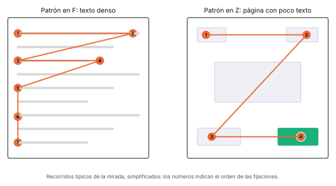

# Tema 11. Economía de la atención y bienestar digital {#sec-tema11}

::: {.callout-note appearance="default"}
## Objetivos
- Entender por qué la atención se ha convertido en un recurso económico.
- Reconocer los mecanismos de diseño que captan y retienen la atención.
- Aplicar criterios de diseño que respeten el tiempo y el bienestar de las personas.
:::

::: {.callout-note appearance="simple" icon="false"}
## Glosario del tema
[Economía de la atención](92-glosario.qmd#gl-economia-atencion) · [Métrica de implicación](92-glosario.qmd#gl-implicacion) · [Refuerzo intermitente](92-glosario.qmd#gl-refuerzo) · [Desplazamiento infinito](92-glosario.qmd#gl-infinito) · [Señal de parada](92-glosario.qmd#gl-parada) · [Bienestar digital](92-glosario.qmd#gl-bienestar)
:::

::: {.callout-tip appearance="simple" icon="false"}
## Descargas
[Plantilla de entrega del reto (.qmd)](plantillas/entrega_reto.qmd){.btn .btn-outline-primary .btn-sm download="entrega_reto.qmd"}
[Tema de estilo (.scss)](plantillas/informe.scss){.btn .btn-outline-primary .btn-sm download="informe.scss"}
:::

## Lectura obligatoria

::: {.lectura}
Williams, J. (2018). [*Stand out of our light: Freedom and resistance in the attention economy*](https://doi.org/10.1017/9781108453004). Cambridge University Press. Libro en acceso abierto: lee la primera parte.
:::

### Lecturas complementarias {.unnumbered}

- Mathur, A. et al. (2019). [Dark patterns at scale](https://doi.org/10.1145/3359183). *Proceedings of the ACM on Human-Computer Interaction*, 3(CSCW). Urgencia y escasez como técnicas para captar la atención y precipitar decisiones.
- Center for Humane Technology. [Recursos para tecnología humana](https://www.humanetech.com/). Materiales sobre diseño que respeta la atención.

## 1. La atención como recurso escaso

Herbert Simon advirtió en 1971 que la abundancia de información crea pobreza de atención: cuanta más información compite por nosotros, más valiosa se vuelve la atención que podemos darle. Muchos servicios digitales gratuitos se financian con publicidad, y la publicidad se vende por la atención que se consigue: cuanto más tiempo y más a menudo se usa el servicio, más ingresos. Ese es el núcleo de la **economía de la atención**.

Williams (2018), que trabajó en publicidad en Google antes de dedicarse a la filosofía, sostiene que el problema no es solo de productividad. Las tecnologías optimizadas para captar la atención pueden apartar a las personas de sus propios objetivos, de lo que ellas mismas querrían hacer con su tiempo.

## 2. Las métricas que dirigen el diseño

Lo que se mide se optimiza. Si el éxito de un producto se mide con **métricas de implicación** (tiempo de uso, sesiones al día, desplazamiento), el diseño evoluciona hacia lo que las aumenta, aunque no ayude a la persona. Una aplicación de biblioteca que «tiene éxito» porque la gente pasa más tiempo buscando probablemente está fallando: lo deseable es que encuentren rápido lo que necesitan.

Por eso, al definir las métricas de un proyecto (Tema 4), conviene preguntar si miden el **valor para la persona** (éxito en la tarea, satisfacción) o solo su **tiempo**.

## 3. Mecanismos de captación

| Mecanismo | Cómo funciona |
|---|---|
| **Desplazamiento infinito** | Elimina el final de la página: no hay un punto natural en el que parar |
| **Reproducción automática** | El siguiente contenido empieza solo; parar exige actuar |
| **Refuerzo intermitente** | Recompensas impredecibles (al actualizar, a veces hay algo nuevo), el mecanismo más difícil de abandonar |
| **Notificaciones** | Interrumpen desde fuera para devolver a la persona al producto |
| **Rachas y contadores** | Convierten el uso diario en algo que no se quiere «perder» (aversión a la pérdida, Tema 10) |
| **Reciprocidad social** | «Te ha escrito», «ha visto tu mensaje»: obligan a responder |

Muchos de estos mecanismos aprovechan los mismos sesgos que los patrones engañosos. La diferencia es de grado y de intención, y no siempre es nítida.

## 4. Diseñar para el bienestar digital

Diseñar a favor de la atención de las personas no significa diseñar productos aburridos, sino **alineados con sus objetivos**:

- **Señales de parada**: un final visible de la lista, un resumen al terminar, paginación en lugar de desplazamiento infinito cuando la tarea es encontrar.
- **Control de las interrupciones**: notificaciones agrupadas, configurables y desactivadas por defecto salvo las imprescindibles.
- **Valores por defecto protectores**: sin reproducción automática, sin rachas.
- **Transparencia**: mostrar el tiempo de uso si la persona lo pide, explicar por qué se recomienda algo.
- **Éxito definido por la tarea**: medir si la persona consiguió lo que quería y cuánto tardó.
- **Atención a los menores y a las personas más vulnerables**, para quienes estos mecanismos tienen más efecto.

En la Unión Europea, el Reglamento de Servicios Digitales obliga a las plataformas y buscadores de muy gran tamaño a evaluar y mitigar los riesgos sistémicos de sus servicios, entre ellos los efectos negativos sobre el bienestar físico y mental de las personas, y exige medidas de protección de los menores en todas las plataformas.

## Práctica

Elige una aplicación que uses a diario y activa durante un día su contador de tiempo de uso (o el del sistema operativo). Anota cada vez que la abres **sin haberlo decidido** y qué te llevó a hacerlo. Identifica qué mecanismos del apartado 3 intervienen.

{#fig-t11-patrones fig-alt="Dos esquemas de página. A la izquierda, líneas de texto con siete fijaciones numeradas que forman una F: dos barridos horizontales arriba y un descenso por el margen izquierdo. A la derecha, una página con logotipo, menú, imagen central, texto y un botón verde, con cuatro fijaciones que forman una Z."}

## Laboratorio: mapa de calor simulado {#lab-t11-calor}

::: {.laboratorio}
::: {.laboratorio-etiqueta}
Laboratorio · datos simulados (no son medidas reales)
:::

Los **mapas de calor** de un estudio de seguimiento ocular (*eye tracking*) acumulan las fijaciones de muchas personas. Este laboratorio **simula** fijaciones a partir de los patrones en F y en Z para que veas cómo se forman: elige el tipo de página y el número de personas.

```{ojs}
//| echo: false
rango = window.Lab.rango
seleccion = window.Lab.seleccion
viewof c_tipo = seleccion("Tipo de página", [["F", "Texto denso (patrón en F)"], ["Z", "Poco texto (patrón en Z)"]], {value: "F"})
viewof c_n = rango("Personas simuladas", [1, 60], {step: 1, value: 20})
```

```{ojs}
//| echo: false
{
  const W = 480, H = 320, cv = document.createElement("canvas"); cv.width = W; cv.height = H;
  cv.style.maxWidth = "100%"; cv.setAttribute("role", "img");
  cv.setAttribute("aria-label", `Mapa de calor simulado de ${c_n} personas sobre una página ${c_tipo === "F" ? "de texto denso: el calor se concentra arriba y en el margen izquierdo" : "con poco texto: el calor se reparte en las cuatro esquinas, siguiendo una Z"}`);
  const g = cv.getContext("2d");
  g.fillStyle = "#fff"; g.fillRect(0, 0, W, H); g.fillStyle = "#d9d8d4";
  if (c_tipo === "F") for (let i = 0; i < 11; i++) g.fillRect(30, 30 + i * 25, 420 - (i % 3) * 80, 8);
  else { [[30, 25, 90, 35], [350, 25, 100, 35], [110, 100, 260, 110], [30, 250, 140, 45], [300, 250, 150, 45]].forEach(r => g.fillRect(...r)); }
  let s = 5; const rnd = () => (s = (s * 9301 + 49297) % 233280) / 233280;
  const gauss = () => Math.sqrt(-2 * Math.log(rnd() + 1e-9)) * Math.cos(2 * Math.PI * rnd());
  const base = c_tipo === "F" ? [[40, 34], [200, 34], [380, 34], [40, 84], [180, 84], [300, 84], [40, 134], [40, 184], [40, 234], [40, 284]]
                              : [[70, 42], [400, 42], [240, 155], [100, 272], [375, 272]];
  const pts = [];
  for (let p = 0; p < c_n; p++) base.forEach(([x, y], k) => { if (rnd() < (c_tipo === "F" ? 1 - k * 0.06 : 0.9)) pts.push([x + gauss() * 18, y + gauss() * 10]); });
  const capa = document.createElement("canvas"); capa.width = W; capa.height = H; const c = capa.getContext("2d");
  pts.forEach(([x, y]) => { const r = c.createRadialGradient(x, y, 0, x, y, 30); r.addColorStop(0, "rgba(0,0,0,0.12)"); r.addColorStop(1, "rgba(0,0,0,0)"); c.fillStyle = r; c.fillRect(x - 30, y - 30, 60, 60); });
  const img = c.getImageData(0, 0, W, H), d = img.data;
  for (let i = 0; i < d.length; i += 4) { const a = Math.min(1, d[i + 3] / 255 * 1.6); if (a < 0.03) { d[i + 3] = 0; continue; }
    const col = a < 0.33 ? [42, 120, 214] : a < 0.66 ? [237, 161, 0] : [192, 57, 43]; d[i] = col[0]; d[i + 1] = col[1]; d[i + 2] = col[2]; d[i + 3] = 90 + 130 * a; }
  c.putImageData(img, 0, 0); g.drawImage(capa, 0, 0);
  return html`<figure>${cv}<figcaption class="small">${pts.length} fijaciones simuladas. Azul: pocas; amarillo: bastantes; rojo: muchas. En un estudio real, el mapa depende de la tarea y de cada página: estos patrones son tendencias, no reglas.</figcaption></figure>`;
}
```
:::

## Actividades

::: {.clasificar #ia-t11-mecanismos titulo="¿Captación o bienestar?" categorias="Mecanismo de captación|Diseño para el bienestar"}
- Desplazamiento infinito sin final → Mecanismo de captación
- Reproducción automática del siguiente vídeo → Mecanismo de captación
- Recompensas variables al refrescar el contenido → Mecanismo de captación
- Aviso «Has terminado las novedades de hoy» → Diseño para el bienestar
- Notificaciones agrupadas en un resumen diario → Diseño para el bienestar
- Rachas que se pierden si un día no entras → Mecanismo de captación
- Panel con el tiempo de uso y límites que elige la persona → Diseño para el bienestar
:::

::: {.clasificar #ia-t11-metricas titulo="¿Qué mide en realidad?" categorias="Atención|Valor para la persona"}
- Tiempo medio en la aplicación → Atención
- Número de sesiones al día → Atención
- Porcentaje que consigue lo que vino a hacer → Valor para la persona
- Satisfacción declarada tras usar el servicio → Valor para la persona
- Clics en notificaciones → Atención
:::

## Reto evaluable {#reto-t11}

::: {.callout-important appearance="simple" icon="false"}
## Reto del Tema 11 · Rediseño para la atención
Elige un servicio digital que use mecanismos de captación de la atención:

1. Identifica **al menos cuatro** mecanismos del apartado 3, con capturas, y explica qué métrica de negocio favorece cada uno.
2. Propón para tu propio proyecto **dos métricas de éxito** centradas en la persona y explica por qué no usas el tiempo de uso.
3. Rediseña en baja fidelidad **dos pantallas** del servicio elegido aplicando los criterios del apartado 4.
4. Valora qué perdería y qué ganaría la organización con tu rediseño.

**Entrega:** un informe hecho con la [plantilla de entrega](plantillas/entrega_reto.qmd). Se evalúa con la rúbrica que incluye la plantilla. Este reto **no tiene solución en el libro**: cada estudiante trabaja con un servicio distinto y la corrección la hace el profesorado.
:::

## Autoevaluación

Responde a todas las preguntas y pulsa **Mostrar respuestas**: verás en verde las acertadas, en rojo las falladas y tu recuento. Puedes corregir y volver a comprobar. No cuenta para la nota.

::: {.webex-check .webex-box}
1. En la economía de la atención, muchos servicios gratuitos se financian con publicidad que se vende según la atención conseguida. 
2. Eliminar el final de la página para que no haya un punto natural en el que parar es el 
3. Que al actualizar «a veces» haya contenido nuevo aprovecha el refuerzo 
4. Para una aplicación de búsqueda en el catálogo, un aumento del tiempo de uso es siempre una buena señal. 
5. ¿Cuál de estas decisiones favorece el bienestar digital?



6. Las rachas de uso aprovechan sobre todo el sesgo de 
:::

::: {.webex-solution boton="Ver explicaciones"}
- Es el núcleo del modelo: la atención es lo que se vende.
- Sin final visible, no hay señal de parada.
- Las recompensas impredecibles son las que más enganchan.
- Si la tarea es encontrar, más tiempo suele significar más dificultad.
- Reducir las interrupciones devuelve el control a la persona.
- Perder la racha pesa más que el valor de lo que se hace cada día.
:::

## Recursos complementarios

| Recurso | Para qué sirve |
|---|---|
| [Williams, J. (2018), en acceso abierto](https://doi.org/10.1017/9781108453004) | La lectura obligatoria |
| [Center for Humane Technology](https://www.humanetech.com/) | Guías de diseño que respeta la atención |
| [Reglamento (UE) 2022/2065 de Servicios Digitales](https://eur-lex.europa.eu/eli/reg/2022/2065/oj) | Riesgos sistémicos y protección de menores |
