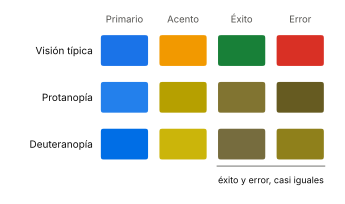

# Tema 12. Diseño equitativo, inclusivo y accesible {#sec-tema12}

::: {.callout-note appearance="default"}
## Objetivos
- Aplicar la perspectiva de género, la diversidad funcional y la diversidad cultural a las decisiones de interfaz.
- Incorporar los criterios de accesibilidad desde la baja fidelidad.
- Comprobar el contraste y la distinción de los colores con datos.
:::

::: {.callout-note appearance="simple" icon="false"}
## Glosario del tema
[Diseño inclusivo](92-glosario.qmd#gl-inclusivo) · [Accesibilidad](92-glosario.qmd#gl-accesibilidad) · [WCAG](92-glosario.qmd#gl-wcag) · [Espectro de personas](92-glosario.qmd#gl-espectro) · [GenderMag](92-glosario.qmd#gl-gendermag) · [Contraste](92-glosario.qmd#gl-contraste) · [Daltonismo](92-glosario.qmd#gl-daltonismo) · [Orden de foco](92-glosario.qmd#gl-orden-foco)
:::

::: {.callout-tip appearance="simple" icon="false"}
## Descargas
[Script R del capítulo](plantillas/12_inclusivo.R){.btn .btn-outline-primary .btn-sm download="12_inclusivo.R"}
[Plantilla de entrega del reto (.qmd)](plantillas/entrega_reto.qmd){.btn .btn-outline-primary .btn-sm download="entrega_reto.qmd"}
[Tema de estilo (.scss)](plantillas/informe.scss){.btn .btn-outline-primary .btn-sm download="informe.scss"}
:::

## Lectura obligatoria

::: {.lectura}
Burnett, M.; Stumpf, S.; Macbeth, J.; Makri, S.; Beckwith, L.; Kwan, I.; Peters, A.; Jernigan, W. (2016). [GenderMag: A method for evaluating software's gender inclusiveness](https://doi.org/10.1093/iwc/iwv046). *Interacting with Computers*, 28(6), 760-787.
:::

### Lecturas complementarias {.unnumbered}

- @w3c2023 — La norma de referencia de la accesibilidad web.
- @microsoftsf — El kit que popularizó el espectro de personas.
- @universityofcambridgsf — Métodos y herramientas para estimar la exclusión.

## 1. Equidad, inclusión y accesibilidad

- **Accesibilidad**: que las personas con discapacidad puedan percibir, entender, navegar e interactuar con el producto. Tiene normas técnicas y obligaciones legales.
- **Diseño inclusivo**: diseñar teniendo en cuenta toda la diversidad humana (capacidades, edad, género, cultura, idioma, contexto), y no a un usuario «medio» que no existe.
- **Equidad**: que el diseño no reparta los beneficios y las cargas de forma injusta entre grupos.

El kit de diseño inclusivo de Microsoft propone el **espectro de personas**: una limitación puede ser **permanente** (una persona con un solo brazo), **temporal** (un brazo escayolado) o **situacional** (un brazo ocupado con un bebé). Diseñar para la permanente beneficia a muchas más personas.

## 2. Perspectiva de género

@burnett2016 desarrollaron **GenderMag**, un método de inspección (parecido a la revisión heurística del Tema 2) que usa personajes para detectar sesgos de género en el software. Se basa en cinco **facetas** cognitivas en las que la investigación ha encontrado diferencias estadísticas entre grupos de género: la **motivación** para usar la tecnología, el **estilo de procesar la información** (completo o selectivo), la **autoeficacia** con el ordenador, la **actitud ante el riesgo** y el **estilo de aprendizaje** (por proceso o probando). El objetivo no es diseñar «para mujeres» y «para hombres», sino que el software funcione bien para todo el espectro de estas facetas.

En las decisiones de baja fidelidad, la perspectiva de género aparece también en los **formularios** (pedir el género solo si hace falta, con opciones inclusivas y no obligatorio), las **imágenes y los ejemplos** (quién aparece y haciendo qué) y el **lenguaje**.

## 3. Diversidad funcional: accesibilidad desde la baja fidelidad

Las **WCAG 2.2** [@w3c2023] organizan los requisitos en cuatro principios: el contenido debe ser **perceptible**, **operable**, **comprensible** y **robusto**. Cada criterio tiene un nivel de conformidad (A, AA, AAA); la normativa europea y española exige el nivel **AA**:

- El **Real Decreto 1112/2018** obliga a los sitios web y aplicaciones del sector público.
- La **Directiva (UE) 2019/882** (Acta Europea de Accesibilidad), transpuesta en España por la Ley 11/2023, se aplica desde el 28 de junio de 2025 a productos y servicios como el comercio electrónico, la banca o los libros electrónicos.

Muchas decisiones de accesibilidad se toman en baja fidelidad:

| Decisión en el esquema | Criterio relacionado |
|---|---|
| Estructura de encabezados y orden de lectura | Información y relaciones; orden significativo |
| **Orden de foco** con teclado | Orden del foco; foco visible |
| Etiquetas visibles en los campos | Etiquetas o instrucciones |
| No transmitir información **solo con el color** | Uso del color |
| Tamaño de los objetivos táctiles (mínimo 24 × 24 px en WCAG 2.2) | Tamaño del objetivo (mínimo) |
| Mensajes de error que dicen qué pasa y cómo corregirlo | Identificación de errores; sugerencias |

## 4. Color: contraste y daltonismo

El contraste mínimo AA es de **4,5:1** para el texto normal, **3:1** para el texto grande y **3:1** para los componentes de interfaz y los gráficos. Cerca del 8 % de los hombres y del 0,5 % de las mujeres de ascendencia europea tienen alguna deficiencia en la visión de los colores, sobre todo en el eje rojo-verde. Por eso un mensaje de error y uno de éxito no pueden distinguirse solo por ser rojo o verde: necesitan además un icono o un texto.

{#fig-daltonismo fig-alt="Tres filas de cuatro cuadrados de color: primario azul, acento naranja, éxito verde y error rojo. En la fila de visión típica los cuatro se distinguen. En las filas de protanopía y deuteranopía, el verde y el rojo se vuelven dos tonos parecidos de marrón oliva, mientras el azul sigue siendo distinto."}

## 5. Diversidad cultural

- **Idiomas y longitud de los textos**: una etiqueta en alemán puede ocupar bastante más espacio que en inglés; los esquemas deben dejar margen.
- **Dirección de lectura**: en árabe o hebreo la interfaz se refleja de derecha a izquierda.
- **Formatos**: fechas, horas, números y monedas cambian según el país.
- **Nombres**: no todas las culturas tienen «nombre y apellidos»; un único campo «Nombre completo» es más inclusivo.
- **Iconos y símbolos**: su significado no es universal.

## Práctica en R: comprobar los colores

```{webr}
#| autorun: true
source("datos/funciones_ux.R")
revisar_paleta(paleta_ejemplo)[, c("nombre", "contraste", "texto_normal_AA", "componente_AA")]
```

### Ejercicio 12.1 {.unnumbered}

El color de acento `#f29900` no cumple el contraste para texto sobre blanco. ¿Cumple al menos el mínimo de 3:1 para **componentes** (un icono, el borde de un campo)?

```{webr}
#| exercise: t12_componente
#| setup: true
source("datos/funciones_ux.R")
```

```{webr}
#| exercise: t12_componente
cumple_wcag("#f29900", "#ffffff", tipo = "______")
```

::: {.hint exercise="t12_componente"}
Los tipos posibles son «normal», «grande» y «componente».
:::

::: {.solution exercise="t12_componente"}
```r
cumple_wcag("#f29900", "#ffffff", tipo = "componente")
```
`FALSE`: su contraste es 2,25:1. Ni siquiera sirve como único indicador visual de un control; habría que oscurecerlo o acompañarlo de un borde con más contraste.
:::

```{webr}
#| exercise: t12_componente
#| check: true
if (identical(.result, FALSE) && grepl("componente", .user_code)) {
  list(correct = TRUE, message = "Correcto: 2,25:1 no llega a 3:1.")
} else {
  list(correct = FALSE, message = "Usa tipo = \"componente\".")
}
```

### Ejercicio 12.2 {.unnumbered}

Simula cómo ve los colores de error y éxito una persona con **deuteranopía** y calcula la diferencia de luminosidad entre ellos con `distinguibles()`. Un valor cercano a 1 significa que no se distinguen por luminosidad.

```{webr}
#| exercise: t12_cvd
#| setup: true
source("datos/funciones_ux.R")
```

```{webr}
#| exercise: t12_cvd
d <- simular_daltonismo(paleta_ejemplo[c("error", "exito")], tipo = "______")
d
distinguibles(d[1], d[2])
```

::: {.hint exercise="t12_cvd"}
Los tipos son «protan», «deutan» y «tritan».
:::

::: {.solution exercise="t12_cvd"}
```r
d <- simular_daltonismo(paleta_ejemplo[c("error", "exito")], tipo = "deutan")
d
distinguibles(d[1], d[2])
```
Alrededor de 1,3: con deuteranopía, el rojo de error y el verde de éxito se convierten en dos marrones oliva casi iguales, muy lejos del 3:1 que se pide para distinguir componentes. Los mensajes deben llevar icono y texto.
:::

```{webr}
#| exercise: t12_cvd
#| check: true
esperado <- {d <- simular_daltonismo(paleta_ejemplo[c("error", "exito")], "deutan"); distinguibles(d[1], d[2])}
if (isTRUE(all.equal(unname(as.numeric(.result)), unname(esperado)))) {
  list(correct = TRUE, message = paste0("Correcto: ", round(as.numeric(.result), 2), ", muy lejos de 3:1."))
} else {
  list(correct = FALSE, message = "Usa tipo = \"deutan\".")
}
```

## Laboratorio: contraste y daltonismo {#lab-t12-contraste}

::: {.laboratorio}
::: {.laboratorio-etiqueta}
Laboratorio · cálculo en tu navegador
:::

Elige un color de texto y uno de fondo. El laboratorio calcula la **razón de contraste** de las WCAG 2.2, te dice qué niveles cumple y simula cómo ven la combinación las personas con los tres tipos principales de daltonismo (matrices de Machado, Oliveira y Fernandes, 2009).

```{ojs}
//| echo: false
color = window.Lab.color
viewof c_texto = color("Color del texto", {value: "#e8663a"})
viewof c_fondo = color("Color del fondo", {value: "#ffffff"})
```

```{ojs}
//| echo: false
{
  const rgb = h => [1, 3, 5].map(i => parseInt(h.slice(i, i + 2), 16) / 255);
  const lin = c => c <= 0.04045 ? c / 12.92 : Math.pow((c + 0.055) / 1.055, 2.4);
  const L = h => { const [r, g, b] = rgb(h).map(lin); return 0.2126 * r + 0.7152 * g + 0.0722 * b; };
  const ratio = (a, b) => { const [x, y] = [L(a), L(b)].sort((p, q) => q - p); return (x + 0.05) / (y + 0.05); };
  const M = {protan: [[0.152286, 1.052583, -0.204868], [0.114503, 0.786281, 0.099216], [-0.003882, -0.048116, 1.051998]],
             deutan: [[0.367322, 0.860646, -0.227968], [0.280085, 0.672501, 0.047413], [-0.011820, 0.042940, 0.968881]],
             tritan: [[1.255528, -0.076749, -0.178779], [-0.078411, 0.930809, 0.147602], [0.004733, 0.691367, 0.303900]]};
  const sim = (h, t) => { const v = rgb(h).map(lin), m = M[t];
    const o = m.map(f => Math.min(1, Math.max(0, f[0] * v[0] + f[1] * v[1] + f[2] * v[2])));
    return "#" + o.map(c => Math.round(255 * (c <= 0.0031308 ? 12.92 * c : 1.055 * Math.pow(c, 1 / 2.4) - 0.055)).toString(16).padStart(2, "0")).join(""); };
  const r = ratio(c_texto, c_fondo);
  const marca = ok => ok ? "✓ cumple" : "✗ no cumple";
  const muestra = (t, f, et) => `<svg viewBox="0 0 160 92" style="flex:1;min-width:9rem;max-width:14rem" role="img" aria-label="${et}: texto ${t} sobre fondo ${f}, contraste ${ratio(t, f).toFixed(2).replace(".", ",")} a 1"><rect x=".5" y=".5" width="159" height="91" rx="6" fill="${f}" stroke="#bbb"/><text x="10" y="20" font-size="11" fill="${t}">${et}</text><text x="10" y="46" font-size="19" font-weight="600" fill="${t}">Reservar</text><text x="10" y="66" font-size="13" fill="${t}">Texto de ejemplo</text><text x="10" y="84" font-size="11" fill="${t}">${ratio(t, f).toFixed(2).replace(".", ",")}:1</text></svg>`;
  const d = html`<div role="status"></div>`;
  d.innerHTML = `<p style="font-size:1.2rem"><strong>Contraste ${r.toFixed(2).replace(".", ",")}:1</strong></p>
  <ul><li>Texto normal, AA (4,5:1): <strong>${marca(r >= 4.5)}</strong></li><li>Texto grande, AA (3:1): <strong>${marca(r >= 3)}</strong></li>
  <li>Componentes y gráficos, AA (3:1): <strong>${marca(r >= 3)}</strong></li><li>Texto normal, AAA (7:1): <strong>${marca(r >= 7)}</strong></li></ul>
  <div style="display:flex;gap:.5rem;flex-wrap:wrap" class="lab-muestras">${muestra(c_texto, c_fondo, "Visión típica")}${muestra(sim(c_texto, "protan"), sim(c_fondo, "protan"), "Protanopia")}${muestra(sim(c_texto, "deutan"), sim(c_fondo, "deutan"), "Deuteranopia")}${muestra(sim(c_texto, "tritan"), sim(c_fondo, "tritan"), "Tritanopia")}</div>
  <p class="small mt-2">Con las funciones del libro: <code>contraste()</code>, <code>cumple_wcag()</code> y <code>simular_daltonismo()</code>. Prueba el naranja por defecto: muy visible, pero no llega a 4,5:1 sobre blanco.</p>`;
  return d;
}
```
:::

## Caso práctico resuelto

::: {.callout-note appearance="simple" icon="false"}
## Revisión de accesibilidad de un esquema
Revisión del esquema de reserva con criterios WCAG antes de pasar a alta fidelidad:

- **Información no solo por color:** las salas ocupadas no se distinguen solo en gris; llevan el texto «Ocupada».
- **Objetivos táctiles** de al menos 44 × 44 px para los botones de franja.
- **Orden de lectura y foco** anotados en el esquema: cabecera, filtros, lista, acción.
- **Etiquetas** visibles en los campos (no solo marcadores de posición).
- **Lenguaje claro** y alternativas: el mapa del edificio tiene una vista en lista equivalente para lectores de pantalla.
:::

## Ejercicios graduados

**Básico.** Anota en un esquema el orden de foco para navegar con teclado la pantalla de confirmación.

::: {.webex-solution boton="Ver solución"}
Orden lógico: título (resumen de la reserva) → datos de la reserva → «Añadir al calendario» → «Cancelar reserva» → «Volver al inicio». El foco inicial debe ir al título para que el lector de pantalla anuncie el resultado.
:::

**Avanzado.** Propón cómo hacer accesible el mapa interactivo del edificio.

::: {.webex-solution boton="Ver solución"}
Ofrecer una alternativa equivalente (lista por plantas), etiquetas accesibles en cada sala del mapa, navegación con teclado y no depender del color para indicar disponibilidad.
:::


## Actividades

::: {.clasificar #ia-t12-pour titulo="¿Qué principio de las WCAG se aplica?" categorias="Perceptible|Operable|Comprensible|Robusto"}
- Las imágenes tienen texto alternativo → Perceptible
- Todo se puede usar solo con el teclado → Operable
- Los mensajes de error explican cómo corregirlos → Comprensible
- El código usa elementos HTML estándar que leen los lectores de pantalla → Robusto
- El texto tiene un contraste suficiente con el fondo → Perceptible
- Hay tiempo suficiente para completar el formulario, o se puede ampliar → Operable
- La navegación está en el mismo sitio en todas las páginas → Comprensible
:::

::: {.clasificar #ia-t12-inclusion titulo="¿Inclusivo o excluyente?" categorias="Inclusivo|Excluyente"}
- Un formulario con «Sexo: hombre / mujer» como campo obligatorio para pedir un libro → Excluyente // Pide un dato innecesario y con opciones cerradas.
- Mostrar el estado de un préstamo con color, icono y texto → Inclusivo
- Indicar los campos obligatorios solo en rojo → Excluyente
- Permitir escribir el nombre con tildes, eñes y apellidos compuestos → Inclusivo
- Un captcha visual sin alternativa sonora o de otro tipo → Excluyente
- Ilustraciones con personas diversas en edad, origen y capacidades → Inclusivo
:::

::: {.callout-warning appearance="simple" icon="false"}
## Errores frecuentes
- **Dejar la accesibilidad para el final**: muchas barreras (orden de lectura, tamaños de toque, etiquetas) se deciden en el esquema.
- **Transmitir información solo con color.**
- **Pensar en la «persona media»**: diseña también para los extremos (Holmes, 2018).
- **Pedir datos que no hacen falta**, sobre todo sensibles.
:::

## Reto evaluable {#reto-t12}

::: {.callout-important appearance="simple" icon="false"}
## Reto del Tema 12 · Revisión inclusiva del prototipo
Sobre el prototipo de tu proyecto:

1. Revisa los esquemas con la tabla del apartado 3: estructura de encabezados, **orden de foco** numerado sobre cada pantalla, etiquetas, uso del color y tamaño de los objetivos. Corrige lo que no cumpla.
2. Aplica **una de las facetas de GenderMag** a la tarea principal: ¿cómo la viviría una persona con baja autoeficacia o con aversión al riesgo? Propón un cambio.
3. Revisa los **formularios y los ejemplos** con criterios de perspectiva de género y diversidad cultural.
4. Si ya tienes una paleta provisional, comprueba su contraste y su distinción con daltonismo con `revisar_paleta()` y `simular_daltonismo()`.

**Entrega:** un informe hecho con la [plantilla de entrega](plantillas/entrega_reto.qmd). Se evalúa con la rúbrica que incluye la plantilla. Este reto **no tiene solución en el libro**: cada estudiante trabaja con un proyecto distinto y la corrección la hace el profesorado.
:::

## Autoevaluación

Responde a todas las preguntas y pulsa **Mostrar respuestas**: verás en verde las acertadas, en rojo las falladas y tu recuento. Puedes corregir y volver a comprobar. No cuenta para la nota.

::: {.webex-check .webex-box}
1. La accesibilidad solo se puede comprobar cuando el diseño visual está terminado. 
2. Un brazo ocupado con un bebé es, en el espectro de personas, una limitación 
3. Las WCAG organizan sus criterios en cuatro principios: perceptible, operable, comprensible y 
4. El contraste mínimo AA para el texto normal es de 
5. Distinguir un mensaje de error de uno de éxito solo por el color rojo o verde cumple las WCAG. 
6. ¿Qué evalúa el método GenderMag?



7. La Directiva (UE) 2019/882 (Acta Europea de Accesibilidad) se aplica desde 2025 a servicios privados como el comercio electrónico. 
:::

::: {.webex-solution boton="Ver explicaciones"}
- Estructura, orden de foco, etiquetas y uso del color se deciden en los esquemas.
- Situacional: depende de las circunstancias del momento.
- Perceptible, operable, comprensible y robusto.
- 4,5:1 para texto normal; 3:1 para texto grande y componentes.
- El criterio «uso del color» exige otro medio además del color.
- Usa personajes con distintos valores de las cinco facetas.
- Desde el 28 de junio de 2025; en España, a través de la Ley 11/2023.
:::

## Recursos complementarios

| Recurso | Para qué sirve |
|---|---|
| [W3C – WCAG 2.2](https://www.w3.org/TR/WCAG22/) | La norma |
| [W3C WAI – Estándares y pautas](https://www.w3.org/WAI/standards-guidelines/wcag/) | Introducción a las WCAG |
| [GenderMag](https://gendermag.org/) | Materiales del método |
| [Microsoft Inclusive Design](https://inclusive.microsoft.design/) | Espectro de personas y kit |
| [Inclusive Design Toolkit (Cambridge)](https://www.inclusivedesigntoolkit.com/) | Estimar la exclusión |
| [Real Decreto 1112/2018](https://www.boe.es/buscar/act.php?id=BOE-A-2018-12699) | Accesibilidad del sector público |
| [Directiva (UE) 2019/882](https://eur-lex.europa.eu/eli/dir/2019/882/oj) | Acta Europea de Accesibilidad |
