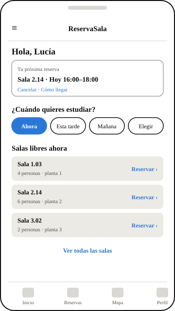
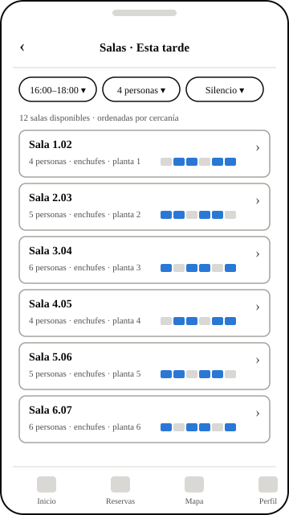
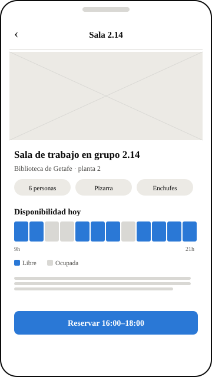
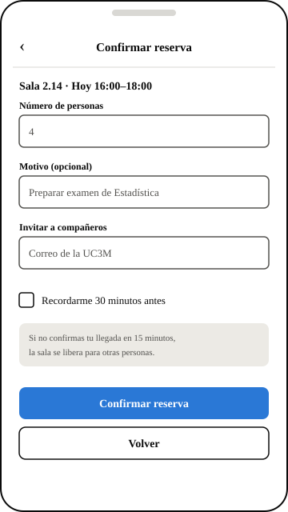
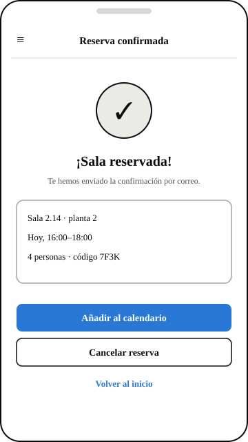
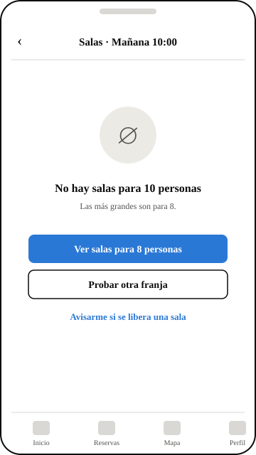
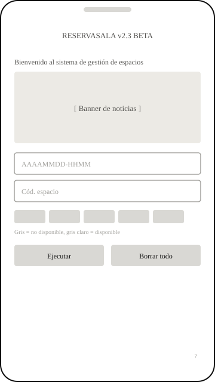

# Galería interactiva de esquemas {#sec-galeria}

Esta galería reúne los esquemas completos de **ReservaSala**, la app para reservar salas de estudio que sirve de ejemplo en los casos prácticos de todos los temas. Úsala como referencia de patrones, como material para criticar y como punto de partida para tus propios esquemas. Todos los esquemas son SVG: puedes descargarlos y editarlos con cualquier herramienta de diseño.

## Las pantallas, una a una

::: {.panel-tabset}

### Inicio

{#fig-g-inicio width="320" fig-alt="Esquema móvil de la pantalla de inicio de ReservaSala: saludo, tarjeta con la próxima reserva y enlaces para cancelar o cómo llegar, botones de franja (Ahora, Esta tarde, Mañana, Elegir), lista de tres salas libres con enlace Reservar y barra de navegación inferior."}

**Decisiones de diseño**

- Lo más urgente primero: la **próxima reserva** (con cancelación a un toque).
- La pregunta de la investigación («¿cuándo quieres estudiar?») se convierte en **botones de franja** grandes.
- Resultados inmediatos sin pantalla intermedia: tres salas libres **ahora**.
- Navegación inferior con cuatro destinos, al alcance del pulgar.

### Lista

{#fig-g-lista width="320" fig-alt="Esquema móvil de la lista de salas: tres filtros desplegables (franja, personas, silencio), un texto con el número de salas disponibles y seis filas con nombre de sala, capacidad, planta y una pequeña barra de disponibilidad horaria."}

**Decisiones de diseño**

- **Filtros visibles** como *chips*: se ve qué está filtrado sin abrir un panel.
- El recuento («12 salas disponibles») confirma que el filtro ha funcionado.
- La **barra horaria** de cada fila permite comparar sin entrar en el detalle.
- Orden explícito («por cercanía»): el usuario sabe por qué ve ese orden.

### Detalle

{#fig-g-detalle width="320" fig-alt="Esquema móvil del detalle de la sala 2.14: marcador de foto, nombre completo, ubicación, etiquetas de capacidad, pizarra y enchufes, barra de disponibilidad de 9 a 21 horas con leyenda Libre y Ocupada, líneas de texto descriptivo y botón Reservar de 16:00 a 18:00."}

**Decisiones de diseño**

- La **disponibilidad** es el elemento central: es lo que decide la reserva.
- La leyenda no depende solo del color: dice «Libre» y «Ocupada».
- El botón concreta la acción («Reservar 16:00–18:00»), no solo «Reservar».

### Formulario

{#fig-g-formulario width="320" fig-alt="Esquema móvil del formulario Confirmar reserva: resumen de sala y hora, campos etiquetados de número de personas, motivo opcional e invitar a compañeros, casilla Recordarme 30 minutos antes, aviso de que la sala se libera si no se confirma la llegada en 15 minutos, botón Confirmar reserva y botón Volver."}

**Decisiones de diseño**

- **Etiquetas visibles** encima de cada campo; el marcador de posición solo da un ejemplo.
- Se indica qué es **opcional**, no qué es obligatorio (la mayoría lo es).
- Las reglas («se libera en 15 minutos») se explican **antes** de confirmar, no después.
- Jerarquía clara: una acción principal y una secundaria.

### Confirmación

{#fig-g-confirmacion width="320" fig-alt="Esquema móvil de Reserva confirmada: icono de verificación, mensaje Sala reservada y aviso de correo enviado, tarjeta con sala, hora, personas y código 7F3K, botones Añadir al calendario y Cancelar reserva, y enlace Volver al inicio."}

**Decisiones de diseño**

- Mensaje de éxito inequívoco y **resumen** para comprobar los datos.
- Las **acciones siguientes** más probables (calendario, cancelar).
- El código de reserva es corto y legible para dictarlo en el mostrador.

### Estado vacío

{#fig-g-vacio width="320" fig-alt="Esquema móvil del estado vacío: icono de conjunto vacío, texto No hay salas para 10 personas, las más grandes son para 8, botones Ver salas para 8 personas y Probar otra franja, y enlace Avisarme si se libera una sala."}

**Decisiones de diseño**

- Explica el **motivo** («para 10 personas») y da el dato útil («las más grandes son para 8»).
- Ofrece **tres salidas**: relajar el filtro, cambiar la franja o esperar un aviso.
- Nunca un callejón sin salida.

:::

## El flujo completo

```{mermaid}
%%| fig-cap: "Flujo de reserva de ReservaSala con sus caminos alternativos."
flowchart LR
  A[Inicio] --> B{¿Franja elegida?}
  B -- Sí --> C[Lista de salas]
  B -- No --> B2[Elegir franja] --> C
  C --> D{¿Hay salas?}
  D -- No --> E[Estado vacío] --> C
  D -- Sí --> F[Detalle de sala]
  F --> G[Formulario]
  G --> H{¿Sigue libre?}
  H -- Sí --> I[Confirmación]
  H -- No --> J[Aviso: sala ocupada] --> C
  I --> K[Calendario]
  I --> L[Cancelar]
```

## Antes y después

::: {layout-ncol=2}
{#fig-g-antes fig-alt="Esquema móvil con problemas: cabecera técnica RESERVASALA v2.3 BETA, gran banner de noticias, campos sin etiqueta con textos AAAAMMDD-HHMM y Cód. espacio, cuadros grises de disponibilidad con leyenda solo por tono, dos botones iguales Ejecutar y Borrar todo, y un pequeño signo de interrogación abajo."}

{#fig-g-despues fig-alt="Esquema móvil de la pantalla de inicio rediseñada de ReservaSala, con la próxima reserva, la elección de franja y las salas libres."}
:::

## Actividad: encuentra los problemas

::: {.zonas #ia-g-problemas titulo="¿Qué falla en esta primera versión?" imagen="figuras/g_problemas.svg" alt="Esquema móvil con cabecera técnica, banner grande, dos campos sin etiqueta, cuadros de disponibilidad en grises, dos botones iguales Ejecutar y Borrar todo y una pequeña ayuda."}
Esta pantalla tiene **siete** problemas de usabilidad o accesibilidad. Pulsa sobre ellos y comprueba.

- [4.4, 5.6, 91.1, 6.9] Cabecera con el nombre y la versión | no | Poco útil, pero no impide la tarea.
- [6.7, 18.8, 86.7, 18.8] Banner de noticias | si | Ocupa la mejor zona de la pantalla y relega la tarea principal (jerarquía).
- [6.7, 40, 86.7, 5.6] Campo «AAAAMMDD-HHMM» | si | Sin etiqueta y con un formato rígido: mejor un selector de fecha y hora.
- [6.7, 47.2, 86.7, 5.6] Campo «Cód. espacio» | si | Nadie conoce los códigos: hay que elegir sala de una lista (reconocer mejor que recordar).
- [6.7, 54.7, 80, 7.2] Disponibilidad en dos grises | si | La información depende solo del tono y el contraste es bajo.
- [6.7, 64.1, 41.7, 5.6] Botón «Ejecutar» | si | Jerga del sistema: la acción es «Reservar».
- [51.7, 64.1, 41.7, 5.6] Botón «Borrar todo» | si | Acción destructiva con el mismo peso que la principal y junto a ella.
- [88, 90.5, 7, 5] Ayuda «?» diminuta | si | Demasiado pequeña para pulsarla y para verla.
:::

## Laboratorio: constructor de esquemas {#lab-galeria-constructor}

::: {.laboratorio}
::: {.laboratorio-etiqueta}
Laboratorio · se ejecuta en tu navegador
:::

Elige los bloques de una pantalla móvil y su orden. El laboratorio dibuja el esquema y señala problemas frecuentes. Puedes descargar el resultado como SVG.

```{ojs}
//| echo: false
seleccion = window.Lab.seleccion
casilla = window.Lab.casilla
viewof b1 = seleccion("Bloque 1 (arriba)", ["Buscador", "Próxima reserva", "Banner", "Filtros", "Lista de resultados", "Botón principal", "(vacío)"], {value: "Próxima reserva"})
viewof b2 = seleccion("Bloque 2", ["Buscador", "Próxima reserva", "Banner", "Filtros", "Lista de resultados", "Botón principal", "(vacío)"], {value: "Filtros"})
viewof b3 = seleccion("Bloque 3", ["Buscador", "Próxima reserva", "Banner", "Filtros", "Lista de resultados", "Botón principal", "(vacío)"], {value: "Lista de resultados"})
viewof b4 = seleccion("Bloque 4 (abajo)", ["Buscador", "Próxima reserva", "Banner", "Filtros", "Lista de resultados", "Botón principal", "(vacío)"], {value: "(vacío)"})
viewof navinf = casilla("Barra de navegación inferior", {value: true})
```

```{ojs}
//| echo: false
{
  const bloques = [b1, b2, b3, b4].filter(b => b !== "(vacío)");
  const alto = {"Buscador": 44, "Próxima reserva": 84, "Banner": 130, "Filtros": 40, "Lista de resultados": 200, "Botón principal": 48};
  let y = 96, partes = [];
  const g = "#eceae5", a = "#2a78d6";
  for (const b of bloques) {
    const h = alto[b];
    if (b === "Buscador") partes.push(`<rect x="24" y="${y}" width="312" height="${h}" rx="22" fill="#fff" stroke="#52514e"/><text x="44" y="${y + 27}" font-size="13" fill="#52514e">Buscar sala…</text>`);
    else if (b === "Próxima reserva") partes.push(`<rect x="24" y="${y}" width="312" height="${h - 10}" rx="10" fill="#fff" stroke="#a3a29e"/><text x="36" y="${y + 24}" font-size="11" fill="#52514e">Tu próxima reserva</text><text x="36" y="${y + 46}" font-size="14" font-weight="600" fill="#0b0b0b">Sala 2.14 · Hoy 16:00</text>`);
    else if (b === "Banner") partes.push(`<rect x="24" y="${y}" width="312" height="${h - 10}" rx="6" fill="${g}"/><text x="180" y="${y + 64}" font-size="13" text-anchor="middle" fill="#52514e">Banner</text>`);
    else if (b === "Filtros") partes.push([0, 1, 2].map(i => `<rect x="${24 + i * 104}" y="${y}" width="96" height="30" rx="15" fill="#fff" stroke="#0b0b0b"/>`).join(""));
    else if (b === "Lista de resultados") partes.push([0, 1, 2].map(i => `<rect x="24" y="${y + i * 64}" width="312" height="56" rx="8" fill="${g}"/><rect x="36" y="${y + i * 64 + 16}" width="140" height="8" rx="4" fill="#a3a29e"/><rect x="36" y="${y + i * 64 + 32}" width="90" height="6" rx="3" fill="#d9d8d4"/>`).join(""));
    else if (b === "Botón principal") partes.push(`<rect x="24" y="${y}" width="312" height="40" rx="8" fill="${a}"/><text x="180" y="${y + 25}" font-size="14" font-weight="600" fill="#fff" text-anchor="middle">Reservar</text>`);
    y += h;
  }
  const navsvg = navinf ? `<line x1="16" y1="580" x2="344" y2="580" stroke="#d9d8d4"/>` + [0, 1, 2, 3].map(i => `<rect x="${46 + i * 92}" y="592" width="24" height="20" rx="4" fill="#d9d8d4"/>`).join("") : "";
  const desborda = y > (navinf ? 576 : 620);
  const svgTxt = `<svg xmlns="http://www.w3.org/2000/svg" viewBox="0 0 360 640" width="260" role="img" aria-label="Esquema generado con ${bloques.join(", ")}"><rect x="1" y="1" width="358" height="638" rx="28" fill="#fff" stroke="#0b0b0b" stroke-width="2"/><rect x="16" y="36" width="328" height="44" fill="#fff"/><text x="180" y="64" font-size="15" font-weight="600" text-anchor="middle" fill="#0b0b0b">ReservaSala</text>${partes.join("")}${navsvg}</svg>`;
  const avisos = [];
  if (bloques[0] === "Banner") avisos.push("El banner ocupa la mejor posición: la tarea principal queda abajo.");
  if (!bloques.includes("Lista de resultados") && !bloques.includes("Próxima reserva")) avisos.push("No hay contenido de la tarea principal: ¿qué hace el usuario aquí?");
  if (bloques.indexOf("Filtros") > bloques.indexOf("Lista de resultados") && bloques.includes("Filtros") && bloques.includes("Lista de resultados")) avisos.push("Los filtros van después de la lista: el usuario no los verá hasta desplazarse.");
  if (new Set(bloques).size < bloques.length) avisos.push("Hay bloques repetidos.");
  if (desborda) avisos.push("El contenido no cabe sin desplazarse: prioriza.");
  const d = html`<div role="status" class="d-flex flex-wrap gap-3 align-items-start"></div>`;
  const izq = html`<div></div>`; izq.innerHTML = svgTxt;
  const der = html`<div style="max-width:24rem"></div>`;
  der.innerHTML = avisos.length ? `<ul>${avisos.map(x => `<li class="lab-medio" style="font-weight:600">${x}</li>`).join("")}</ul>` : '<p class="lab-bien" style="font-weight:600">Estructura coherente: la tarea principal está arriba y todo cabe.</p>';
  const enlace = html`<a class="btn btn-outline-primary btn-sm" download="esquema.svg">Descargar SVG</a>`;
  enlace.href = URL.createObjectURL(new Blob([svgTxt], {type: "image/svg+xml"}));
  der.append(enlace);
  d.append(izq, der);
  return d;
}
```
:::

## Laboratorio: prototipo navegable {#lab-galeria-prototipo}

::: {.laboratorio}
::: {.laboratorio-etiqueta}
Laboratorio · se ejecuta en tu navegador
:::

Un prototipo de baja fidelidad navegable hecho solo con los esquemas de la galería y zonas pulsables. Haz la tarea: **reserva una sala para esta tarde**. Así se prueba un flujo antes de diseñar nada en alta fidelidad.

```{ojs}
//| echo: false
{
  const pantallas = {
    inicio: {img: "figuras/g_inicio.svg", zonas: [[24, 322, 312, 50, "detalle", "Sala 1.03"], [100, 242, 72, 34, "lista", "Esta tarde"], [24, 500, 312, 30, "lista", "Ver todas las salas"]]},
    lista: {img: "figuras/g_lista.svg", zonas: [[24, 162, 312, 58, "detalle", "Sala 1.02"], [16, 40, 40, 40, "inicio", "Volver"]]},
    detalle: {img: "figuras/g_detalle.svg", zonas: [[24, 528, 312, 40, "formulario", "Reservar 16:00–18:00"], [16, 40, 40, 40, "lista", "Volver"]]},
    formulario: {img: "figuras/g_formulario.svg", zonas: [[24, 484, 312, 40, "confirmacion", "Confirmar reserva"], [24, 534, 312, 40, "detalle", "Volver"]]},
    confirmacion: {img: "figuras/g_confirmacion.svg", zonas: [[100, 545, 160, 24, "inicio", "Volver al inicio"]]}
  };
  const caja = html`<div style="position:relative;width:288px;max-width:100%"></div>`;
  const estado = html`<p role="status" aria-live="polite" class="small"></p>`;
  let pasos = 0;
  const ir = id => {
    const p = pantallas[id]; caja.innerHTML = "";
    const im = html``; im.src = p.img; caja.append(im);
    for (const [x, y, w, h, dest, et] of p.zonas) {
      const b = html`<button type="button" aria-label="${et}" title="${et}" style="position:absolute;left:${x / 3.6}%;top:${y / 6.4}%;width:${w / 3.6}%;height:${h / 6.4}%;background:rgba(42,120,214,.12);border:2px dashed rgba(42,120,214,.6);border-radius:8px;cursor:pointer"></button>`;
      b.onclick = () => { pasos++; ir(dest); };
      caja.append(b);
    }
    estado.textContent = id === "confirmacion" ? `¡Tarea completada en ${pasos} pasos! El camino más corto son 4.` : `Pantalla: ${id} · pasos: ${pasos}`;
  };
  ir("inicio");
  return html`<div>${caja}${estado}<p class="small">Las zonas pulsables están marcadas con borde discontinuo. Puedes navegar también con el tabulador.</p></div>`;
}
```
:::

## Para tu proyecto

- Descarga los SVG desde el botón derecho del ratón («Guardar imagen como…») y edítalos en Figma, Penpot o Inkscape.
- Usa la lista de **decisiones de diseño** de cada pantalla como guion para presentar tus esquemas en la crítica.
- Reproduce el **prototipo navegable** con tus propias pantallas: es la forma más rápida de probar un flujo con cinco personas.
