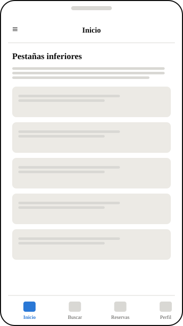
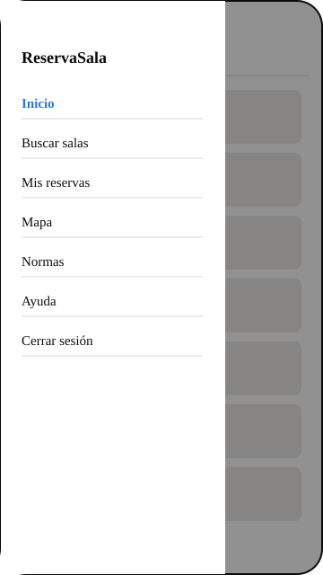
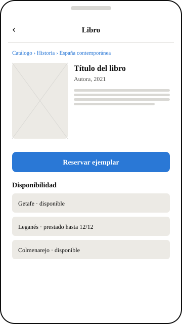
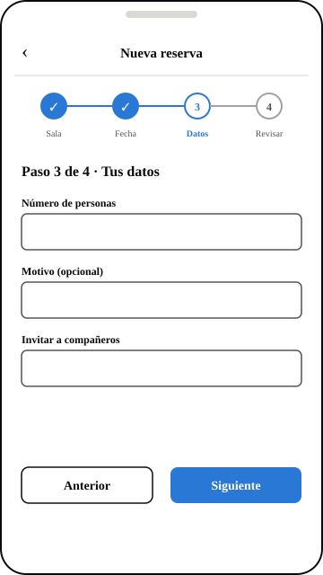
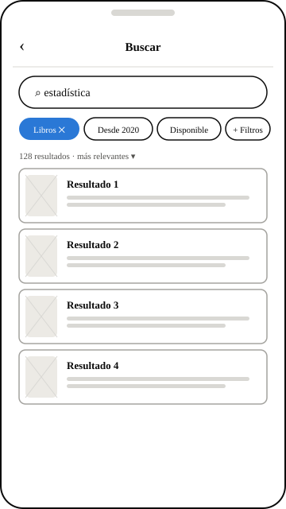
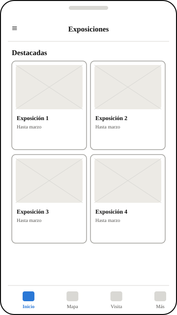
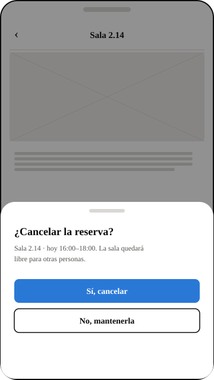
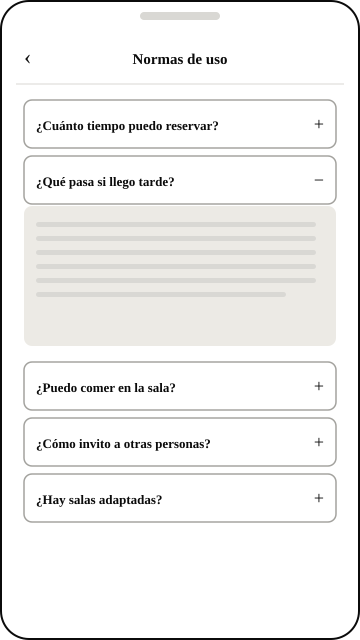
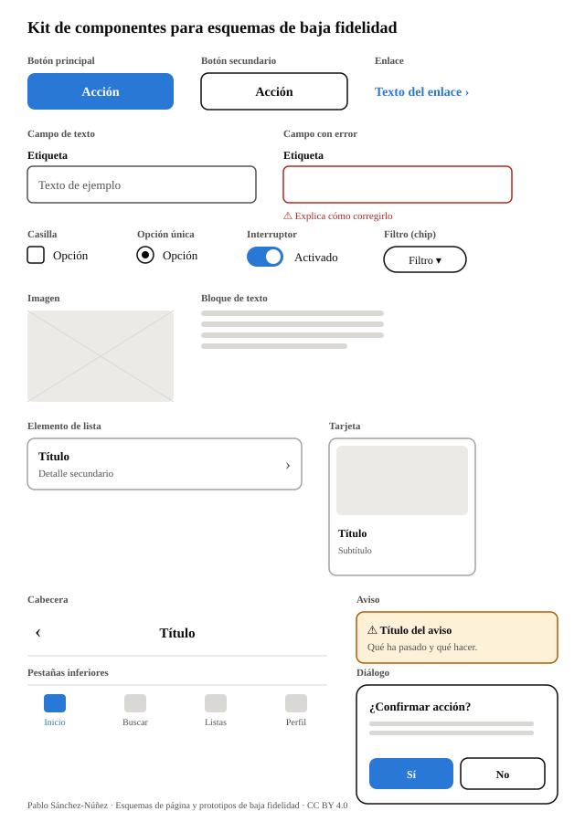

# Patrones de navegación e interfaz {#sec-patrones}

Un **patrón** es una solución probada a un problema de diseño que se repite. Usarlos no es copiar: las personas ya saben cómo funcionan, así que aprenden tu interfaz antes y cometen menos errores. Este apéndice reúne ocho patrones frecuentes en esquemas de móvil, con cuándo conviene usarlos, cuándo no y qué cuidar para que sean accesibles.

## Galería de patrones

::: {.panel-tabset}

### Pestañas inferiores

::: {layout="[40,60]"}
{#fig-p-pestanas fig-alt="Esquema móvil con cabecera Inicio, bloques de contenido y una barra inferior de cuatro pestañas; la primera, Inicio, aparece resaltada en azul."}

**Qué es.** Una barra fija en la parte inferior con entre 3 y 5 destinos principales.

**Úsalo cuando** la aplicación tiene pocas secciones de importancia parecida y la gente cambia a menudo entre ellas.

**Evítalo cuando** hay más de cinco destinos o una sola tarea domina: entonces sobra.

**Accesibilidad.** Cada pestaña lleva icono **y** texto; la activa se distingue por algo más que el color (peso, subrayado); zonas táctiles de al menos 44 × 44 px.
:::

### Menú lateral

::: {layout="[40,60]"}
{#fig-p-cajon fig-alt="Esquema móvil con un menú lateral abierto que oscurece el contenido y muestra siete opciones de navegación; Inicio está resaltada."}

**Qué es.** Un panel que se abre desde el icono ≡ con toda la navegación.

**Úsalo cuando** hay muchas secciones secundarias (normas, ayuda, ajustes) que no caben en pestañas.

**Evítalo** para las acciones principales: lo que está escondido se usa menos. Combínalo con pestañas para lo frecuente.

**Accesibilidad.** El botón ≡ necesita un nombre accesible («Menú»); al abrirse, el foco pasa al panel y vuelve al botón al cerrarse; se cierra con Escape.
:::

### Migas de pan

::: {layout="[40,60]"}
{#fig-p-migas fig-alt="Esquema de la ficha de un libro con una línea de migas de pan en azul: Catálogo, Historia, España contemporánea; debajo, portada, título, botón Reservar ejemplar y disponibilidad por biblioteca."}

**Qué es.** La ruta jerárquica hasta la página actual, con cada nivel enlazado.

**Úsalo cuando** el contenido tiene una jerarquía profunda (catálogos, repositorios, sedes web institucionales).

**Evítalo** en aplicaciones planas o en flujos lineales: ahí no hay jerarquía que mostrar.

**Accesibilidad.** Envuélvelas en `<nav aria-label="Migas de pan">` y marca la página actual con `aria-current="page"`.
:::

### Asistente por pasos

::: {layout="[40,60]"}
{#fig-p-pasos fig-alt="Esquema de un asistente con cuatro pasos numerados; los dos primeros están completados, el tercero, Datos, está activo; tres campos y botones Anterior y Siguiente."}

**Qué es.** Divide una tarea larga en pasos con un indicador de progreso.

**Úsalo cuando** la tarea tiene partes claramente separadas y cada una depende de la anterior.

**Evítalo** para formularios cortos (menos de 6 campos): los pasos añaden clics sin ayudar.

**Accesibilidad.** Anuncia «Paso 3 de 4» como texto; permite volver atrás sin perder lo escrito; el paso «Revisar» antes de confirmar reduce errores.
:::

### Búsqueda con filtros

::: {layout="[40,60]"}
{#fig-p-busqueda fig-alt="Esquema con un campo de búsqueda, cuatro chips de filtros (uno activo, Libros), el recuento de 128 resultados con orden por relevancia y cuatro resultados con miniatura."}

**Qué es.** Un campo de búsqueda con filtros visibles (chips) que acotan los resultados.

**Úsalo cuando** hay muchos elementos y la gente sabe más o menos qué busca.

**Evítalo** si el catálogo es pequeño: una lista bien ordenada basta.

**Accesibilidad.** Muestra cuántos resultados hay y anúncialo al cambiar los filtros (`aria-live`); los filtros activos se pueden quitar uno a uno.
:::

### Rejilla de tarjetas

::: {layout="[40,60]"}
{#fig-p-tarjetas fig-alt="Esquema con el título Destacadas y cuatro tarjetas en dos columnas, cada una con imagen, nombre de exposición y Hasta marzo; barra de pestañas inferior."}

**Qué es.** Elementos presentados como tarjetas con imagen y poco texto.

**Úsalo cuando** la imagen ayuda a elegir (exposiciones, salas, recetas) y los elementos son comparables.

**Evítalo** cuando la gente compara datos (precios, fechas, disponibilidad): una lista o una tabla se lee mejor.

**Accesibilidad.** Toda la tarjeta es un solo enlace con un nombre claro; la imagen decorativa lleva `alt=""`.
:::

### Diálogo de confirmación

::: {layout="[40,60]"}
{#fig-p-modal fig-alt="Esquema con el contenido oscurecido y una hoja inferior: ¿Cancelar la reserva?, una explicación de las consecuencias y dos botones, Sí, cancelar y No, mantenerla."}

**Qué es.** Una ventana que interrumpe para pedir confirmación.

**Úsalo** solo para acciones destructivas o difíciles de deshacer.

**Evítalo** para avisos informativos: interrumpir sin necesidad entrena a la gente a pulsar «Aceptar» sin leer. Mejor ofrece «Deshacer».

**Accesibilidad.** Botones con verbos concretos («Sí, cancelar», no «Aceptar»); el foco queda atrapado dentro mientras está abierto y vuelve al origen al cerrar.
:::

### Acordeón

::: {layout="[40,60]"}
{#fig-p-acordeon fig-alt="Esquema de Normas de uso con cinco preguntas plegables; la segunda, ¿Qué pasa si llego tarde?, está desplegada con el texto de la respuesta."}

**Qué es.** Secciones que se despliegan al pulsar su título (divulgación progresiva).

**Úsalo cuando** hay mucha información de consulta y cada persona necesita solo una parte (preguntas frecuentes, normas).

**Evítalo** para el contenido que todo el mundo necesita leer: escondido, se lo saltan.

**Accesibilidad.** Cada título es un botón con `aria-expanded`; usa `
` y `
` si puedes, porque ya son accesibles.
:::

:::

## Actividad: elige el patrón

::: {.clasificar #ia-patrones titulo="¿Qué patrón usarías en cada caso?" categorias="Pestañas inferiores|Menú lateral|Migas de pan|Asistente por pasos|Búsqueda con filtros|Diálogo de confirmación|Acordeón"}
- La app del campus tiene cuatro secciones que se usan a diario: horario, notas, biblioteca y comedor → Pestañas inferiores // Pocas secciones frecuentes y de igual peso.
- Además, hay ajustes, ayuda, privacidad y cerrar sesión → Menú lateral // Secundarias y poco frecuentes.
- Un repositorio con comunidades, colecciones y documentos → Migas de pan // Jerarquía profunda.
- Solicitar una beca: datos personales, académicos, económicos y documentos → Asistente por pasos // Tarea larga con partes separadas.
- Encontrar un libro entre 400 000 → Búsqueda con filtros // Mucho contenido y una búsqueda concreta.
- Eliminar todas las reservas de la semana → Diálogo de confirmación // Acción destructiva.
- Treinta preguntas sobre el uso de las salas → Acordeón // Información de consulta, cada persona necesita una parte.
:::

## Kit de componentes y plantillas

Descarga estos recursos para bocetar a mano o en una herramienta de diseño. El kit en SVG se puede importar en Figma, Penpot o Inkscape y cada componente es un grupo con nombre.

{#fig-kit fig-alt="Hoja con diecisiete componentes de baja fidelidad etiquetados: botón principal y secundario, enlace, campo de texto normal y con error, casilla, opción única, interruptor, chip de filtro, imagen, bloque de texto, elemento de lista, tarjeta, cabecera, pestañas inferiores, aviso y diálogo."}

| Recurso | Para qué sirve | Descarga |
|---|---|---|
| Kit de componentes | Componer esquemas digitales con piezas coherentes | [SVG](plantillas/kit-esquemas.svg) |
| Seis pantallas de móvil | Bocetar un flujo completo con notas bajo cada pantalla | [PDF A4](plantillas/plantilla-movil-6.pdf) |
| Crazy 8s | Generar ocho ideas en ocho minutos antes de elegir | [PDF A4](plantillas/crazy-8s.pdf) |
| Escritorio con rejilla | Esquemas de escritorio alineados a 12 columnas | [PDF A4](plantillas/plantilla-escritorio.pdf) |
| Hoja de flujo | Dibujar flujos con la notación del capítulo 5 | [PDF A4](plantillas/hoja-flujo.pdf) |
| Plantillas del curso | Pantallas de móvil con campos de proyecto y versión | [PDF](plantillas/plantillas_esquemas.pdf) |
