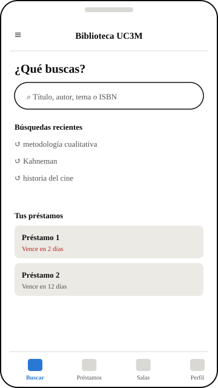
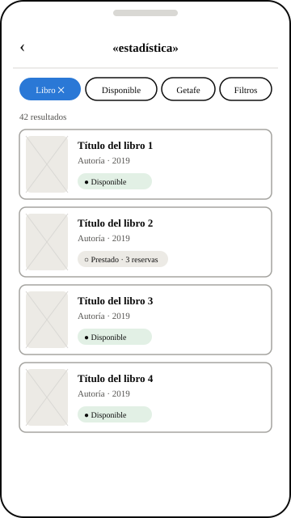
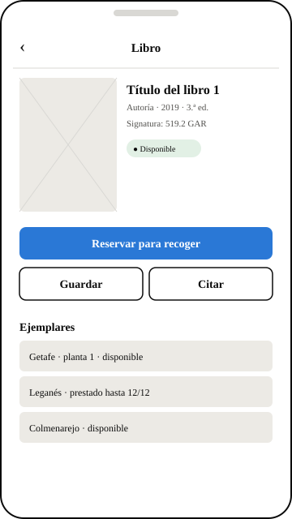
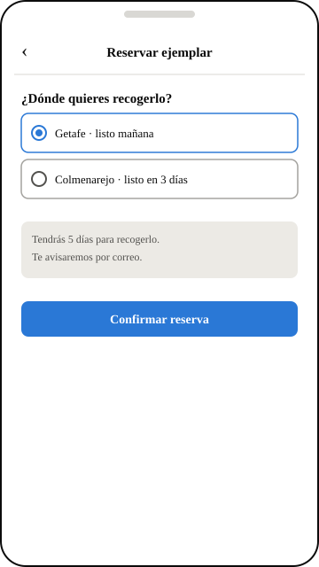
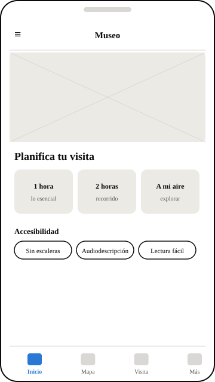
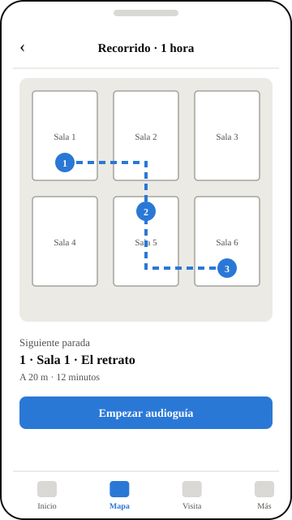
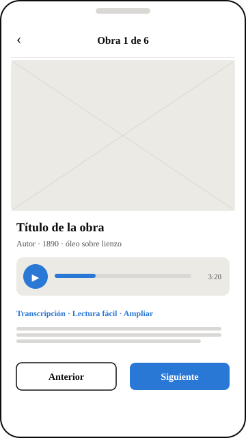
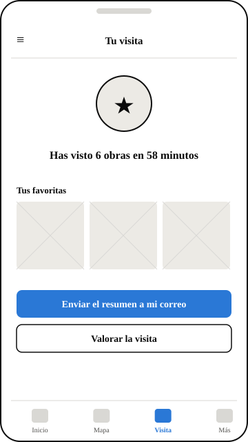

# Dos casos completos {#sec-casos}

ReservaSala acompaña todo el libro. Estos dos casos aplican el mismo proceso a problemas distintos, de principio a fin: problema, métricas, flujo, arquitectura y esquemas. Úsalos como modelo para tu proyecto o como práctica: intenta resolver cada paso antes de leer la propuesta.

## Caso 1: el catálogo de la biblioteca

### Problema

::: {.callout-note appearance="simple" icon="false"}
## Enunciado del problema
El estudiantado de grado **necesita** saber en pocos segundos si un libro está disponible y en qué campus **porque** desplazarse a otro campus para un libro prestado le hace perder una mañana. **Sabremos que lo hemos resuelto** cuando 8 de cada 10 personas encuentren un libro y su disponibilidad en menos de un minuto en una prueba con 5 participantes.
:::

**Hipótesis de diseño.** Si mostramos la disponibilidad por campus en la lista de resultados (y no solo en la ficha), la gente necesitará abrir menos fichas y tardará menos.

**Métricas (HEART).** *Tarea*: porcentaje de éxito y tiempo hasta ver la disponibilidad. *Adopción*: reservas hechas desde el móvil. *Satisfacción*: una pregunta de facilidad (SEQ) tras cada tarea.

### Flujo de usuario

```{mermaid}
%%| fig-cap: "Flujo de búsqueda y reserva de un libro, con los caminos alternativo y de error."
flowchart TD
  A([Inicio]) --> B[Buscar por título, autor o tema]
  B --> C{¿Hay resultados?}
  C -- No --> D[Sugerencias: revisar ortografía, ampliar filtros, préstamo interbibliotecario]
  D --> B
  C -- Sí --> E[Lista con disponibilidad por campus]
  E --> F{¿Disponible en mi campus?}
  F -- Sí --> G[Ficha: signatura y planta] --> H([Ir a la estantería])
  F -- No --> I[Reservar para recoger en otro campus]
  I --> J[Elegir campus de recogida] --> K[Confirmación y aviso por correo] --> L([Fin])
```

### Mapa del sitio

```{dot}
//| fig-cap: "Arquitectura de la información de la app de la biblioteca."
digraph sitio {
  graph [rankdir=TB, nodesep=0.3, ranksep=0.5, fontname="Helvetica", bgcolor="white", pad=0.2];
  node [shape=box, style="rounded", fontname="Helvetica", fontsize=11];
  edge [arrowhead=none];
  Inicio [style="rounded,filled", fillcolor="#e8f0fb"];
  Inicio -> {Buscar; Prestamos; Salas; Perfil};
  Prestamos [label="Préstamos"];
  Buscar -> {Resultados; "Búsquedas guardadas"};
  Resultados -> Ficha -> {"Reservar ejemplar"; Citar; Guardar};
  Prestamos -> {"Renovar"; "Historial"};
  Perfil -> {"Avisos"; "Datos y privacidad"};
}
```

### Esquemas

::: {.panel-tabset}

#### 1 · Buscar

::: {layout="[40,60]"}
{fig-alt="Esquema de inicio con la pregunta ¿Qué buscas?, un campo de búsqueda, tres búsquedas recientes y dos préstamos, uno que vence en 2 días en rojo; barra de pestañas Buscar, Préstamos, Salas y Perfil."}

- El buscador es lo primero: es la tarea principal.
- Las **búsquedas recientes** ahorran escribir en móvil.
- Los préstamos que vencen pronto se destacan con texto («Vence en 2 días»), no solo con color.
:::

#### 2 · Resultados

::: {layout="[40,60]"}
{fig-alt="Esquema de resultados para estadística con filtros Libro, Disponible, Getafe y Filtros, y cuatro libros con portada, autoría y una etiqueta Disponible o Prestado con 3 reservas."}

- La **disponibilidad aparece en la lista**: es la hipótesis de diseño.
- Etiquetas con símbolo y texto (● Disponible / ○ Prestado), legibles sin color.
- Los filtros activos se ven y se quitan con un toque.
:::

#### 3 · Ficha

::: {layout="[40,60]"}
{fig-alt="Esquema de ficha con portada, título, edición, signatura 519.2 GAR, etiqueta Disponible, botón principal Reservar para recoger, botones Guardar y Citar, y la lista de ejemplares por campus."}

- La **signatura** está arriba: es lo que se necesita para ir a la estantería.
- Una sola acción principal; «Guardar» y «Citar» son secundarias.
:::

#### 4 · Reservar

::: {layout="[40,60]"}
{fig-alt="Esquema con la pregunta ¿Dónde quieres recogerlo?, dos opciones de campus con el tiempo de espera, un aviso de 5 días para recogerlo y el botón Confirmar reserva."}

- Cada opción dice **cuándo** estará listo: es lo que decide la elección.
- La norma (5 días para recogerlo) se ve antes de confirmar.
:::

:::

### Decisiones y alternativas descartadas

| Decisión | Alternativa descartada | Por qué |
|---|---|---|
| Disponibilidad en la lista | Solo en la ficha | Obliga a abrir cada ficha: más toques y más tiempo |
| Pestañas inferiores | Menú lateral | Buscar y Préstamos se usan casi a diario |
| Búsqueda única | Búsqueda avanzada en portada | La mayoría busca por título; la avanzada va en «Filtros» |

::: {.ordenar #ia-caso-catalogo titulo="Ordena el flujo principal del catálogo"}
1. Escribir el título en el buscador
2. Revisar la lista con la disponibilidad por campus
3. Abrir la ficha del libro disponible
4. Anotar la signatura y la planta
5. Ir a la estantería
:::

## Caso 2: la app del museo

### Problema

::: {.callout-note appearance="simple" icon="false"}
## Enunciado del problema
Las personas que visitan el museo por primera vez **necesitan** saber qué ver si solo tienen una hora **porque** se pierden entre salas y se van sin ver las obras principales. **Sabremos que lo hemos resuelto** cuando quienes usen el recorrido de una hora vean al menos 5 de las 6 obras clave.
:::

**Hipótesis de diseño.** Si la visita empieza eligiendo el **tiempo disponible** (y no recorriendo un catálogo), la gente planificará mejor y verá más obras clave.

**Requisito de inclusión.** Desde el primer esquema: recorrido sin escaleras, audiodescripción y versión de lectura fácil.

### Flujo de usuario

```{mermaid}
%%| fig-cap: "Flujo de la visita guiada por tiempo disponible."
flowchart TD
  A([Abrir la app]) --> B[Elegir tiempo: 1 h, 2 h o libre]
  B --> C[Elegir opciones de accesibilidad]
  C --> D[Recorrido en el mapa]
  D --> E[Obra: audio, transcripción, lectura fácil]
  E --> F{¿Quedan obras?}
  F -- Sí --> D
  F -- No --> G[Resumen de la visita] --> H([Fin])
  D -. Me he perdido .-> I[Volver a mi posición en el mapa] --> D
```

### Mapa del sitio

```{dot}
//| fig-cap: "Arquitectura de la información de la app del museo."
digraph museo {
  graph [rankdir=TB, nodesep=0.3, ranksep=0.5, fontname="Helvetica", bgcolor="white", pad=0.2];
  node [shape=box, style="rounded", fontname="Helvetica", fontsize=11];
  edge [arrowhead=none];
  Inicio [style="rounded,filled", fillcolor="#e8f0fb"];
  Inicio -> {Mapa; Visita; Mas};
  Mas [label="Más"];
  Visita -> {"Recorrido 1 h"; "Recorrido 2 h"; "A mi aire"};
  "Recorrido 1 h" -> Obra -> {Audio; "Transcripción"; "Lectura fácil"};
  Mas -> {"Horarios y entradas"; Accesibilidad; Tienda};
}
```

### Esquemas

::: {.panel-tabset}

#### 1 · Planificar

::: {layout="[40,60]"}
{fig-alt="Esquema de inicio del museo con imagen, el título Planifica tu visita, tres tarjetas 1 hora, 2 horas y A mi aire, y tres filtros de accesibilidad: Sin escaleras, Audiodescripción y Lectura fácil."}

- La primera decisión es el **tiempo**: lo que la persona sabe al llegar.
- La accesibilidad no está escondida en ajustes: forma parte de la planificación.
:::

#### 2 · Recorrido

::: {layout="[40,60]"}
{fig-alt="Esquema de mapa con seis salas, un recorrido discontinuo con tres paradas numeradas, la siguiente parada Sala 1 El retrato a 20 metros y el botón Empezar audioguía."}

- El mapa muestra **solo** el recorrido elegido, numerado.
- «Siguiente parada» indica distancia y tiempo, para no tener que interpretar el mapa.
:::

#### 3 · Obra

::: {layout="[40,60]"}
{fig-alt="Esquema de una obra con imagen grande, título, autoría y técnica, un reproductor de audio de 3 minutos 20, enlaces a Transcripción, Lectura fácil y Ampliar, y botones Anterior y Siguiente."}

- El audio tiene **transcripción** y versión de **lectura fácil**: equivalentes, no extras.
- «Anterior» y «Siguiente» siguen el orden del recorrido.
:::

#### 4 · Resumen

::: {layout="[40,60]"}
{fig-alt="Esquema de resumen con una estrella, el texto Has visto 6 obras en 58 minutos, tres miniaturas de favoritas y los botones Enviar el resumen a mi correo y Valorar la visita."}

- Cierra la experiencia y da un dato para la métrica (obras vistas y tiempo).
- Enviar el resumen es opcional y pide permiso: sin registro obligatorio.
:::

:::

### Ejercicio

::: {.callout-tip appearance="simple" icon="false"}
## Tu turno
Dibuja con la [plantilla de seis pantallas](plantillas/plantilla-movil-6.pdf) el flujo alternativo «Me he perdido»: ¿qué ve la persona, qué puede hacer y cómo vuelve al recorrido?

::: {.webex-solution boton="Ver una propuesta"}
1. Botón «¿Dónde estoy?» visible en el mapa. 2. La app pide escanear el código de la sala (o elegirla en una lista, alternativa sin cámara). 3. El mapa se centra en esa sala y recalcula el camino a la siguiente parada. 4. Un mensaje confirma «Estás en la sala 4; la siguiente obra está a 30 m». Sin geolocalización obligatoria: dentro de los edificios suele fallar.
:::
:::
